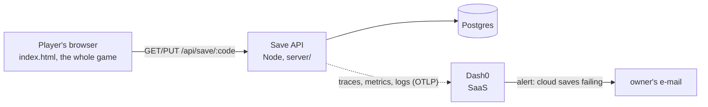

# Immune Citadel

A tower-defence game inside the human body, for teens (12-15). You defend tissue samples against pathogens by growing immune cells, and each cell fights the way it really does in the body.

**Play:** https://immune-citadel-v4.onrender.com (production) · https://immune-citadel-v4-dev.onrender.com (dev). Free Render instances sleep: the first load can take about 50 s.

## The problem

Immunology is taught as a list of names to memorise: neutrophil, macrophage, killer T cell, antibody. Teens learn the names without understanding what each cell does, or why the body needs so many kinds. Immune Citadel teaches the same content by play: to win a level you must use each cell for what it is actually good at. New ideas arrive one at a time, and every place where the game bends the real biology says so in an "In reality" note.

## What it does

- **18 levels** ("specimens"), three in each of six body places: skin, lungs, blood, lymph node, gut, brain. New cells and pathogens arrive gradually, each with an intro card the first time it appears.
- **Immune cells** (neutrophils, macrophages, killer T cells, B cells and their antibodies, a hero cell) and abilities (fever, cell swarm), unlocked as the campaign goes.
- **Field Guide**: a plate for every cell and pathogen met, with the real biology.
- **Challenges** (Acute, Chronic) on the last level of each body place, and **Memory** upgrades bought with stars.
- **Saves**: progress is kept in the browser and, under a 16-character save code, in the cloud. Typing the code on another device continues the game there; the two devices' progress is merged, never overwritten.

Expected behaviour and acceptance criteria per player journey: [docs/SPEC.md](docs/SPEC.md).

## Run it

```bash
docker compose up
```

Game: http://localhost:8080. To also send telemetry to Dash0, copy `.env.example` to `.env` and fill in the token; without it, telemetry is off.

## Test it

```bash
npm ci
npm test
```

`npm ci` also installs the API's packages and a headless Chromium. `npm test` runs the fast tests (under a second), then starts the stack and runs the integration tests: a save goes through the API into Postgres and back, and a save made in one browser continues in another through its code. `npm run test:game` runs the slower game suite (every level played by a bot, phone and tablet layouts).

## How it fits together



| Part | Where | Local | Render |
|---|---|---|---|
| Game | `index.html` | nginx in Compose | static site |
| Save API | `server/index.js` | Compose | web service |
| Database | Postgres | Compose | Render Postgres |
| Telemetry | `server/otel.js`, `observability/alert.js` | to Dash0, if `.env` is set | dev: to Dash0; production: from its next release |

## How it is built

A small AI agent team works from GitHub issues: see [AGENTS.md](AGENTS.md) (where everything is) and [docs/TEAM.md](docs/TEAM.md) (roles and the loop). Deploys, telemetry and the alert: [docs/OPERATIONS.md](docs/OPERATIONS.md).

## For reviewers

| # | Criterion | Where to look |
|---|---|---|
| 1 | Problem description | [The problem](#the-problem), [What it does](#what-it-does) |
| 2 | Product specification | [docs/SPEC.md](docs/SPEC.md); the tracker is [GitHub Issues](https://github.com/alexisdacquay/immune-citadel-v4/issues): each task has acceptance criteria, e.g. [#24](https://github.com/alexisdacquay/immune-citadel-v4/issues/24), [#25](https://github.com/alexisdacquay/immune-citadel-v4/issues/25), and [#21](https://github.com/alexisdacquay/immune-citadel-v4/issues/21) shows spec, engineer report and QA verdict by the agents |
| 3 | Agent team | [docs/TEAM.md](docs/TEAM.md) |
| 4 | Context management | [AGENTS.md](AGENTS.md), pointing to SPEC, TEAM and OPERATIONS |
| 5 | Application | game, save API and Postgres, end to end; `docker compose up` |
| 6 | Testing | `npm test`: unit + integration ([server/](server), [test/](test)) |
| 7 | Containerization | [compose.yaml](compose.yaml), [server/Dockerfile](server/Dockerfile) |
| 8 | Deployment | the URLs at the top |
| 9 | CI/CD | [CI](.github/workflows/ci.yml) on every PR and push; Render deploys every commit on `dev` (only green pull requests get there); production moves only when the owner merges `dev` into `main`: [docs/OPERATIONS.md](docs/OPERATIONS.md#releases) |
| 10 | Observability | the cloud-save journey in Dash0: traces, metrics and logs sharing a trace ID, no save codes: [docs/OPERATIONS.md](docs/OPERATIONS.md#telemetry) |
| 11 | Alerting on user impact | "Cloud saves failing" in Dash0, as code: [observability/alert.js](observability/alert.js) |
| 12 | On-call agent | not done yet |
