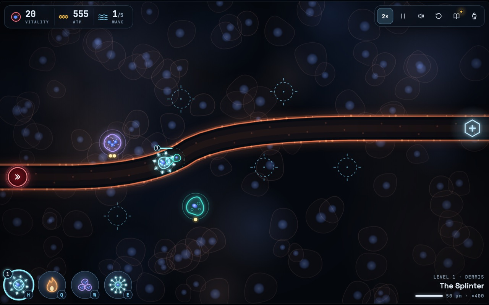
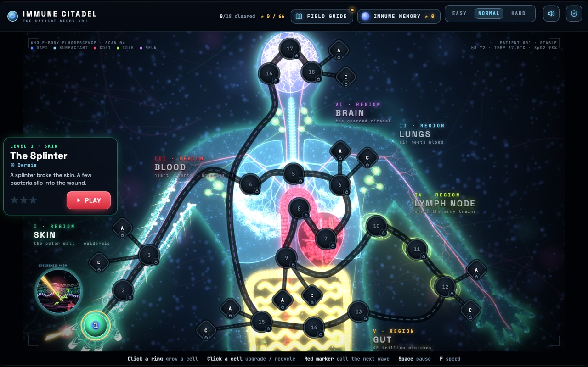
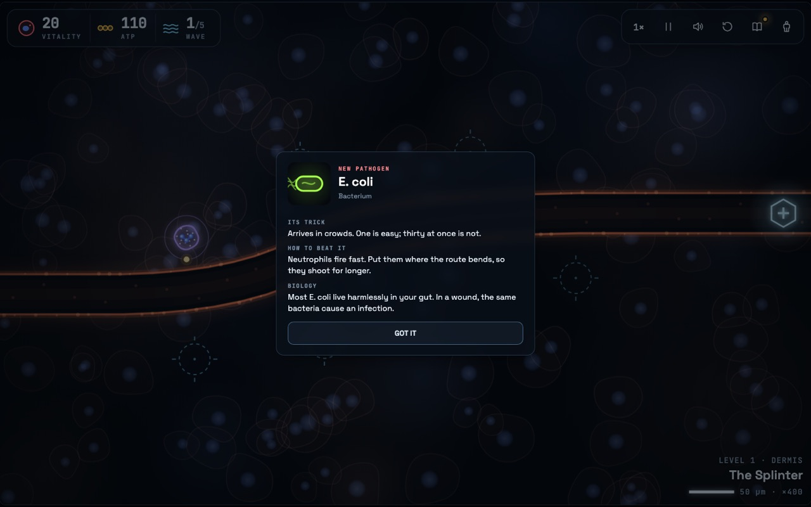
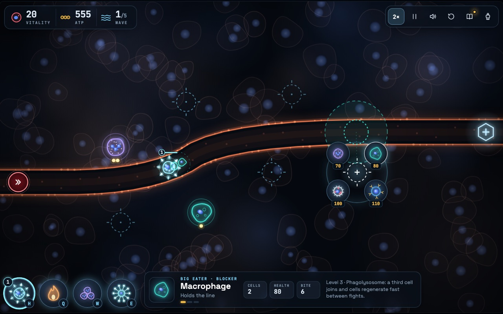
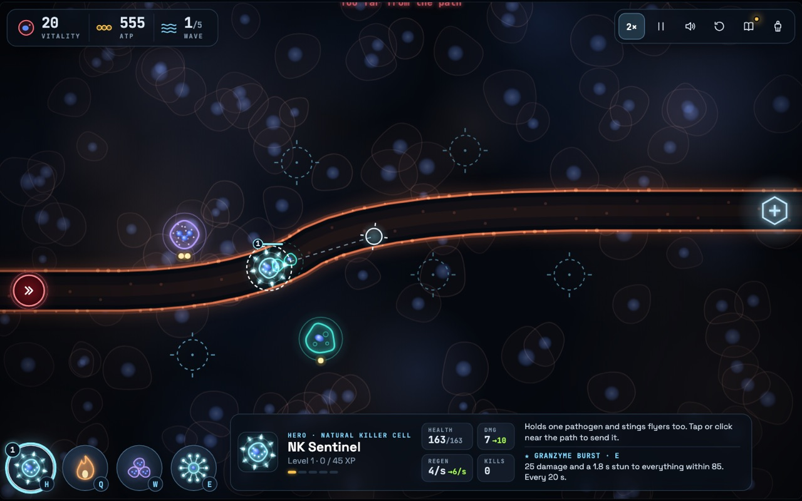
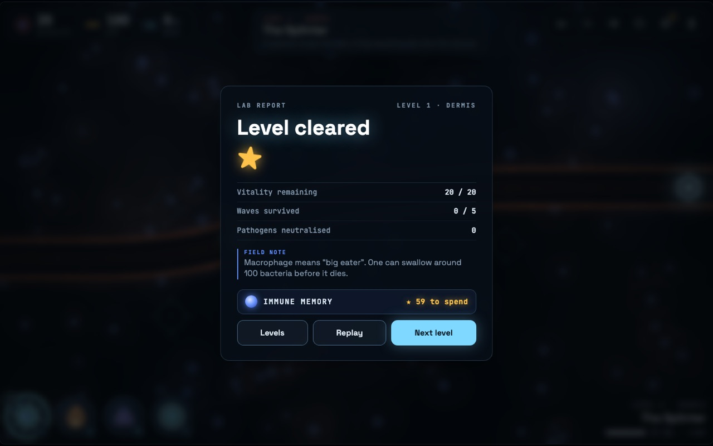
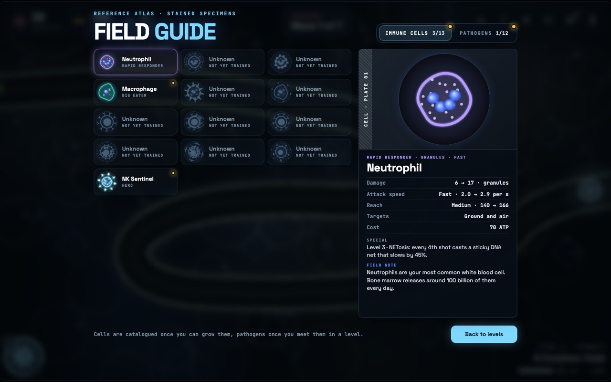
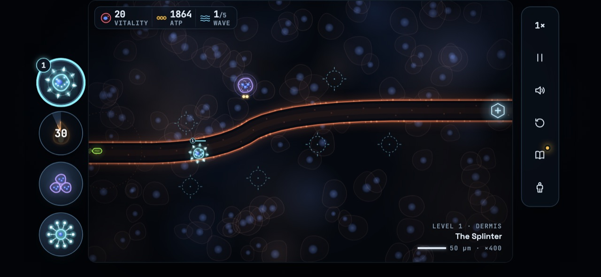

# Immune Citadel

[](https://github.com/alexisdacquay/immune-citadel-v4/actions/workflows/ci.yml?query=branch%3Adev)

**A tower-defence game inside the human body, for teens aged 12 to 15.** Bacteria, viruses, fungi and parasites pour into the body, and you grow immune cells beside their route to stop them. Each cell fights the way it really does in the body, so to win you have to learn what each one is good at.

**Built with:**
- Game: vanilla JavaScript on an HTML canvas, one `index.html`
- Save API: Node 22 (`node:http`, `pg`, `pino`) and Postgres
- Run: Docker Compose with nginx; Render (Frankfurt) in the cloud
- Tests and CI: Node's test runner, Playwright, GitHub Actions
- Monitoring: Sentry (EU), Better Stack
- Agents: Claude Code builds; DeepSeek agents check every change and answer alerts



**Play it in the browser:** https://immune-citadel-v4.onrender.com (production) · https://immune-citadel-v4-dev.onrender.com (dev, the newest changes). Free, no account, on a laptop, a tablet or a phone held sideways.

**Reviewers:** [proof of all 12 criteria, with screenshots](docs/PROOF.md).

[The problem](#the-problem) · [What it does](#what-it-does) · [Screenshots](#screenshots) · [Run it](#run-it) · [Test it](#test-it) · [How it fits together](#how-it-fits-together) · [How it is built](#how-it-is-built) · [For reviewers](#for-reviewers)

## The problem

- **Today:** immunology is taught as a list of names to memorise: neutrophil, macrophage, killer T cell, antibody.
- **The gap:** teens learn the names without understanding what each cell does, or why the body needs so many kinds.
- **Immune Citadel:** you win a level only by using each cell for what it really does, so the lesson is something you do, not something you read.

## What it does

### Play in 30 seconds

1. Click a ring beside the route to grow a cell. The first one is the neutrophil.
2. Click the red marker to call the next wave of pathogens.
3. Each pathogen that reaches the end costs vitality. Survive every wave to win.

### How it teaches

1. **One new thing at a time.** Each level adds at most one thing to your side (a cell, an ability, or one cell's two specialist forms), so nothing arrives as a list. A first-time player has only the neutrophil.
2. **A card at the moment it matters.** The first time a pathogen appears, or something joins your side, the game pauses on one short card. The card for the first pathogen:

   | E. coli | |
   |---|---|
   | Its trick | Arrives in crowds. One is easy; thirty at once is not. |
   | How to beat it | Neutrophils fire fast. Put them where the route bends, so they shoot for longer. |
   | Biology | Most E. coli live harmlessly in your gut. In a wound, the same bacteria cause an infection. |

3. **The right cell in the right place.** Each pathogen's trick needs a real answer. Staph aureus has a tough coat that blunts neutrophils and macrophages. A worm is far too big for killer T cells. Flu drifts over the macrophages that block the path.
4. **Honest about every bend.** Where the game bends real biology for play, the card says so in an "In reality" note. For flu: it does not fly through your body; it spreads from cell to cell.
5. **Something to come back for.** A win earns 1 to 3 stars. Stars buy Memory upgrades that last across levels. Every cell and pathogen met gets a plate in the Field Guide. Once you reach level 17, the last level of each body place offers two harder challenges, Acute and Chronic.

### The campaign: 18 levels, six body places

| Body place | Levels | New on your side | New pathogens |
|---|---|---|---|
| Skin | 01-03 | Neutrophil, Macrophage | E. coli, Staph aureus |
| Lungs | 04-06 | the hero (NK Sentinel, a natural killer cell) and its Granzyme Burst; Fever | Rhinovirus, Influenza |
| Blood | 07-09 | Killer T cell, B cell (antibodies) | a helminth (blood fluke) |
| Lymph node | 10-12 | specialists of the killer T cell (Effector CTL, Th1 Helper) and the B cell (Plasma Cell, Memory B Cell) | MRSA superbug (boss) |
| Gut | 13-15 | Swarm; neutrophil specialists (NET Trapper, Degranulator) | Candida, Salmonella |
| Brain | 16-18 | macrophage specialists (M1 Inflammatory, M2 Resolver) | Toxoplasma, Rabies |

Every level can be won with the cells unlocked by then: a bot plays all 18 in the test suite. Player journeys and their acceptance criteria: [docs/SPEC.md](docs/SPEC.md).

### Saves and privacy

- **Saves without an account.** Progress is kept in the browser and copied to the cloud under a 16-character save code. Typing the code on another device continues the game there; the two devices' progress is merged. A cloud save unchanged for 13 months is deleted.
- **No names, no ads, no chat.** A few anonymous play stats (level, outcome, how long a card stays open) go to the game's own database, never the save code. Crash reports, and page-load reports while play stats are on, go to Sentry (EU), with no name and no internet address. A switch under "Your data" turns play stats off. Details: [docs/EVENTS.md](docs/EVENTS.md); the data protection impact assessment, signed by the owner: [docs/DPIA.md](docs/DPIA.md).
- **Questions.** Open a [GitHub issue](https://github.com/alexisdacquay/immune-citadel-v4/issues); no response time is promised. Never post a save code there: it is the only key to a save.

## Screenshots

<table>
<tr>
<td width="50%"><br><b>Start.</b> The first level is open on the first visit, with no account.</td>
<td width="50%"><br><b>Body map.</b> 18 levels in six body places, from the skin to the brain.</td>
</tr>
<tr>
<td><br><b>Intro card.</b> A new pathogen pauses the game: its trick, how to beat it, the real biology.</td>
<td><br><b>Grow a cell.</b> Pick a cell for a site beside the route; click it later to upgrade or recycle it.</td>
</tr>
<tr>
<td><br><b>Hero.</b> The NK Sentinel, a natural killer cell you send where fast pathogens slip past.</td>
<td><br><b>Report.</b> Each level ends on a lab report with a field note; stars buy Memory upgrades.</td>
</tr>
<tr>
<td><br><b>Field Guide.</b> A plate for every cell and pathogen met, with the real biology.</td>
<td><br><b>Any screen.</b> Mouse or touch: laptop, tablet, or a phone held sideways.</td>
</tr>
</table>

## Run it

Needs Docker.

```bash
docker compose up --build
```

- Game: http://localhost:8080
- Save API: http://localhost:8787, with its own Postgres
- Optional: copy `.env.example` to `.env` and set `SENTRY_DSN` to send save API errors to Sentry

## Test it

Needs Node 22 (as in CI) and Docker.

```bash
npm ci              # also installs the save API's packages and a headless Chromium
npm test            # unit tests, then integration tests on the Docker stack
npm run test:game   # the game suite, about 6 minutes
```

| Command | What it checks |
|---|---|
| `npm test` | Unit tests (seconds): the save API, its privacy scrub, the deploy check, the QA agent's tool. Then it starts the Docker stack and runs the integration tests: a save goes game → API → Postgres and back; cloud saves untouched for 13 months are pruned; past the daily cap, a new save code is refused while existing saves still update; gameplay events reach their table; a save continues on a second browser. |
| `npm run test:game` | Onboarding with real clicks, a bot playing every level, saves, challenges, Memory, the Field Guide, and phone and tablet layouts ([tools/test.js](tools/test.js), [tools/touch.js](tools/touch.js)). |
| `node tools/balance.js <runs> [levels] [none\|all\|both]` | Gameplay balance, for example `node tools/balance.js 10 1,2,3 none` (levels comma-separated, all 18 if omitted; Memory upgrades off, on, or both): a bot prints the vitality left per run. |

Every pull request into `dev` also gets an independent QA agent: see [How it is built](#how-it-is-built).

## How it fits together



| Part | Code | Local (`docker compose up`) | Render, Frankfurt (dev and production) |
|---|---|---|---|
| Game | `index.html`, the whole game in one file | nginx | static site |
| Save API | `server/` (Node) | container | web service, deploys gated by `/health` |
| Database | Postgres | Postgres 16 container | Render Postgres 18, one per environment |
| Errors and traces | `server/sentry.js`, Sentry SDK in the game | save API only, if `.env` sets `SENTRY_DSN`; the game never reports locally | Sentry EU. The game and the save API report from dev and production |
| Uptime | `observability/betterstack.js` | none | Better Stack checks both game sites and both APIs every 5 minutes |

Every Render setting lives in [render.yaml](render.yaml). Environments, releases, telemetry and runbooks: [docs/OPERATIONS.md](docs/OPERATIONS.md).

## How it is built

A small AI agent team builds the game, with one human owner who sets priorities, playtests and gives the go for each production release. Four agents: the orchestrator (the main Claude Code session) builds; a DeepSeek QA agent checks every change in CI; a DeepSeek on-call agent answers alerts with a fix; short-lived Claude panels audit and propose designs. Roles and the loop: [docs/TEAM.md](docs/TEAM.md).

**From issue to production:**



1. Work starts as a [GitHub issue](https://github.com/alexisdacquay/immune-citadel-v4/issues) with acceptance criteria and is built on its own branch.
2. The pull request into `dev` carries a `## QA checks` section written by the builder: one closed question per thing the change could break, phrased so YES means right.
3. CI runs `test`, `game` and `qa` (the QA agent, required) on it, plus `qa-review` (advisory). Details: [docs/TEAM.md](docs/TEAM.md).
4. GitHub merges the pull request into `dev` as soon as `test`, `game` and `qa` are green. Auto-merge is armed through the owner's login, so GitHub shows the owner as the merger.
5. Render deploys every commit on `dev`, and CI's `deployed` job proves that commit is live, then runs a read-only smoke and privacy check on it ([tools/smoke.js](tools/smoke.js)).
6. Production is manual: a promotion pull request (`dev` → `main`) is merged only on the owner's go for that release; nothing merges into `main` automatically.

Where to read more:

| Document | What it answers |
|---|---|
| [AGENTS.md](AGENTS.md) | Where everything is, and the rules every agent follows. A new contributor starts here. |
| [docs/STATUS.md](docs/STATUS.md) | Where the project stands and what comes next. |
| [docs/SPEC.md](docs/SPEC.md) | Player journeys and their acceptance criteria. |
| [docs/TEAM.md](docs/TEAM.md) | Who does what, and the team loop. |
| [docs/OPERATIONS.md](docs/OPERATIONS.md) | Environments, releases, telemetry, alerts and runbooks. |
| [docs/EVENTS.md](docs/EVENTS.md), [docs/DPIA.md](docs/DPIA.md) | What gameplay data is and is never collected; the data protection impact assessment. |
| [docs/PIPELINE-PLAN.md](docs/PIPELINE-PLAN.md), [docs/OBSERVABILITY-PLAN.md](docs/OBSERVABILITY-PLAN.md) | How the deploy pipeline and the monitoring were built, step by step, with proof. |

## For reviewers

**About this repository.** It was created on 2026-11-12 under the same name as the project's original repository, which was renamed and made private the same day, to publish the course submission without later product work. It keeps the full commit history; issues #1 to #58 were copied without their comments, each starting with a "_Copy of_" note. The original's pull requests, Actions runs and issue comments are not public, so the screenshots of issue #131, pull request #132 and run 42502143601 in [docs/PROOF.md](docs/PROOF.md) show the original repository under this same name; those numbers do not point to them here. Likewise, #numbers in commit messages before 2026-11-12 refer to the original repository, and GitHub links them to unrelated items here. The licence commit [`3d488f8`](https://github.com/alexisdacquay/immune-citadel-v4/commit/3d488f8) went to `main` directly during the re-creation, before the branch rules applied; every change since went through a pull request.

Immune Citadel is a project for the [DataTalksClub AI Dev Tools Zoomcamp](https://github.com/DataTalksClub/ai-dev-tools-zoomcamp/tree/main/project). Each row links to its proof in [docs/PROOF.md](docs/PROOF.md): the rubric's words, screenshots, raw output, links that open without a login.

| # | Criterion | Points | Proof (screenshots and raw output) |
|---|---|---|---|
| 1 | Problem description | 2 / 2 | [Proof](docs/PROOF.md#1-problem-description) |
| 2 | Product specification | 2 / 2 | [Proof](docs/PROOF.md#2-product-specification) |
| 3 | Agent team | 2 / 2 | [Proof](docs/PROOF.md#3-agent-team) |
| 4 | Context management | 2 / 2 | [Proof](docs/PROOF.md#4-context-management) |
| 5 | Application | 2 / 2 | [Proof](docs/PROOF.md#5-application) |
| 6 | Testing | 2 / 2 | [Proof](docs/PROOF.md#6-testing) |
| 7 | Containerization | 2 / 2 | [Proof](docs/PROOF.md#7-containerization) |
| 8 | Deployment | 2 / 2 | [Proof](docs/PROOF.md#8-deployment) |
| 9 | CI/CD | 3 / 3 | [Proof](docs/PROOF.md#9-cicd) |
| 10 | Observability | 2 / 2 | [Proof](docs/PROOF.md#10-observability) |
| 11 | Alerting on user impact | 1 / 1 | [Proof](docs/PROOF.md#11-alerting-on-user-impact) |
| 12 | On-call agent | 2 / 2 | [Proof](docs/PROOF.md#12-on-call-agent) |

**Claimed: 24 of 24 points.**

## License

Immune Citadel is licensed under the [PolyForm Noncommercial License 1.0.0](LICENSE.md): free to use, share and modify for non-commercial purposes; commercial use requires a separate licence from the author. © 2026 Alexis Dacquay.
