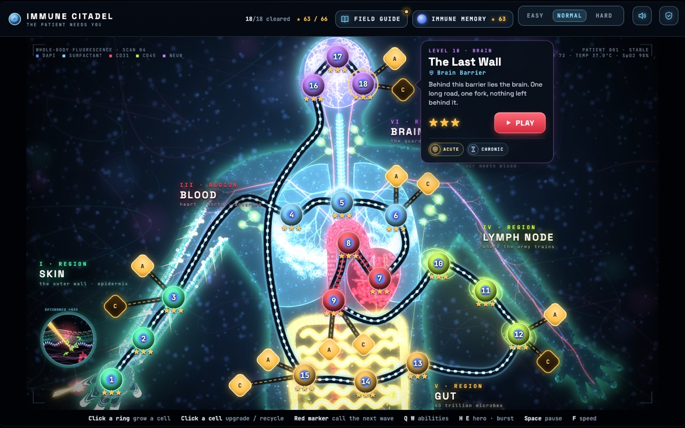

# Immune Citadel

[](https://github.com/alexisdacquay/immune-citadel-v4/actions/workflows/ci.yml?query=branch%3Adev)

**A tower-defence game inside the human body, for teens aged 12 to 15.** Bacteria, viruses, fungi and parasites pour into the body, and you grow immune cells beside their route to stop them. Each cell fights the way it really does in the body, so to win you have to learn what each one is good at.

**Built with:** vanilla JavaScript on an HTML canvas (the whole game is one `index.html`), a Node 22 save API (`node:http`, `pg`, `pino`), Postgres, Docker Compose with nginx, Playwright tests, GitHub Actions, Render (Frankfurt), Sentry (EU) and Better Stack; built by Claude Code and checked by a DeepSeek QA agent.


**Play it in the browser:** https://immune-citadel-v4.onrender.com (production) · https://immune-citadel-v4-dev.onrender.com (dev, the newest changes). Free, no account, on a laptop, a tablet or a phone held sideways.

**Reviewers:** every course criterion, with the points claimed and a proof you can open without logging in, is in [For reviewers](#for-reviewers).

[The problem](#the-problem) · [What it does](#what-it-does) · [Screenshots](#screenshots) · [Run it](#run-it) · [Test it](#test-it) · [How it fits together](#how-it-fits-together) · [How it is built](#how-it-is-built) · [For reviewers](#for-reviewers)

## The problem

Immunology is usually taught as a list of names to memorise: neutrophil, macrophage, killer T cell, antibody. Teens learn the names without understanding what each cell does, or why the body needs so many kinds.

Immune Citadel teaches the same content through play. To win a level you must use each cell for what it is really good at, so the lesson is something you do, not something you read.

## What it does

### Play in 30 seconds

1. Click a ring beside the route to grow a cell. The first one is the neutrophil.
2. Click the red marker to call the next wave of pathogens.
3. Each pathogen that reaches the end costs vitality. Survive every wave to win.

### How it teaches

1. **One new thing at a time.** Each level adds at most one thing to your side (a cell, an ability, or one cell's two specialist forms), so nothing arrives as a list. A first-time player has only the neutrophil.
2. **A card at the moment it matters.** The first time a pathogen appears, or something joins your side, the game pauses on one short card. The card for the first pathogen:

   | E. coli | |
   |---|---|
   | Its trick | Arrives in crowds. One is easy; thirty at once is not. |
   | How to beat it | Neutrophils fire fast. Put them where the route bends, so they shoot for longer. |
   | Biology | Most E. coli live harmlessly in your gut. In a wound, the same bacteria cause an infection. |

3. **The right cell in the right place.** Each pathogen's trick needs a real answer. Staph aureus has a tough coat that blunts neutrophils and macrophages. A worm is far too big for killer T cells. Flu drifts over the macrophages that block the path.
4. **Honest about every bend.** Where the game bends real biology for play, the card says so in an "In reality" note. For flu: it does not fly through your body; it spreads from cell to cell.
5. **Something to come back for.** A win earns 1 to 3 stars. Stars buy Memory upgrades that last across levels. Every cell and pathogen met gets a plate in the Field Guide. The last level of each body place, once won, opens two harder challenges, Acute and Chronic, from level 17 on, when your side is complete.

### The campaign: 18 levels, six body places

| Body place | Levels | New on your side | New pathogens |
|---|---|---|---|
| Skin | 01-03 | Neutrophil, Macrophage | E. coli, Staph aureus |
| Lungs | 04-06 | the hero (NK Sentinel, a natural killer cell) and its Granzyme Burst; Fever | Rhinovirus, Influenza |
| Blood | 07-09 | Killer T cell, B cell (antibodies) | a helminth (blood fluke) |
| Lymph node | 10-12 | specialists of the killer T cell (Effector CTL, Th1 Helper) and the B cell (Plasma Cell, Memory B Cell) | MRSA superbug (boss) |
| Gut | 13-15 | Swarm; neutrophil specialists (NET Trapper, Degranulator) | Candida, Salmonella |
| Brain | 16-18 | macrophage specialists (M1 Inflammatory, M2 Resolver) | Toxoplasma, Rabies |

Every level can be won with the cells unlocked by then: a bot plays all 18 in the test suite. Player journeys and their acceptance criteria: [docs/SPEC.md](docs/SPEC.md).

### Saves and privacy

- **Saves without an account.** Progress is kept in the browser. The first save also creates a 16-character save code and a copy in the cloud. Typing the code on another device continues the game there; the two devices' progress is merged, never overwritten (except when two devices sync at the same moment: the cloud then keeps the last write until the other device syncs again, [#104](https://github.com/alexisdacquay/immune-citadel-v4/issues/104)). A cloud save not updated for 13 months is deleted automatically; a browser that still has the game uploads its progress again at the next visit.
- **No names, no ads, no chat.** The game sends a few anonymous play stats (which level, the outcome, how long a card stays open) to its own database, never the save code. Each page load, and any crash, also sends a report to Sentry, which keeps reports in the EU. A report has no name and no internet address in it; Sentry's servers see the address in transit but are set never to keep it. A switch under "Your data" on the title screen turns the play stats off. What is and is never collected: [docs/EVENTS.md](docs/EVENTS.md); the data protection impact assessment, signed by the owner: [docs/DPIA.md](docs/DPIA.md).
- **Questions.** Open a [GitHub issue](https://github.com/alexisdacquay/immune-citadel-v4/issues); no response time is promised. Never post a save code there: issues are public and the code is the only key to a save. Without the code nobody can find a save, so there is no deletion on request: an unused cloud save is deleted after 13 months.

## Screenshots

<table>
<tr>
<td width="50%"><br><b>Start.</b> The first level is open on the first visit, with no account.</td>
<td width="50%"><br><b>Body map.</b> 18 levels in six body places, from the skin to the brain.</td>
</tr>
<tr>
<td><br><b>Intro card.</b> A new pathogen pauses the game: its trick, how to beat it, the real biology.</td>
<td><br><b>Grow a cell.</b> Pick a cell for a site beside the route; click it later to upgrade or recycle it.</td>
</tr>
<tr>
<td><br><b>Hero.</b> The NK Sentinel, a natural killer cell you send where fast pathogens slip past.</td>
<td><br><b>Report.</b> Each level ends on a lab report with a field note; stars buy Memory upgrades.</td>
</tr>
<tr>
<td><br><b>Field Guide.</b> A plate for every cell and pathogen met, with the real biology.</td>
<td><br><b>Any screen.</b> Mouse or touch: laptop, tablet, or a phone held sideways.</td>
</tr>
</table>

## Run it

Needs Docker.

```bash
docker compose up --build
```

The game is at http://localhost:8080 and the save API at http://localhost:8787, with its own Postgres. To also send save API errors to Sentry, copy `.env.example` to `.env` and fill in `SENTRY_DSN`; without it, Sentry is off.

## Test it

Needs Node 22 (as in CI) and Docker.

```bash
npm ci              # also installs the save API's packages and a headless Chromium
npm test            # unit tests, then integration tests on the Docker stack
npm run test:game   # the game suite, about 6 minutes
```

| Command | What it checks |
|---|---|
| `npm test` | Unit tests (a few seconds): the save API, its telemetry and privacy scrub, the wiring between the parts, the deploy proof, the QA tool. Then the stack starts and the integration tests run: a save goes from the game page through the API into Postgres and back, and a save made in one browser continues in another through its code, and gameplay events reach their table. |
| `npm run test:game` | Onboarding with real clicks, a bot playing every level, saves, challenges, Memory, the Field Guide, and phone and tablet layouts ([tools/test.js](tools/test.js), [tools/touch.js](tools/touch.js)). |
| `node tools/balance.js 10 <levels> none` | Gameplay balance: an unseeded bot prints the vitality left per run. |

Every pull request into `dev` also gets an independent QA agent: see [How it is built](#how-it-is-built).

## How it fits together


| Part | Code | Local (`docker compose up`) | Render, Frankfurt (dev and production) |
|---|---|---|---|
| Game | `index.html`, the whole game in one file | nginx | static site |
| Save API | `server/` (Node) | container | web service, deploys gated by `/health` |
| Database | Postgres | Postgres 16 container | Render Postgres 18, one per environment |
| Errors and traces | `server/sentry.js`, Sentry SDK in the game | save API only, if `.env` sets `SENTRY_DSN`; the game never reports locally | Sentry EU. The game and the save API report from dev and production |
| Uptime | `observability/betterstack.js` | none | Better Stack checks both game sites and both APIs every 5 minutes |

Every Render setting lives in [render.yaml](render.yaml). Environments, releases, telemetry and runbooks: [docs/OPERATIONS.md](docs/OPERATIONS.md).

## How it is built

A small AI agent team builds the game, with one human owner who sets priorities, playtests and approves every production release. The main Claude Code session plans, designs and builds; an independent DeepSeek agent checks its work in CI. Roles and the loop: [docs/TEAM.md](docs/TEAM.md).

**From issue to production:**


1. Work starts as a [GitHub issue](https://github.com/alexisdacquay/immune-citadel-v4/issues) with acceptance criteria and is built on its own branch.
2. The pull request into `dev` carries a `## QA checks` section written by the builder: one closed question per thing the change could break, phrased so YES means right.
3. CI runs four jobs on it:
   - `test` and `game`: the suites above.
   - `qa`, stage 1, **required**. The QA agent answers each check YES or NO at low effort, three times, from the files the check names; the majority answer counts. It also asks again every past failure in [test/past-failures.md](test/past-failures.md) whose files the change touches. A `[changes]` check must be YES on the new code and not YES on the old, so it really tests the change.
   - `qa-review`, stage 2, **advisory**. An open review against the issue's acceptance criteria. It comments and never blocks; every finding is fixed or answered before a promotion.
4. GitHub merges the pull request into `dev` as soon as `test`, `game` and `qa` are green. No human merges into `dev`.
5. Render deploys every commit on `dev`, and CI's `deployed` job proves that commit is live, then runs a read-only smoke and privacy check on it ([tools/smoke.js](tools/smoke.js)).
6. Production moves only through a promotion: a pull request from `dev` into `main`, merged once the owner gives a written go.

Where to read more:

| Document | What it answers |
|---|---|
| [AGENTS.md](AGENTS.md) | Where everything is, and the rules every agent follows. A new contributor starts here. |
| [docs/STATUS.md](docs/STATUS.md) | Where the project stands and what comes next. |
| [docs/SPEC.md](docs/SPEC.md) | Player journeys and their acceptance criteria. |
| [docs/TEAM.md](docs/TEAM.md) | Who does what, and the team loop. |
| [docs/OPERATIONS.md](docs/OPERATIONS.md) | Environments, releases, telemetry, alerts and runbooks. |
| [docs/EVENTS.md](docs/EVENTS.md), [docs/DPIA.md](docs/DPIA.md) | What gameplay data is and is never collected; the data protection impact assessment. |
| [docs/PIPELINE-PLAN.md](docs/PIPELINE-PLAN.md), [docs/OBSERVABILITY-PLAN.md](docs/OBSERVABILITY-PLAN.md) | How the deploy pipeline and the monitoring were built, step by step, with proof. |

## For reviewers

Immune Citadel is a project for the [DataTalksClub AI Dev Tools Zoomcamp](https://github.com/DataTalksClub/ai-dev-tools-zoomcamp/tree/main/project). One row per criterion, with the rubric's top band in short, the points claimed, and a proof a logged-out reader can open.

| # | Criterion: top band | Points claimed | Proof |
|---|---|---|---|
| 1 | **Problem description:** the README describes the problem, what the system does and how it behaves | 2 / 2 | The README opens with the teaching problem, then how the game plays and teaches. [The problem](#the-problem), [What it does](#what-it-does) |
| 2 | **Product specification:** a spec, a public tracker, tasks with acceptance criteria, evidence that agents used it | 2 / 2 | The spec writes each player journey as acceptance criteria; most issues from #19 on carry their own, and the agents post their spec, reports and QA verdicts on the issues. [docs/SPEC.md](docs/SPEC.md), [#25](https://github.com/alexisdacquay/immune-citadel-v4/issues/25) (acceptance criteria), [#21](https://github.com/alexisdacquay/immune-citadel-v4/issues/21) (spec, engineer report, a QA FAIL, then a PASS) |
| 3 | **Agent team:** the agent team and how it works together | 2 / 2 | TEAM names each role, what it owns and never does, and the loop from an issue to production. [docs/TEAM.md](docs/TEAM.md) |
| 4 | **Context management:** AGENTS.md pointing to modular docs | 2 / 2 | AGENTS.md, which [CLAUDE.md](CLAUDE.md) loads, sends each agent to STATUS, SPEC, TEAM, OPERATIONS and the plans. [AGENTS.md](AGENTS.md), [team-loop skill](.claude/skills/team-loop/SKILL.md) |
| 5 | **Application:** full stack end to end, data in a database, one command locally | 2 / 2 | `docker compose up --build` runs the game, the save API and Postgres; a save made in one browser continues in another. [Run it](#run-it), [test/integration.test.js](test/integration.test.js) |
| 6 | **Testing:** unit and integration tests, one command, passing | 2 / 2 | `npm test` runs the unit tests, then the integration tests on the Docker stack; both pass in CI on `dev` (the run lists `test` and `game` green; the Actions log, which names each test file, needs a GitHub login). [Test it](#test-it), [a green CI run on dev](https://github.com/alexisdacquay/immune-citadel-v4/actions/runs/42480697284) |
| 7 | **Containerization:** the whole system, database included, with one Compose command | 2 / 2 | One Compose file starts the game (nginx), the save API and Postgres, each with a health check. [compose.yaml](compose.yaml), [server/Dockerfile](server/Dockerfile) |
| 8 | **Deployment:** reachable at a public URL | 2 / 2 | Production and dev run on Render, declared in [render.yaml](render.yaml); each API's `/health` and each site's `/version.txt` name the commit that is live. Production: [/health](https://immune-citadel-v4-api.onrender.com/health), [/version.txt](https://immune-citadel-v4.onrender.com/version.txt). Dev: [/health](https://immune-citadel-v4-api-dev.onrender.com/health), [/version.txt](https://immune-citadel-v4-dev.onrender.com/version.txt) |
| 9 | **CI/CD:** CI runs the tests, CD deploys to dev, a manual deploy to production | 3 / 3 | CI tests every pull request, Render deploys every commit on `dev`, and production moves only through a promotion pull request into `main` that the owner approves in writing. [Promotion #113](https://github.com/alexisdacquay/immune-citadel-v4/pull/113), [its deployed run](https://github.com/alexisdacquay/immune-citadel-v4/actions/runs/42478940135), [OPERATIONS, Releases](docs/OPERATIONS.md#releases) |
| 10 | **Observability:** a key journey with metrics, traces and structured logs sharing a trace ID, no customer data, viewable in a UI | 2 / 2 | One save gives Sentry (EU) a trace, a log line and a duration metric under one trace ID, the same ID as its Render log line, with no player data. Screenshots of one real save in Sentry's UI: [Follow one save](docs/OPERATIONS.md#follow-one-save); a test rebuilds the chain on any machine: [server/observability.test.js](server/observability.test.js) |
| 11 | **Alerting on user impact:** at least one alert | 1 / 1 | A failed save or load (save API error) and a game crash email the owner, both defined as code; Better Stack emails when a site or an API is down. [The alert in Sentry, with a real firing](docs/OPERATIONS.md#alert-save-api-error), [observability/sentry-alert.json](observability/sentry-alert.json) |
| 12 | **On-call agent:** wakes on an alert and fixes the issue | 0 / 2 until its first drill | Built: a Sentry alert opens an issue here, the agent wakes on it, finds the cause, and opens a pull request into `dev` with the fix and a regression test, tested sealed. The first real drill is recorded after the owner's setup. [OPERATIONS, On-call agent](docs/OPERATIONS.md#on-call-agent), [.github/workflows/oncall.yml](.github/workflows/oncall.yml) |

**Claimed: 22 of 24 points.**
