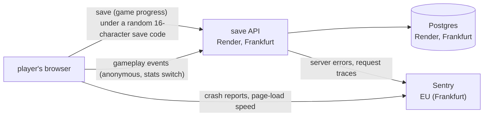

# Data protection impact assessment

Status: **draft, to be signed by the owner before gameplay events reach production** (step 6). Dev runs them first: it has no real players, only the owner and the team, and its data proves the design this assessment describes. Headings follow the ICO template ([Children's Code, standard 2](https://ico.org.uk/for-organisations/uk-gdpr-guidance-and-resources/childrens-information/childrens-code-guidance-and-resources/age-appropriate-design-a-code-of-practice-for-online-services/2-data-protection-impact-assessments/)). Review it when anything that leaves the browser changes.

## The service

| | |
|---|---|
| What | Immune Citadel: a free browser game that teaches immunology |
| Players | children aged 12-15; no accounts, no names, no ads, no chat |
| Controller | the owner |

## Data flows

| Data | Purpose | Where | Kept | Identifies a child? |
|---|---|---|---|---|
| save (stars, settings, cards seen) under a save code | continue on another device | Postgres | until deleted on request (no automatic expiry yet) | no name; the code is a credential, never logged or sent to Sentry |
| gameplay events ([EVENTS.md](EVENTS.md)) | make levels fairer, cards clearer | Postgres | 13 months, deleted automatically | no: random id per page load, date only, fixed values |
| crash reports, load speed | fix bugs | Sentry (processor, EU) | 30 days on the free plan, 90 on paid plans ([Sentry](https://docs.sentry.io/security-legal-pii/security/data-retention-periods/)) | no: IP not stored, location removed, save codes scrubbed, no replay |
| IP address | rate limiting | save API memory only | forgotten within two minutes; never written or logged by our code (Render's edge may log it under its own policy) | used, not stored |
| on/off choices (sound, difficulty in the save; stats under its own key, never uploaded) | remember the player's settings | the browser (localStorage) | until the player clears it | no |

## Lawful basis

| Processing | Basis | Why |
|---|---|---|
| saves | contract / the player's request (they press for a cloud save) | the feature does nothing else |
| gameplay events, crash reports | legitimate interests | small, anonymous, first-party; no profiling, no ads; children's interests weighed below |
| reading and sending from the browser (ePrivacy Art 5(3)) | UK: statistical-purposes exception ([DUAA 2025 s.112](https://www.legislation.gov.uk/ukpga/2025/18/section/112)); FR: [CNIL audience-measurement exemption](https://www.cnil.fr/fr/cookies-et-autres-traceurs/regles/cookies-solutions-pour-les-outils-de-mesure-daudience) | both need a notice and an easy way to object: the "Your data" popover and the stats switch |

**Balancing test (children first):** the benefit is a fairer, clearer learning game. The risk to a child is being singled out from their play, which is close to none: no id survives a reload, no time of day, no IP, no free text, no third party sees play. A child (or parent) turns stats off with two taps: the shield on the title screen, then the switch. A browser's Global Privacy Control signal turns them off.

## Default setting: stats on

| Option | Result | Decision |
|---|---|---|
| on, with notice and switch | data from most players; meets the UK and FR exemptions | **chosen by the owner, 2026-11-06** |
| off until the player opts in | under GDPR Art 8 a child consents alone only from 15 (FR) or 16 (DE): most players could not | rejected |

## Risks and measures

| Risk | Measure | Residual |
|---|---|---|
| a sitting linked to a known child (e.g. a teacher watching a class) | date only, no time; page id dies with the page | low |
| free text or identifiers smuggled into the table | server accepts only fixed values and formats ([server/play.js](../server/play.js)) | low |
| the events table fills the shared disk and takes saves down | 20 events a request, 2,000 rows a day per server, 13-month deletion | low |
| play data seen by a third party | `/api/play` excluded from Sentry in the browser and the server; tested | low |
| strict member states (e.g. DE) do not accept the exemptions | stats switch and GPC honoured | medium, accepted by the owner |
| saves never expire | none yet | open: decide a retention for saves |

## Sign-off

| Role | Name | Date |
|---|---|---|
| owner | | |
