# Gameplay events

What anonymous play data the game sends, why, and what it never sends.

| | |
|---|---|
| **Status** | **approved by the owner 2026-11-06** (stats on by default); built in [OBSERVABILITY-PLAN.md](OBSERVABILITY-PLAN.md) step 5 |
| **Review** | 2026-11-06: draft checked by 4 independent reviewers (code accuracy, children's privacy, usefulness, abuse and cost); this version re-checked against their findings and the code |
| **Code** | [server/play.js](../server/play.js) (accepted shapes), [server/index.js](../server/index.js) (`/api/play`, table, views), [index.html](../index.html) (`playEv`, `runEnd`, "Your data") |
| **Privacy** | the data protection impact assessment, signed by the owner: [DPIA.md](DPIA.md) |

## What it answers

| # | Owner question | Answered by |
|---|---|---|
| 1 | Where do players give up? | first campaign wins per level: the drop between level N-1 and level N; the top of the funnel is page loads on a browser with no save yet (`open` with `new`) |
| 2 | Which level is too hard? | outcome shares (won / lost / quit / restart) per level, mode and difficulty; the wave reached on a loss |
| 3 | Do players read the intro cards? | how many seconds each card stays open |
| 4 | How long is one sitting? | the largest `t` in one page load |

Not answerable, by design: following one child across days, play time per child, whether a given child comes back.

## Events (5)

The moments are named by function and element id in [index.html](../index.html), not by line number, so this table cannot go stale.

| Event | Sent when | Fields |
|---|---|---|
| `open` | game booted, title shown (end of the script), once the commit from `/version.txt` is known | `new` |
| `level_start` | `startLevel` after boot; not the scenery level behind the title | `level`, `mode`, `difficulty` |
| `level_end` | `endLevel`: won / lost · `#restartBtn` during a level: restart · `#mapBtn` during a level: quit | `level`, `mode`, `difficulty` (as at start), `outcome`, `first`, `stars`, `wave` |
| `card` | an intro card closed with GOT IT (`#cardGo`) | `card`, `secs` |
| `hide` | the tab is hidden (`visibilitychange`) | none |

A level left by closing the tab has a `level_start` and no `level_end` in the same page load. The views count it as "abandoned".
"During a level" means a run started after boot that has not ended. One in-memory flag tracks it, so a run is never counted twice.

### Event fields

| Field | Values | Why |
|---|---|---|
| `level` | 1-18 | Q1, Q2 |
| `mode` | `campaign`, `heroic` (shown as Acute), `iron` (shown as Chronic); challenges only on levels 3, 6, 9, 12, 15, 18 | Q2 |
| `difficulty` | `easy`, `normal`, `hard` | Q2 |
| `outcome` | `won`, `lost`, `quit`, `restart` | Q2 |
| `first` | true on the first win of this level and mode in this save | Q1 (campaign only): separates first clears from replays |
| `stars` | 1-3 on a campaign win; empty otherwise (a challenge's first win gives a Memory star, but the event sends none) | Q2 |
| `wave` | waves called: 0 to the level and mode's wave count (max 14; Chronic has 1 wave, so it says little there) | Q2 |
| `card` | one of the 21 intro-card ids (`bact`, `virus`, … `swarm`) | Q3 |
| `secs` | whole seconds the card was open while the tab was visible | Q3 |
| `new` | true when this browser has no save yet (`firstRun`); over-counts visitors who left before playing, a blocked localStorage reads false, a cloud code on a new device reads true | Q1: top of the funnel. Kept against the privacy reviewer's advice to drop it: Q1 has no starting count without it; the notice and switch cover reading the save |

### Every request also carries

| Field | Value | Why |
|---|---|---|
| `page` | 16 random hex characters made at page load, kept in memory only | groups one sitting; a reload gets a new id, so nobody can be followed across visits |
| `release` | commit from `/version.txt` | compare before and after a change |
| `t` (per event) | whole seconds since page load, counted only while the tab is visible | order of events, Q4 |

The server adds the **date** it received the request (no time of day): one day is enough for every question, and a precise time could link a sitting to a known child.

## Never collected

| Never | Why |
|---|---|
| save code, save content | the player's only credential |
| names, free text | could identify a child |
| IP address, user agent, screen size, location | identifying; the IP is used in server memory only, to stop abuse, forgotten within two minutes, never written or logged |
| any id kept on the device (cookie, localStorage) | would follow one child over time |
| clicks, tower placements, per-wave detail | no question needs them; add one only with a question that needs it |

## The player's side

| Item | Detail | Why |
|---|---|---|
| "Your data" popover | the shield button on the title screen; about 6 lines a 12-year-old can read: what is sent, why, where (Render, Frankfurt; Sentry, EU, for crashes; cloud saves), how long it is kept, how to turn stats off | sending data from the browser counts as access to the device under EU ePrivacy, even with nothing stored ([EDPB Guidelines 2/2023](https://www.edpb.europa.eu/system/files/2024-10/edpb_guidelines_202302_technical_scope_art_53_eprivacydirective_v2_en_0.pdf), paras 33, 38). Before this popover the game had no privacy notice, although Sentry and cloud saves already sent data |
| "Send anonymous play stats" switch | on by default; the choice is kept on this device under its own key (`immune-citadel-v4-stats`), never in the cloud save, and holds across tabs; a browser's Global Privacy Control signal counts as off | the analytics exemptions need a notice and an easy way to object: UK statistical-purposes exception ([Data (Use and Access) Act 2025, s.112](https://www.legislation.gov.uk/ukpga/2025/18/section/112), in force 5 Feb 2026); French audience-measurement exemption ([CNIL](https://www.cnil.fr/fr/cookies-et-autres-traceurs/regles/cookies-solutions-pour-les-outils-de-mesure-daudience)). Opt-in is not workable: under GDPR Art 8 a child consents alone only from 15 in France and 16 in Germany, so most players could not say yes |
| [DPIA.md](DPIA.md) | one page: data flows, lawful basis, the default-on decision, retention, risks; signed by the owner on 2026-11-07 | a service likely used by children needs a data protection impact assessment ([ICO Children's Code, standard 2](https://ico.org.uk/for-organisations/uk-gdpr-guidance-and-resources/childrens-information/childrens-code-guidance-and-resources/age-appropriate-design-a-code-of-practice-for-online-services/2-data-protection-impact-assessments/)) |

## How events travel

| Rule | Detail | Why |
|---|---|---|
| send | `fetch` with `keepalive`, plain-text JSON body, path `/api/play` | `sendBeacon` and the path `/api/events` match ad-block lists (EasyPrivacy); plain text needs no CORS preflight |
| when | `open` at once; the rest at each `level_end` and on `hide` | `pagehide` often never fires on phones ([MDN](https://developer.mozilla.org/en-US/docs/Web/API/Navigator/sendBeacon)); small batches stay under the 8 KB body limit |
| validate | every field checked against the sets above; `page` `^[0-9a-f]{16}$`, `release` `^[0-9a-f]{7,40}$`, `t` and `secs` integers 0-86400; an event with a bad value or an unknown key is dropped alone, the rest of the request is kept | no free-text channel into the table |
| cap | at most 20 events per request; at most 2,000 rows a day per server, counted in the table (survives restarts), one batch at a time; a batch that does not fit is dropped whole (no start without its end); its own rate limit per IP, separate from saves | the table sits in the same Postgres as the saves (one per environment, render.yaml); a full disk suspends it, and saves with it. Budget: 2,000 rows × 395 days × ~150 B ≈ 120 MB per environment. 2,000 rows ≈ 130 sittings a day; raise it with the disk |
| keep | rows deleted after 13 months, at server start and daily; cloud saves not updated for 13 months are deleted at the same moment (server/index.js `prune`) | storage limit; the CNIL exemption allows at most 25 months |
| Sentry | server: `/api/play` not traced, an insert error logged, not reported. Game: no span for `/api/play` (`shouldCreateSpanForRequest`), its breadcrumbs dropped (`beforeBreadcrumb`); a failed send is caught and never reported; `page` never sent to Sentry | no third party sees play; the save-failure alert stays about saves |
| origin | a request from a site other than the game is dropped | stops other web pages posting; the caps stop scripts |
| local, tests | off, like Sentry; a test keeps the server's card list equal to the game's 21 intro cards | no real players there; tests stay deterministic |
| not doing | win rate before the first clear (tries over several page loads cannot be linked) | |

## Views

| View | Shows |
|---|---|
| `funnel` | per campaign level: first wins, abandoned runs; top: `open` with `new` |
| `level_stats` | per level × mode × difficulty: runs, won, lost, quit, restart, abandoned (counts, matched per page load), median wave on a loss |
| `card_reads` | per card: times closed, median seconds open, share closed in under 3 s |
| `sittings` | per day: page loads, median and 90th-percentile sitting length |
