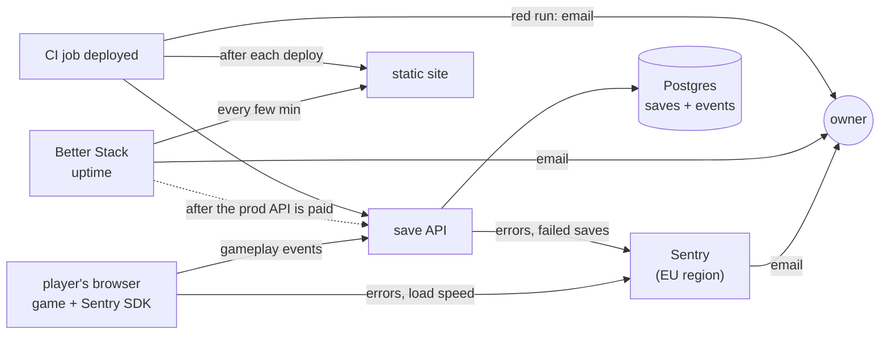

# Observability plan

Approved by the owner on 2026-11-06. One step at a time; each step is proven before the next starts. Tick a step only when its proof is recorded here. How things work today stays in [OPERATIONS.md](OPERATIONS.md); it is updated in the step that changes it.

## Target

| Job | Tool | Cost | Replaces |
|---|---|---|---|
| game crashes and errors | Sentry, browser SDK | free plan | nothing (the game reports nothing today) |
| game load speed | Sentry, same SDK, low sample rate | free plan | nothing |
| gameplay and learning: levels started, won, lost, quit | own events: game → save API → Postgres; funnels as SQL views | $0 | nothing |
| save API errors, "saves failing" alert | Sentry, Node SDK | free plan | Dash0 and `observability/alert.js` |
| site and API up | Better Stack uptime | free plan | nothing |
| right commit live | CI job `deployed` | done | — |
| alerts | email from each tool | $0 | — |

Dash0 is removed from this project in step 2, once step 1 is proven (the account stays, for another project). Checkly, Grafana and PostHog are not used.

## Why these tools

| Tool | Reason | Source |
|---|---|---|
| Sentry | most used and most admired of the monitoring tools in the survey (13.9% used, 45.9% admired); the only tracker found in the school apps Kahoot, Padlet and Sdui | [Stack Overflow survey 2026](https://survey.stackoverflow.co/2026/technology/data), [Kuketz audit](https://www.kuketz-blog.de/die-digitale-bildung-unter-der-lupe-eine-analyse-von-schul-und-lern-apps/) |
| own gameplay events | kids' learning apps keep this first-party (ANTON logs to its own domain, no trackers); no third party sees children's play | [Kuketz on ANTON](https://www.kuketz-blog.de/anton-datenschutzfreundlich-und-verantwortungsbewusst-schul-apps-teil-3/) |
| Better Stack | Render's docs name it for outside uptime checks; recommended by practitioners | [Render uptime advice](https://render.com/docs/uptime-best-practices), [HN](https://news.ycombinator.com/item?id=40276687) |
| no Dash0 | Sentry already does its one job here (API errors and the save alert) | — |

## Rules for every step

| Rule | Detail |
|---|---|
| Sentry org region | EU (Frankfurt). Chosen at sign-up, cannot be changed later |
| Sentry organisation settings | Security & Privacy: "Prevent Storing of IP Addresses" on; Advanced Data Scrubbing rule `[Remove] [Anything] from [$user.geo.**]` (errors, transactions, attachments): Sentry derives a location from the IP even when IP storage is off. Set 2026-11-06; proof: IMMUNE-CITADEL-GAME-3 (19:00, IP gone, city still there), IMMUNE-CITADEL-GAME-4 (19:13, no IP, no location) |
| Sentry privacy | `dataCollection: { userInfo: false, cookies: false, httpHeaders: false, httpBodies: [], urlQueryParams: false }` (from SDK v11 these are collected unless set; `sendDefaultPii` is deprecated); IP storage off in project settings; Session Replay off; no save code in any message or URL sent |
| gameplay events | as in [EVENTS.md](EVENTS.md): anonymous, a random id per page load kept in memory, date only, deleted after 13 months; no save code, no free text, no IP stored; a "Your data" card and a stats switch in the game |
| Render Free hours | an uptime check every few minutes keeps a Free API awake all month (~744 of the 750 shared hours), which suspends every Free service. Monitor the APIs only once they are on a paid instance; static sites cost no hours |
| dev vs production | dev first, proven, then production at the next promotion (the owner approves it) |

## Steps

| # | Step | Proof | Rollback | Owner does | Status |
|---|---|---|---|---|---|
| 1 | Sentry on the save API (dev), errors only, next to Dash0: Sentry's own OpenTelemetry setup off and no tracing, so it does not clash with `server/otel.js` (Sentry custom OpenTelemetry setup); email alert when a save fails | local stack with the dev DSN: `docker compose stop db`, make a save → Sentry issue → email; Render dev deploy green with the DSN set | remove the `SENTRY_DSN` variable | create the Sentry organisation, EU region (fixed at sign-up) | done 2026-11-06: local failed save 17:42:21 UTC → issue IMMUNE-CITADEL-API-1 (route `/api/save/:code`, no player data) → alert 17:42:33 → email received; dev runs it since PR #48 (20e3aba, `deployed` green, `SENTRY_DSN` and `SENTRY_ENVIRONMENT=dev` set) |
| 2 | remove Dash0: `server/otel.js`, OpenTelemetry packages, `observability/alert.js`, `OTEL_*` and `DASH0_*` variables; Sentry traces every request except `/health`; the alert kept as code in `observability/sentry-alert.json`; OPERATIONS.md and README rewritten | `git grep -i dash0` finds only plans; tests green (traces carry no save code); a save on dev appears as a trace in Sentry, environment `dev` | revert the PR, restore the variables | none: the Dash0 account stays for another project | done 2026-11-06: PR #49; dev save at 18:54:21 UTC → trace `PUT /api/save/:code` with its Postgres spans (`$1`, no values), environment `dev` |
| 3 | Sentry in the game: errors and load speed. Loaded only on the dev and production sites (never locally or in tests) from Sentry's CDN, pinned version with an integrity hash; the commit from `/version.txt` is the release; save codes scrubbed from reports, traces and breadcrumbs | a thrown test error on dev → Sentry issue with browser and commit → email; DevTools: no new cookie or storage key | revert the PR | none | done 2026-11-06: PR #50; on the dev site Sentry loads (environment `dev`, release 6919f8b), no cookie, no storage beyond the game's own keys; test error 18:55:01 → issue IMMUNE-CITADEL-GAME-1 with the code scrubbed; page load traced (827 ms). Finding: Sentry derived the city from the IP (`user.geo`); fixed by the organisation settings above. Game alert added (1464194): new or returning game errors email the owner, fired 18:57:13 on a second test error; Sentry's default high-priority alert disabled (it duplicated save API emails) |
| 4 | Better Stack: both game sites, HEAD every 5 min, defined in `observability/betterstack.js` | monitors up; a test monitor on a missing page → email | delete the monitors | create the Better Stack account | done 2026-11-06: monitors 5198459 (production) and 5198460 (dev) up since 18:55 UTC, created by `observability/betterstack.js`; a temporary monitor on a missing dev page opened incident 1048345571 at 18:56:22 (HTTP 404, email on), then was deleted |
| 5 | gameplay events ([EVENTS.md](EVENTS.md)): endpoint `/api/play` with caps, table with 13-month deletion, views; "Your data" card and stats switch; `docs/DPIA.md` | a played level on dev appears in `level_stats`; with the switch off, nothing is sent | revert the PR (the table stays, unused) | approve EVENTS.md (list, default on); sign [DPIA.md](DPIA.md) | done 2026-11-06: list approved (stats on by default); PR #54 (dc5fadb) on dev. Level 2 played on the dev site with the Play button, card closed, won 22:27 UTC → 3 batches, all 204, no storage warning; `dev.level_stats`: level 2 campaign normal, 1 run, 1 won; `dev.funnel`: 1 first win; `dev.card_reads`: bact 1 s; no `/api/play` span in Sentry (game or API). DPIA waiting for the owner's signature, before step 6 |
| 6 | production at promotion: Sentry DSN, paid API instance, Better Stack monitor on the production API, the events table migrated | laptop test error with the production DSN → email; a test error from the production game → Sentry issue; a played level on production appears in the funnel query; API monitor up | per step | approve the promotion and the paid instance | todo |

## Open

- Not covered: CI never running after a merge, or a dashboard rollback leaving an old commit live. The `deployed` job runs only when CI runs. Accepted: practitioners check the commit after each deploy, not continuously; a rollback is a deliberate owner action.
- Sentry's free plan lists 20 metric monitors; whether one can alert on a count of failed saves is unconfirmed. Confirmed: an email on a new or recurring save error. Step 1 settles it.
- Ad blockers can block Sentry reports from the game. Sentry's `tunnel` option (reports sent through our own API) fixes it if step 2 shows missing reports.
