# Observability plan

*Who this page is for: a build record of how the monitoring was set up, step by step, with its proof. How it works today: [OPERATIONS.md](OPERATIONS.md#telemetry). The pull requests and Actions runs it describes are in the project's original repository, so it names each pull request by its merge commit, which is on `main` here; commits marked "original repository" are not; issue numbers are this repository's.*

**Status:** steps 1 to 5 done and proven on dev (2026-11-06). Step 6, production, is partly done: production was promoted on 2026-11-07 and 2026-11-08, and its save API reports to Sentry since 2026-11-08; some production checks are not recorded. Step 7 (one trace ID across trace, log line and metric) is on dev since 2026-11-07 and on production since 2026-11-08; its walkthrough of one real dev save, with screenshots, was done on 2026-11-08 (trace `e273c17a`, [Follow one save](OPERATIONS.md#follow-one-save)).

One step at a time; each step is proven before the next starts, and a step is marked done only when its proof is recorded here. How things work today lives in [OPERATIONS.md, Telemetry](OPERATIONS.md#telemetry); it is updated in the step that changes it.

## At a glance

| # | Step | Dev | Production |
|---|---|---|---|
| 1 | Sentry on the save API: errors and the "save failed" email | done 2026-11-06 | on since 2026-11-08 (`SENTRY_DSN` set); the alert covers production; no production test error recorded |
| 2 | Dash0 removed; Sentry traces every request | done 2026-11-06 | done 2026-11-08: a production trace at 07:47 UTC |
| 3 | Sentry in the game: errors and load speed | done 2026-11-06 | on since the 2026-11-07 promotion; no test error recorded |
| 4 | Better Stack on both game sites | done 2026-11-06 | done 2026-11-06 |
| 5 | Own gameplay events, "Your data" card, DPIA | done 2026-11-06 | code shipped 2026-11-07; no production read recorded |
| 6 | Production at the promotion | n/a | partly done 2026-11-07 and 2026-11-08 |
| 7 | One trace ID across trace, log line and metric ([#37](https://github.com/alexisdacquay/immune-citadel-v4/issues/37)) | merged 2026-11-07 (`736fda6`); real-save walkthrough with screenshots 2026-11-08 | shipped 2026-11-08 (`ee5728d`); a trace, a log line and metric points seen |

## Target

| Job | Tool | Cost | Replaced |
|---|---|---|---|
| game crashes and errors | Sentry, browser SDK | free plan | nothing (the game reported nothing before) |
| game load speed | Sentry, same SDK | free plan | nothing |
| gameplay and learning: levels started, won, lost, quit | own events: game → save API → Postgres; funnels as SQL views | $0 | nothing |
| save API errors, "saves failing" alert | Sentry, Node SDK | free plan | Dash0 and `observability/alert.js` |
| site and API up | Better Stack uptime | free plan | nothing |
| right commit live | CI job `deployed` | $0 | nothing ([PIPELINE-PLAN.md](PIPELINE-PLAN.md), step 3) |
| alerts | email from each tool | $0 | nothing |

Checkly, Grafana and PostHog are not used. The Dash0 account stays, for another project.

## Why these tools

| Tool | Reason | Source |
|---|---|---|
| Sentry | the most used and most admired of the monitoring tools in the survey (13.9% used, 45.9% admired); the only tracker found in the school apps Kahoot, Padlet and Sdui | [Stack Overflow survey 2026](https://survey.stackoverflow.co/2026/technology/data), [Kuketz audit](https://www.kuketz-blog.de/die-digitale-bildung-unter-der-lupe-eine-analyse-von-schul-und-lern-apps/) |
| own gameplay events | children's learning apps keep this first-party (ANTON logs to its own domain, no trackers), so no third party sees children's play | [Kuketz on ANTON](https://www.kuketz-blog.de/anton-datenschutzfreundlich-und-verantwortungsbewusst-schul-apps-teil-3/) |
| Better Stack | Render's docs name it for outside uptime checks; practitioners recommend it | [Render uptime advice](https://render.com/docs/uptime-best-practices), [HN](https://news.ycombinator.com/item?id=40276687) |
| no Dash0 | Sentry already does its one job here (API errors and the save alert) | — |

## Rules for every step

| Rule | Detail |
|---|---|
| Sentry region | EU (Frankfurt), chosen at sign-up; it cannot be changed later |
| Sentry organisation settings | Security & Privacy: "Prevent Storing of IP Addresses" on; Advanced Data Scrubbing rule `[Remove] [Anything] from [$user.geo.**]` (errors, transactions, attachments), because Sentry derives a location from the IP even when IP storage is off. Set 2026-11-06; proof: IMMUNE-CITADEL-GAME-3 (19:00, IP gone, city still there), IMMUNE-CITADEL-GAME-4 (19:13, no IP, no location) |
| Sentry privacy in code | game and API: `dataCollection: { userInfo: false, cookies: false, httpHeaders: false, httpBodies: [], urlQueryParams: false }` (from SDK v11 these are collected unless set; `sendDefaultPii` is deprecated); the API also sets `databaseQueryData: false, stackFrameVariables: false`. Session Replay off. No save code in anything sent |
| gameplay events | as in [EVENTS.md](EVENTS.md): anonymous, a random id per page load kept in memory, date only, deleted after 13 months; no save code, no free text, no IP stored; a "Your data" card and a stats switch in the game |
| dev, then production | dev first, proven, then production at the next promotion, which the owner approves |

## Steps in detail

### 1. Sentry on the save API: done on dev

Errors only at first, next to Dash0, with Sentry's own OpenTelemetry setup off so it did not clash with `server/otel.js`; an email alert when a save fails.

- **Proof, 2026-11-06:** on the local stack with the dev DSN, a failed save at 17:42:21 UTC opened issue IMMUNE-CITADEL-API-1 (route `/api/save/:code`, no player data); the alert fired at 17:42:33; the email arrived. Dev runs it since `96cff7d` (`deployed` green on `20e3aba`, original repository; `SENTRY_DSN` and `SENTRY_ENVIRONMENT=dev` set).
- **Rollback:** remove the `SENTRY_DSN` variable.
- **Owner did:** created the Sentry organisation in the EU region.

### 2. Dash0 removed, Sentry traces: done

Removed `server/otel.js`, the OpenTelemetry packages, `observability/alert.js`, and the `OTEL_*` and `DASH0_*` variables. Sentry traces every request except `/health` (and, since step 5, `/api/play`); the alert is kept as code in [observability/sentry-alert.json](../observability/sentry-alert.json).

- **Proof, 2026-11-06 (`2ae4fa0`):** a dev save at 18:54:21 UTC appeared as the trace `PUT /api/save/:code` with its Postgres spans (`$1`, no values), environment `dev`.
- **Rollback:** revert the pull request and restore the variables.

### 3. Sentry in the game: done on dev

Errors and load speed. Loaded only on the dev and production sites (never locally or in tests) from Sentry's CDN, at a pinned version with an integrity hash; the commit in `/version.txt` is the release; save codes are scrubbed from reports, traces and breadcrumbs.

- **Proof, 2026-11-06 (`548ead1`):** on the dev site Sentry loads (environment `dev`, release `6919f8b`, original repository) with no cookie and no storage beyond the game's own keys. A test error at 18:55:01 opened IMMUNE-CITADEL-GAME-1 with the code scrubbed; the page load was traced (827 ms).
- **Finding:** Sentry derived the city from the IP (`user.geo`); fixed by the organisation settings in the rules above.
- **Game alert** 1464194: a new or returning game error emails the owner; it fired at 18:57:13 on a second test error. Sentry's default "high priority issues" rules: the save API project's (1463992) is disabled, because it duplicated the save API emails; the game project's (1463993) is enabled and kept as a backstop.
- **Rollback:** revert the pull request.

### 4. Better Stack: done

Both game sites, HEAD every 5 min, defined in [observability/betterstack.js](../observability/betterstack.js).

- **Proof, 2026-11-06:** monitors 5198459 (production) and 5198460 (dev) up since 18:55 UTC, created by the script. A temporary monitor on a missing dev page opened incident 1048345571 at 18:56:22 (HTTP 404, email on), then was deleted.
- **Rollback:** delete the monitors.
- **Owner did:** created the Better Stack account.

### 5. Gameplay events: done on dev

As listed in [EVENTS.md](EVENTS.md): the endpoint `/api/play` with caps, a table with 13-month deletion, SQL views, the "Your data" card and the stats switch, and [DPIA.md](DPIA.md).

- **Proof, 2026-11-06 (`969716f`):** level 2 played on the dev site with the Play button, card closed, won at 22:27 UTC: 3 batches, all answered 204, no storage warning. `dev.level_stats`: level 2, campaign normal, 1 run, 1 won; `dev.funnel`: 1 first win; `dev.card_reads`: bact 1 s. No `/api/play` span in Sentry, game or API.
- **Owner did:** signed the DPIA, which covers the event list (2026-11-07).
- **Rollback:** revert the pull request; the table stays, unused.

### 6. Production at the promotion: partly done

Production gets the Sentry DSN, Better Stack monitors on both APIs, and the events table. Paid instances and one database per environment were done on 2026-11-06.

Done on 2026-11-07:
- Promoted through a pull request into `main`, merged as `db0ae14`; its `main` CI run (original repository) green, deploy proof included.
- Better Stack monitors 5200741 (production API) and 5200742 (dev API) created.
- The code that loads Sentry in the game and sends gameplay events shipped to production with the promotion.

Done on 2026-11-08:
- Promoted through two pull requests into `main`, merged as `ee5728d` (step 7) and `a296382`.
- The owner set `SENTRY_DSN` on the production save API (manual deploy at 07:41 UTC). It had been removed on 2026-11-07 until step 7 reached production, because the browser identifier (user agent) reached Sentry on dev.
- **Proof, 07:47 UTC:** one load of an unknown save code on production gave a Sentry trace `GET /api/save/:code` reading the production database, and a log line, both with environment `production`. The save API alert has no environment filter, so production save API errors email the owner.
- The promotion of 2026-11-08 (fonts `743baac`, smoke `f008c34`): the `deployed` job on `dev` and `main` also runs a read-only smoke and privacy check ([tools/smoke.js](../tools/smoke.js)).

Not done:
- Not recorded: a laptop test error with the production DSN, a test error from the production game in Sentry, and a played level on production in the funnel query.

### 7. One trace ID across trace, log line and metric: on dev and production

Logs and one metric for saves and loads in Sentry under the request's trace ID, with the same ID in Render's log line; the user agent removed; a tab closed mid-save is no error; `SIGTERM` finishes saves in flight and sends buffered telemetry ([#37](https://github.com/alexisdacquay/immune-citadel-v4/issues/37)).

Done:
- [server/observability.test.js](../server/observability.test.js), run by CI on every pull request; each check proven able to fail by 25 code removals (13 by an independent reviewer). See [Follow one save](OPERATIONS.md#follow-one-save).
- A privacy reviewer sent realistic browser traffic (user agent, referer, accept-language, cookie, forwarded IPs, query string): no marker reached anything sent to Sentry (`736fda6`).
- Merged into `dev` on 2026-11-07 at 20:29 UTC as `736fda6`; its `dev` push run (original repository) green, deploy proof included.
- Better Stack `GET /health` monitors on both APIs (see step 6).
- On production since `ee5728d` (promoted 2026-11-08); a production trace and log line at 07:47 UTC (see step 6).
- **Owner did:** re-signed [DPIA.md](DPIA.md) for the new Sentry records (2026-11-07).

Not done:
- Done 2026-11-08: the walkthrough of one real dev save in Sentry's UI ([Follow one save](OPERATIONS.md#follow-one-save)), and its automatic check: after every deploy to dev or production, CI's `deployed` job runs [tools/verify-sentry.js](../tools/verify-sentry.js), one save under a known trace ID that must reach Sentry as a trace, a log line and a metric within 5 minutes.
- Production: shown on 2026-11-08: a load at 07:47 UTC gave trace `7fdfa1f7fe03461e9f0b104ffa5d7c51` (`SELECT "prod".saves`) and its log line under one trace ID, and Sentry holds `http.server.request.duration` points with environment `production`. The screenshots in OPERATIONS are of a dev save.

**Rollback:** revert `736fda6`.

## Open

- **Not covered:** CI never running after a merge, or a dashboard rollback leaving an old commit live; the `deployed` job runs only when CI runs. Accepted: practitioners check the commit after each deploy, not continuously, and a rollback is a deliberate owner action.
- **Not settled:** an alert on a count of failed saves. Sentry's free plan lists 20 metric monitors, and step 7 adds the save metric, but whether a monitor can alert on it is unconfirmed. Today every save API error emails the owner (alert 1464000).
- **Not measured:** ad blockers can block the game's Sentry reports (the game still runs). If reports go missing, Sentry's `tunnel` option, which sends them through our own API, is the fix.
