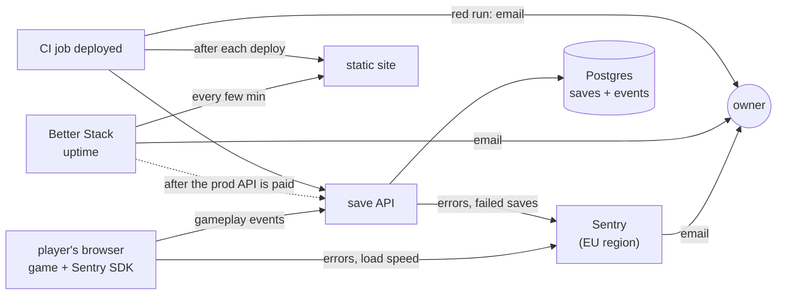

# Observability plan

Approved by the owner on 2026-11-06. One step at a time; each step is proven before the next starts. Tick a step only when its proof is recorded here. How things work today stays in [OPERATIONS.md](OPERATIONS.md); it is updated in the step that changes it.

## Target

| Job | Tool | Cost | Replaces |
|---|---|---|---|
| game crashes and errors | Sentry, browser SDK | free plan | nothing (the game reports nothing today) |
| game load speed | Sentry, same SDK, low sample rate | free plan | nothing |
| gameplay and learning: levels started, won, lost, quit | own events: game → save API → Postgres; funnels as SQL views | $0 | nothing |
| save API errors, "saves failing" alert | Sentry, Node SDK | free plan | Dash0 and `observability/alert.js` |
| site and API up | Better Stack uptime | free plan | nothing |
| right commit live | CI job `deployed` | done | — |
| alerts | email from each tool | $0 | — |

Dash0 is removed in step 2, once step 1 is proven. Checkly, Grafana and PostHog are not used.

## Why these tools

| Tool | Reason | Source |
|---|---|---|
| Sentry | most used and most admired of the monitoring tools in the survey (13.9% used, 45.9% admired); the only tracker found in the school apps Kahoot, Padlet and Sdui | [Stack Overflow survey 2026](https://survey.stackoverflow.co/2026/technology/data), [Kuketz audit](https://www.kuketz-blog.de/die-digitale-bildung-unter-der-lupe-eine-analyse-von-schul-und-lern-apps/) |
| own gameplay events | kids' learning apps keep this first-party (ANTON logs to its own domain, no trackers); no third party sees children's play | [Kuketz on ANTON](https://www.kuketz-blog.de/anton-datenschutzfreundlich-und-verantwortungsbewusst-schul-apps-teil-3/) |
| Better Stack | Render's docs name it for outside uptime checks; recommended by practitioners | [Render uptime advice](https://render.com/docs/uptime-best-practices), [HN](https://news.ycombinator.com/item?id=40276687) |
| no Dash0 | Sentry already does its one job here (API errors and the save alert) | — |

## Rules for every step

| Rule | Detail |
|---|---|
| Sentry org region | EU (Frankfurt). Chosen at sign-up, cannot be changed later |
| Sentry privacy | `dataCollection: { userInfo: false, cookies: false, httpHeaders: false, httpBodies: [], urlQueryParams: false }` (from SDK v11 these are collected unless set; `sendDefaultPii` is deprecated); IP storage off in project settings; Session Replay off; no save code in any message or URL sent |
| gameplay events | anonymous: event name, level, outcome, duration, a random id per page load kept in memory; no save code, no free text, no IP stored |
| Render Free hours | an uptime check every few minutes keeps a Free API awake all month (~744 of the 750 shared hours), which suspends every Free service. Monitor the APIs only once they are on a paid instance; static sites cost no hours |
| dev vs production | dev first, proven, then production at the next promotion (the owner approves it) |

## Steps

| # | Step | Proof | Rollback | Owner does | Status |
|---|---|---|---|---|---|
| 1 | Sentry on the save API (dev), errors only, next to Dash0: Sentry's own OpenTelemetry setup off and no tracing, so it does not clash with `server/otel.js` (Sentry custom OpenTelemetry setup); email alert when a save fails | local stack with the dev DSN: `docker compose stop db`, make a save → Sentry issue → email; Render dev deploy green with the DSN set | remove the `SENTRY_DSN` variable | create the Sentry organisation, EU region (fixed at sign-up) | in progress: local proof done 2026-11-06 17:42 UTC (issue IMMUNE-CITADEL-API-1, route `/api/save/:code`, alert fired 17:42:33, 12 s after the failed save); Render dev deploy with the DSN pending |
| 2 | remove Dash0: `server/otel.js`, OpenTelemetry packages, `observability/alert.js`, `OTEL_*` and `DASH0_*` variables; Sentry tracing on (low sample rate); OPERATIONS.md and README rewritten | step 1's proof again; `grep -ri dash0` finds only history; tests green | revert the PR, restore the variables | cancel Dash0 | todo |
| 3 | Sentry in the game (dev): errors and load speed. Sentry's CDN bundle (pinned version) in a script tag, so the static-site build does not change; the commit read from `/version.txt` and set as a tag | a thrown test error on dev → Sentry issue with browser and commit → email; DevTools: no new cookie or storage key | revert the PR | none | todo |
| 4 | Better Stack: both game sites | monitors up; a test monitor on a missing page → email | delete the monitors | create the Better Stack account | todo |
| 5 | gameplay events: event list, API endpoint, table, funnel views | a played level on dev appears in the funnel query | revert the PR (the table stays, unused) | approve the event list | todo |
| 6 | production at promotion: Sentry DSN, paid API instance, Better Stack monitor on the production API, the events table migrated | laptop test error with the production DSN → email; a test error from the production game → Sentry issue; a played level on production appears in the funnel query; API monitor up | per step | approve the promotion and the paid instance | todo |

## Open

- Not covered: CI never running after a merge, or a dashboard rollback leaving an old commit live. The `deployed` job runs only when CI runs. Accepted: practitioners check the commit after each deploy, not continuously; a rollback is a deliberate owner action.
- Sentry's free plan lists 20 metric monitors; whether one can alert on a count of failed saves is unconfirmed. Confirmed: an email on a new or recurring save error. Step 1 settles it.
- Ad blockers can block Sentry reports from the game. Sentry's `tunnel` option (reports sent through our own API) fixes it if step 2 shows missing reports.
