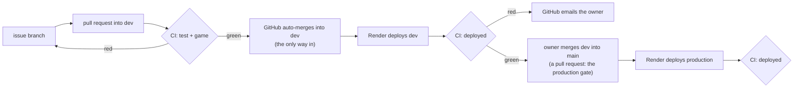

# Operations

## Environments

| | Game | Save API | Deploys |
|---|---|---|---|
| Production | https://immune-citadel-v4.onrender.com | https://immune-citadel-v4-api.onrender.com | every commit on `main` |
| Dev | https://immune-citadel-v4-dev.onrender.com | https://immune-citadel-v4-api-dev.onrender.com | every commit on `dev` |
| Local | http://localhost:8080 | http://localhost:8787 | `docker compose up` |

All on Render: two static sites, two Node web services, one Postgres with one schema per environment. `GET /health` on an API returns the commit it runs (production from its next release), e.g. `{"ok":true,"commit":"13c5715…"}`; Render uses it as the health check, so a broken API deploy never takes traffic.

Settings on a Render static site: build `mkdir -p public && cp index.html public/ && printf %s "$RENDER_GIT_COMMIT" > public/version.txt`, publish directory `public`, variable `SKIP_INSTALL_DEPS=true`. Only the game is public (the default would publish the whole checkout, server code and `node_modules` included), and `/version.txt` shows the commit the site runs.

## Releases

| Step | What | Proof |
|---|---|---|
| CI | [ci.yml](../.github/workflows/ci.yml): `test` (unit and integration) and `game` on every pull request and every push to `dev` and `main`; the rules below make both required | PR [#30](https://github.com/alexisdacquay/immune-citadel-v4/pull/30) and [#31](https://github.com/alexisdacquay/immune-citadel-v4/pull/31) checks |
| Auto-merge | `gh pr merge <n> --auto --merge` on the pull request: GitHub merges it once `test` and `game` pass on a branch up to date with `dev`; if `dev` moved meanwhile, it waits: `gh pr update-branch <n>`. Enabled with a person's token: a merge by `GITHUB_TOKEN` would start no workflows, so no deploy proof | PR [#45](https://github.com/alexisdacquay/immune-citadel-v4/pull/45) |
| CD | Render's auto-deploy trigger "on commit" on all four services: every commit on `dev` (or `main`) deploys, and only green pull requests can put one there | [PIPELINE-PLAN.md](PIPELINE-PLAN.md) step 3 |
| Deploy proof | CI job `deployed` on each push to `dev`/`main`: [tools/verify-deploy.js](../tools/verify-deploy.js) waits until the API `/health` and the site `/version.txt` serve the pushed commit, else the run goes red after 15 min (a newer push on the branch takes over the check) | [run 42221746028](https://github.com/alexisdacquay/immune-citadel-v4/actions/runs/42221746028): live 58 s after the merge |
| Production | the same on `main`; only the owner merges `dev` into `main` | the `deployed` job on `main` (from the next release: production's current build has no commit in `/health`) |

**Rules on `dev` and `main`** ([.github/rulesets/dev-main.json](../.github/rulesets/dev-main.json), GitHub ruleset 26693579, needs GitHub Pro on a private repo): changes only through a pull request; `test` and `game` (from GitHub Actions) must pass on a branch that is up to date; no force push, no deletion, nobody bypasses. Re-apply after an edit: `gh api -X PUT repos/alexisdacquay/immune-citadel-v4/rulesets/26693579 --input .github/rulesets/dev-main.json`.

**What goes wrong, and who notices:**

| Failure | Caught by | Signal |
|---|---|---|
| a test or game check fails | `test` / `game` on the pull request | red check, no merge |
| a commit bypasses CI | ruleset (pull request + checks required, no bypass) | push rejected (`GH013`) |
| a broken API build | Render health check on `/health` | the old deploy keeps traffic; `deployed` red after 15 min |
| Render never deploys, or deploys the wrong commit | `deployed` | red run; GitHub emails whoever triggered it (the person who enabled auto-merge, today the owner) if Actions email notifications are on |
| CI itself never runs, a dashboard rollback, a dead pipeline | nothing yet | [PIPELINE-PLAN.md](PIPELINE-PLAN.md) step 5 (outside observer) |
| cloud saves fail | Dash0 alert (below), dev only until production sends telemetry | email |

**Rollback:** Render dashboard → the service → Events → Rollback on the last good deploy (reuses its build; a dashboard rollback turns auto-deploy off: turn it back on after), or merge a revert pull request (CI, then Render, redeploy).

## Telemetry

The save API sends traces, metrics and logs to [Dash0](https://www.dash0.com) over OpenTelemetry (OTLP). Dev on Render sends them now; production will from its next release; locally only when `.env` holds the token (`.env.example`). The key journey is the cloud save (`PUT` then `GET /api/save/:code`).

- **Traces:** every API request, with its Postgres query. Spans carry the route `/api/save/:code`, never the code; client addresses are redacted; queries show `$1`, not values.
- **Metrics:** request duration by method and status; `saves_total{outcome="ok"|"failed"}`. Every signal carries `deployment.environment.name` (local, dev, production).
- **Logs:** JSON lines, each with the `trace_id` and `span_id` of its request, so a log line opens its trace.
- Code: [server/otel.js](../server/otel.js) (OpenTelemetry), [server/route.js](../server/route.js) (the redaction), [server/index.js](../server/index.js) (logs and the counter). Fast tests: [server/telemetry.test.js](../server/telemetry.test.js).

Settings on a Render API service: build `cd server && npm ci --omit=dev`, start `cd server && npm start` (that is what loads OpenTelemetry; `node server/index.js` would skip it), and the variables `OTEL_EXPORTER_OTLP_ENDPOINT=https://ingress.europe-west4.gcp.dash0.com`, `OTEL_EXPORTER_OTLP_HEADERS=Authorization=Bearer <token>`, `OTEL_SERVICE_NAME=immune-citadel-api`, `OTEL_RESOURCE_ATTRIBUTES=deployment.environment.name=<env>`.

## Alert: cloud saves failing

Defined as code in [observability/alert.js](../observability/alert.js) and created in Dash0 with `npm run alert`: fires when any save in the last 5 minutes failed with a server error, so a player's progress did not reach the cloud, and e-mails the owner. Checked every minute.

Try it locally (with `.env` set): `docker compose up`, make a save, then `docker compose stop db` and make another. Measured on 2026-11-05: three failed saves at 20:26:03 UTC, Dash0 marked the check critical at 20:27:04 (observed value 3). Then `docker compose start db`.
