# Operations

How Immune Citadel runs: where it is deployed, how a change reaches players, what watches it, and what to do when an alert fires. The plans behind this page, with their proof, are [PIPELINE-PLAN.md](PIPELINE-PLAN.md) and [OBSERVABILITY-PLAN.md](OBSERVABILITY-PLAN.md).

**On this page:** [Environments](#environments) · [Infrastructure as code](#infrastructure-as-code) · [Releases](#releases) · [QA in two stages](#qa-in-two-stages) · [Branch rules](#branch-rules) · [Rollback](#rollback) · [Restore the database](#restore-the-database) · [Telemetry](#telemetry) · [Follow one save](#follow-one-save) · [Reading gameplay events](#reading-gameplay-events) · [Alert: save API error](#alert-save-api-error) · [Alert: API down](#alert-api-down)

## Environments

| | Game | Save API | Deploys |
|---|---|---|---|
| Production | https://immune-citadel-v4.onrender.com | [immune-citadel-v4-api.onrender.com/health](https://immune-citadel-v4-api.onrender.com/health) | every commit on `main` |
| Dev | https://immune-citadel-v4-dev.onrender.com | [immune-citadel-v4-api-dev.onrender.com/health](https://immune-citadel-v4-api-dev.onrender.com/health) | every commit on `dev` |
| Local | http://localhost:8080 | http://localhost:8787 | `docker compose up --build` (or `npm start`) |

The save API answers only under `/health` and `/api/`; its bare host returns 404.

**Which commit is live:** `GET /health` on a save API returns it (`{"ok":true,"commit":"…"}`), and `/version.txt` on a game site shows it. Render waits for `/health` to answer before a new API deploy takes traffic, so a broken build never does. Every promotion, with its commit and proof: [STATUS, Promotions](STATUS.md#promotions).

### What runs on Render

Everything runs on Render in Frankfurt. Dev mirrors production (owner, 2026-11-06: everything is production grade): the same services on the same plans, differing only in data, secrets, branch and allowed origins.

| | Production | Dev |
|---|---|---|
| Game: a static site | `immune-citadel-v4` | `immune-citadel-v4-dev` |
| Save API: Node 22 web service, Starter plan (always on), health check `/health` | `immune-citadel-v4-api` | `immune-citadel-v4-api-dev` |
| Database: Postgres 18, `basic-256mb`, 15 GB, point-in-time recovery and daily backups | `immune-citadel-v4-prod-db`, schema `prod` | `immune-citadel-v4-dev-db`, schema `dev` |
| Branch | `main` | `dev` |
| `ALLOWED_ORIGINS` (who may call the API) | the production site | the dev site and `http://localhost:8794` |
| `SENTRY_ENVIRONMENT` | `production` | `dev` |

Locally, `docker compose up` ([compose.yaml](../compose.yaml)) runs the same three parts on your machine: the game behind nginx, the save API, and Postgres 16. Sentry stays off unless `.env` sets `SENTRY_DSN` (see `.env.example`).

### Infrastructure as code

[render.yaml](../render.yaml) declares all six resources, and Render applies it through Blueprint `exs-dbndeu7f3r2c738bllag`. Change a plan or a setting there, never in the dashboard: Render's API refuses a Free-to-paid change on a service, a Blueprint sync does not.

**Today:** the Blueprint reads `main` with auto-sync on, for both environments, so a change to `render.yaml` reaches Render only through a promotion. How it got there, with dates: [STATUS, Promotions](STATUS.md#promotions).

Each database accepts outside connections only from an IP allowlist holding the owner's address. That address is personal, so it is set in Render only, never in `render.yaml` or anywhere in this repository (a Blueprint sync keeps a list the file leaves out).

| Service | Build | Then |
|---|---|---|
| Game site | `mkdir -p public && cp index.html public/ && cp -r fonts public/ && printf %s "$RENDER_GIT_COMMIT" > public/version.txt` (the game and its self-hosted fonts) | publishes `public`, with `SKIP_INSTALL_DEPS=true` |
| Save API | `cd server && npm ci --omit=dev` | starts `cd server && exec npm start` |

Why: the site publishes only the game (Render's default would publish the whole checkout, server code and `node_modules` included), and `/version.txt` names its commit. With `exec`, Render's stop signal reaches npm, which passes it to the API instead of stopping at a shell. `exec` is in `render.yaml` and applied: the Blueprint's plan from `main` found no difference from the running services.

Save API variables: `SENTRY_DSN` (a secret set in Render: Sentry → the project → Client Keys; without it, Sentry is off), `SENTRY_ENVIRONMENT`, `DB_SCHEMA`, `ALLOWED_ORIGINS`, `DATABASE_URL` (from the database) and `NODE_VERSION`.

On each deploy Render sends `SIGTERM` to the old instance: the API finishes the saves in flight, sends its buffered telemetry, and exits within 25 s (Render kills it at 30 s).

## Releases


A change reaches players in six moves:

1. **Branch and pull request.** Work happens on its own branch (`issue/<n>-<slug>`, or `fix/`, `feat/`, `infra/`, `docs/` plus a slug) and enters `dev` only through a pull request. Its description carries a `## QA checks` section, written by the builder ([Writing QA checks](#qa-in-two-stages)).
2. **Checks.** CI runs `test` and `game`, and the QA agent's two stages.
3. **Auto-merge into dev.** Right after opening the pull request, the builder arms auto-merge with `sh tools/automerge.sh <n>`, which refuses any base but `dev`. GitHub merges as soon as `test`, `game` and `qa` are green, with no human in the loop.
4. **Deploy and proof.** Render deploys every commit on `dev`. The CI job `deployed` proves the new commit is live.
5. **Promotion.** A pull request from `dev` into `main` that needs `test`, `game` and `dev-green`, and the owner's written go. Render deploys production and `deployed` proves it.
6. **Back into dev.** The promotion's merge commit lands on `main` only, and `main` accepts only a branch that is up to date with it. So the next pull request into `dev` also merges `origin/main` (no file changes), or the next promotion cannot merge. A pull request that only does this fails stage 1, which needs a real `[changes]` check, so it rides with a real change.

| Step | What | Proof |
|---|---|---|
| CI | [ci.yml](../.github/workflows/ci.yml) on every pull request and every push to `dev` and `main`: `test` (unit tests, then integration on the Docker stack; about 1 min) and `game` (a bot plays every level; saves, challenges, Field Guide, phone and tablet layouts; 6 to 7 min) | checks on PR [#112](https://github.com/alexisdacquay/immune-citadel-v4/pull/112); [a green `dev` run](https://github.com/alexisdacquay/immune-citadel-v4/actions/runs/42480697284) |
| QA | `qa` (required) and `qa-review` (advisory) on every pull request into `dev`: [TEAM, How QA works](TEAM.md#how-qa-works-two-stages) | [PR #114's QA checks comment](https://github.com/alexisdacquay/immune-citadel-v4/pull/114#issuecomment-6721457780) |
| Auto-merge | armed with a person's token, never `GITHUB_TOKEN`: a merge by `GITHUB_TOKEN` starts no workflows, so there would be no deploy proof. The branch need not be up to date with `dev`: CI runs again on `dev` after every merge, and a red `dev` blocks the next promotion | [PR #45](https://github.com/alexisdacquay/immune-citadel-v4/pull/45) |
| CD | Render's auto-deploy trigger is "on commit" on all four services; only green pull requests can put a commit on `dev` or `main` | [PIPELINE-PLAN.md](PIPELINE-PLAN.md), step 3 |
| Deploy proof | CI job `deployed` on each push to `dev` or `main`: [tools/verify-deploy.js](../tools/verify-deploy.js) waits until the API's `/health` and the site's `/version.txt` serve the pushed commit, else the run goes red after 15 min (if a newer push arrives first, that push's own run takes over). Then [tools/smoke.js](../tools/smoke.js) plays the live site in Chromium, read-only (Sentry and the page's `/api/` calls are answered locally, nothing is sent or saved), and goes red on a wrong commit, an error, or a save code, user agent, an `ip_address` field, headers or play data in a Sentry payload, or a crash report that does not tell Sentry to drop the IP (`infer_ip` not `never`) | dev: [run 42221746028](https://github.com/alexisdacquay/immune-citadel-v4/actions/runs/42221746028), live 58 s after the merge; production: [run 42388716983](https://github.com/alexisdacquay/immune-citadel-v4/actions/runs/42388716983), live 73 s after the merge; every promotion's run is in [STATUS, Promotions](STATUS.md#promotions) |
| Promotion | [promotion.yml](../.github/workflows/promotion.yml): `dev-green` waits for `dev`'s own CI run on the same commit, deploy proof included, and fails unless it is green; then, on the owner's written go, the owner or the orchestrator merges | [STATUS, Promotions](STATUS.md#promotions): every promotion, its approval and its proof run |

**Every promotion needs the owner's written go.** Then the owner or, on that go, the orchestrator (the main Claude Code session) clicks merge. Each go is recorded in the [STATUS promotions table](STATUS.md#promotions). No agent arms auto-merge on a pull request into `main`. This is a team rule ([AGENTS.md](../AGENTS.md)); GitHub does not enforce it.

### QA in two stages

QA is an independent DeepSeek agent ([tools/qa.js](../tools/qa.js)) that runs as two CI jobs on every pull request into `dev`: `qa`, stage 1, required, asks closed YES or NO questions; `qa-review`, stage 2, advisory, is an open review. The full process, its rules and its proof: [TEAM, How QA works](TEAM.md#how-qa-works-two-stages).

**Writing QA checks.** The builder owns this test plan. One line per thing the change could break, under `## QA checks` in the pull request description, for example (from PR #92):

```markdown
## QA checks
- [changes] tools/qa.js: In stage 1, is each question asked 3 times, with the answer at least 2 of them give counting, and UNSURE when all 3 differ?
- [stays] .github/workflows/ci.yml: Do the qa and qa-review jobs run only on pull requests into dev?
```

- `[changes]`: true because of this change. It must be YES on the new code and not YES on the old, otherwise it does not test the change. Every pull request needs at least one.
- `[stays]`: something that must still hold. It must be YES on the new code.
- Phrase each question so YES means right, about behaviour (never "does X appear"), and name the files that hold the answer: the model sees only those files, not library defaults. More guidance: [AGENTS.md](../AGENTS.md), **Test plan**.

**Past failures.** [test/past-failures.md](../test/past-failures.md) holds one line per past failure that reached a player, `dev` or a review, as a closed question. A bug fix adds its line in the same pull request; because stage 1 reads the file from the base branch, a new line counts from the next pull request.

**Known gap:** GitHub reads `ci.yml` from the pull request, so a pull request that edits `ci.yml` can change its own `qa` job. Not fixed yet.

### Branch rules

GitHub rulesets on both branches; nobody bypasses them, and neither branch accepts a force push or deletion.

| | `dev` | `main` |
|---|---|---|
| Ruleset | 26753396, [.github/rulesets/dev.json](../.github/rulesets/dev.json) | 26693579, [.github/rulesets/main.json](../.github/rulesets/main.json) |
| Changes only through a pull request | yes | yes |
| Required checks | `test`, `game`, `qa` | `test`, `game`, `dev-green` |
| Branch must be up to date | no, so auto-merge never stalls | yes |

- `dev-green` lives in its own workflow, [promotion.yml](../.github/workflows/promotion.yml), which runs only on pull requests into `main`. Inside `ci.yml` it would be skipped on every push, and GitHub counts a skipped check as passing ([#75](https://github.com/alexisdacquay/immune-citadel-v4/issues/75)).
- No merge queue: GitHub offers it only to repositories owned by an organisation, and this one belongs to a personal account. So the strict guarantee sits on the promotion, as trunk-based development advises (owner, 2026-11-07).
- Re-apply a ruleset after editing its file: `gh api -X PUT repos/alexisdacquay/immune-citadel-v4/rulesets/<id> --input .github/rulesets/<file>.json`.

### What goes wrong, and who notices

| Failure | Caught by | Signal |
|---|---|---|
| a test, the game suite or a QA check fails | `test`, `game`, `qa` on the pull request | red check, no merge; `qa` comments which check failed and why |
| a commit tries to bypass CI | the rulesets | push rejected (`GH013`) |
| a broken API build | Render's health check on `/health` | the old deploy keeps traffic; `deployed` goes red after 15 min |
| Render never deploys, or deploys the wrong commit | `deployed` | red run; GitHub emails whoever triggered it (the person who armed auto-merge, today the owner) if their Actions email notifications are on |
| `dev` is red when the owner promotes | `dev-green` | the promotion's check fails |
| a game site is down | Better Stack: HEAD on both sites every 5 min ([observability/betterstack.js](../observability/betterstack.js)) | email |
| a save API is down | Better Stack: GET `/health` on both APIs every 5 min (monitors 5200741, 5200742) | email; [runbook](#alert-api-down) |
| the game crashes on a player's device (dev and production sites) | Sentry, project `immune-citadel-game` | email when an issue is new or returns ([observability/sentry-game-alert.json](../observability/sentry-game-alert.json)) |
| a save or load fails with a server error | Sentry alert: on dev and production (the rule has no environment filter) | email; [runbook](#alert-save-api-error) |
| CI never runs after a merge, or a dashboard rollback leaves an old commit live | not covered | accepted: [OBSERVABILITY-PLAN.md](OBSERVABILITY-PLAN.md#open) |

### Rollback

Either of these:
- **Render dashboard:** the service → Events → Rollback on the last good deploy. It reuses that build. A dashboard rollback turns auto-deploy off: turn it back on afterwards.
- **Revert pull request:** merge a revert; CI runs, then Render redeploys.

### Restore the database

**Never rehearsed:** neither database has been restored yet, so how long it takes is not known.

1. **Restore.** Render → the database (`immune-citadel-v4-prod-db` or `immune-citadel-v4-dev-db`) → Recovery → restore to a point in time inside Render's recovery window. Render creates a new database from it; the old one keeps running.
2. **Lock it down at once.** A new database accepts any IP with valid credentials: set its IP allowlist to the owner's address (the database → Networking), as on the old one ([Infrastructure as code](#infrastructure-as-code)).
3. **Repoint the API.** The API gets `DATABASE_URL` from `fromDatabase` in [render.yaml](../render.yaml), by database name. Put the restored database's name in its `databases` entry and in the API's `fromDatabase`, through a pull request into `dev` and then a promotion: the Blueprint reads `main` for both environments, so even the dev database moves only with a promotion.
4. **Check.** `/health` answers, and a save and a load on the site work.
5. **Clean up.** Once the restored database serves saves, the owner deletes the old one in Render.

A restore brings the data back as it was at that time, so rows deleted since then come back too. The API's prune runs again when it starts and then daily; a save deleted by hand since then must be deleted again by hand.

## Telemetry



**What is on where:**

| Signal | Dev | Production |
|---|---|---|
| game errors and load speed (Sentry) | on | on since the 2026-11-07 promotion; no production test error recorded |
| save API errors and traces (Sentry) | on | on since 2026-11-08 (`SENTRY_DSN` set) |
| save log lines and metric in Sentry (#70) | on since PR #82 (2026-11-07) | on since 2026-11-08: a trace and a log line with environment `production` at 07:47 UTC, and `http.server.request.duration` points with environment `production` in Sentry (checked 2026-11-08) |
| gameplay events (own Postgres) | on | the code is on `main` since the 2026-11-07 promotion; no production read is recorded |
| uptime (Better Stack) and deploy proof (`deployed`) | on | on |

**The signals:**

| What | Where | Detail |
|---|---|---|
| save API errors | Sentry, project `immune-citadel-api` | every request that fails with a server error, with its stack trace and route |
| save API traces | same | every request except `/health` and `/api/play`, with its Postgres queries (query text with `$1`, never the values) |
| logs | Render, the service's Logs tab: every request except `/health`. Sentry, Logs: saves and loads only | one JSON line per request: method, route, status, `ms`, and `trace_id` and `span_id` while Sentry is on; never the save code |
| save metric | Sentry, Metrics: `http.server.request.duration` (seconds, OpenTelemetry's name) | one point per save or load, by `http.request.method`, `http.route` and `http.response.status_code`: the count is the request rate, the status codes the errors, the value the speed |
| game errors and load speed | Sentry, project `immune-citadel-game` | dev and production sites only; the release is the commit in `/version.txt`; save codes scrubbed |
| gameplay events | the save API's Postgres: table `events`, views `funnel`, `level_stats`, `card_reads`, `sittings` | dev and production sites only; anonymous; what is and is never collected: [EVENTS.md](EVENTS.md); [how to read them](#reading-gameplay-events) |
| uptime | Better Stack | HEAD on both game sites, GET `/health` on both APIs, every 5 min; apply changes with `node observability/betterstack.js` (needs `BETTERSTACK_API_TOKEN`) |

Sentry organisation `myown-76`, EU region (de.sentry.io); environments `local`, `dev` and `production`. Organisation privacy settings: IP addresses are not stored, and an Advanced Data Scrubbing rule removes the location (`$user.geo`), because Sentry derives it from the IP even when IP storage is off.

**Children's data.** [server/sentry.js](../server/sentry.js) sends no IP, headers, cookies, bodies, query strings, database parameters, local variables or browser identifier (user agent), and replaces any save code (the player's only credential) with `:code` in errors, traces, logs and metrics. Gameplay events (`/api/play`) never reach Sentry. Proof: [server/sentry.test.js](../server/sentry.test.js) and [server/observability.test.js](../server/observability.test.js). Logs name the route `/api/save/:code`, never the code ([server/route.js](../server/route.js), [server/telemetry.test.js](../server/telemetry.test.js)).

A player who closes the tab mid-save is logged in Render (`client left mid-upload`), not reported as an error. Sentry still shows that request's trace as a `PUT` with status 200; Render's line with the same `trace_id` is the truth.

### Follow one save

One save or load gives Sentry one trace, one log line and one metric point, all under the request's trace ID, and Render's log line for that request carries the same `trace_id`. So one ID leads from any signal to the others.

**On any machine, without a Sentry login** (what a course reviewer can run, with Node 22 and no Docker; CI runs it in `test` on every pull request):

```bash
npm ci --prefix server && node --test server/observability.test.js
```

It starts the real API with the real Sentry SDK against a local stand-in for Sentry, and checks that:
- one save gives one trace, one log line and one metric under the trace ID of its Render log line;
- no save code, save, IP or browser identifier leaves;
- gameplay events stay home;
- a closed tab is no error, but is logged;
- a deploy finishes a save in flight;
- a Sentry outage never fails a save.

Each check was proven able to fail by removing the code it guards: 25 removals on 2026-11-07, 13 of them by an independent reviewer. Two removals change nothing on their own, by design: the scrub on logs and metrics (a second guard behind the save-route filter) and the route attribute (fixed inside that filter).

**On dev, with Sentry access:** after a save on the dev site, Render → `immune-citadel-v4-api-dev` → Logs shows its line (`"msg":"request"`, `"route":"/api/save/:code"`) with a `trace_id`. In Sentry, project `immune-citadel-api`, environment `dev`, that trace ID finds the trace (`PUT /api/save/:code` with its Postgres spans), the log line, and the metric point.

**Not done yet:** the walkthrough of one real dev save with screenshots, an after-merge item of [#70](https://github.com/alexisdacquay/immune-citadel-v4/issues/70). [PR #90](https://github.com/alexisdacquay/immune-citadel-v4/pull/90) (open, not merged) adds a CI job `observed` that makes one real save on dev after every deploy and asks Sentry's API for all three; run by hand on 2026-11-07 at 20:46 UTC, it found the trace, the log line and the metric (trace `f026882f878afbbb6006c851a118cc13`).

## Reading gameplay events

The databases accept outside connections only from their IP allowlist: the owner's machine. If that address changes, update it in Render (the database → Networking, or `PATCH /v1/postgres/<id>` with `ipAllowList`). The Render MCP query tool connects from Render's servers, so the allowlist blocks it.

```bash
docker run --rm -it -e U="$URL?sslmode=require" postgres:18-alpine sh -c 'psql "$U" -c "SELECT * FROM dev.level_stats"'
```

`$URL` is the database's external connection string (Render → the database → Connect, or `GET /v1/postgres/<id>/connection-info`); never commit or paste it. Schemas: `dev` and `prod`. Views: `funnel`, `level_stats`, `card_reads`, `sittings` ([EVENTS.md](EVENTS.md)).

## Alert: save API error

**"Save API error (a save or load failed): email owner"**: every error in Sentry project `immune-citadel-api` emails the owner, at most once per 30 min per issue. Defined in [observability/sentry-alert.json](../observability/sentry-alert.json) (Sentry alert 1464000) and applied through the Sentry MCP.

| | |
|---|---|
| Meaning | a save or load answered 500 |
| Impact | that player's progress is not in the cloud; the game keeps it in the browser and retries on the next save or visit |
| Diagnosis | the Sentry issue's trace → its Postgres span and log line; Render → the API → Logs, search the `trace_id` |
| Mitigation | database down: Render → the database → Events. Bad deploy: [Rollback](#rollback) |

Try it locally (with `SENTRY_DSN` in `.env`): `docker compose up`, make a save, `docker compose stop db`, make another, then `docker compose start db`. Measured 2026-11-06: the failed save at 17:42:21 UTC opened issue IMMUNE-CITADEL-API-1, the alert fired at 17:42:33, and the email arrived.

## Alert: API down

Better Stack emails when `/health` fails and still fails 60 s later.

| | |
|---|---|
| Meaning | the API does not answer, or it started without its database |
| Impact | no player can save or load |
| Diagnosis | Render → the API → Events (did a deploy fail?) and Logs (`startup failed`) |
| Mitigation | [Rollback](#rollback); if the database is down, Render → the database → Events |
