# Operations

## Environments

| | Game | Save API | Deploys |
|---|---|---|---|
| Production | https://immune-citadel-v4.onrender.com | https://immune-citadel-v4-api.onrender.com | every commit on `main` |
| Dev | https://immune-citadel-v4-dev.onrender.com | https://immune-citadel-v4-api-dev.onrender.com | every commit on `dev` |
| Local | http://localhost:8080 | http://localhost:8787 | `docker compose up` |

All on Render, Frankfurt. Dev mirrors production: the same services on the same plans, and only data, secrets, branch and alert routing differ (owner, 2026-11-06: everything is production grade). Per environment: a static site, a Node web service on the Starter plan (always on, health-check gated deploys), and its own Postgres 18 on `basic_256mb` (point-in-time recovery and daily backups): `immune-citadel-v4-prod-db` with schema `prod`, `immune-citadel-v4-dev-db` with schema `dev`. `GET /health` on an API returns the commit it runs (production from its next release), e.g. `{"ok":true,"commit":"13c5715…"}`; Render uses it as the health check, so a broken API deploy never takes traffic.

[render.yaml](../render.yaml) declares all six resources; Render applies it through Blueprint `exs-dbndeu7f3r2c738bllag` (first sync 2026-11-06 adopted the existing services, moved both APIs from Free to Starter, and grew the dev database disk to 15 GB like production). Change a plan or setting there, never in the dashboard: Render's API refuses a Free-to-paid change on a service, a Blueprint sync does not. The Blueprint reads `dev` with auto-sync off (the branch it first read was deleted when history was cleaned, 2026-11-07; a plan from `dev` showed no changes) until `render.yaml` reaches `main`; then point it at `main` with auto-sync on, so only the owner's merge into production changes infrastructure.

Settings on a Render static site: build `mkdir -p public && cp index.html public/ && printf %s "$RENDER_GIT_COMMIT" > public/version.txt`, publish directory `public`, variable `SKIP_INSTALL_DEPS=true`. Only the game is public (the default would publish the whole checkout, server code and `node_modules` included), and `/version.txt` shows the commit the site runs.

## Releases



| Step | What | Proof |
|---|---|---|
| CI | [ci.yml](../.github/workflows/ci.yml): `test` (unit and integration) and `game` on every pull request and every push to `dev` and `main`; then `qa` on every pull request ([tools/qa.js](../tools/qa.js): an independent DeepSeek agent judges the diff against the named issues' acceptance criteria, comments its verdict, fails on FAIL or on no verdict; repository secret `DEEPSEEK_API_KEY`); the rules below make all three required | PR [#30](https://github.com/alexisdacquay/immune-citadel-v4/pull/30) and [#31](https://github.com/alexisdacquay/immune-citadel-v4/pull/31) checks |
| Auto-merge | `sh tools/automerge.sh <n>` right after opening a pull request into `dev` (refuses any other base): GitHub merges it once `test`, `game` and `qa` pass; the branch need not be up to date with `dev` (CI runs again on `dev` after the merge, and a red `dev` blocks promotion). Enabled with a person's token: a merge by `GITHUB_TOKEN` would start no workflows, so no deploy proof | PR [#45](https://github.com/alexisdacquay/immune-citadel-v4/pull/45) |
| CD | Render's auto-deploy trigger "on commit" on all four services: every commit on `dev` (or `main`) deploys, and only green pull requests can put one there | [PIPELINE-PLAN.md](PIPELINE-PLAN.md) step 3 |
| Deploy proof | CI job `deployed` on each push to `dev`/`main`: [tools/verify-deploy.js](../tools/verify-deploy.js) waits until the API `/health` and the site `/version.txt` serve the pushed commit, else the run goes red after 15 min (a newer push on the branch takes over the check) | [run 42221746028](https://github.com/alexisdacquay/immune-citadel-v4/actions/runs/42221746028): live 58 s after the merge |
| Production | the same on `main`; only the owner merges `dev` into `main` | the `deployed` job on `main` (from the next release: production's current build has no commit in `/health`) |

**Rules on `dev` and `main`** (GitHub rulesets, need GitHub Pro on a private repo; no force push, no deletion, nobody bypasses):
- `dev` ([.github/rulesets/dev.json](../.github/rulesets/dev.json)): changes only through a pull request; `test`, `game` and `qa` must pass; the branch need not be up to date, so auto-merge never stalls; CI runs again on `dev` after each merge.
- `main` ([.github/rulesets/main.json](../.github/rulesets/main.json), ruleset 26693579): the same checks on a branch that is up to date, plus `dev-green`: the promotion fails unless `dev`'s own CI run on that commit, deploy proof included, finished green.
- Owner, 2026-11-07: GitHub's merge queue needs Enterprise Cloud on a private repo, so the strict guarantee sits on the promotion, as DORA and trunk-based development advise.
- Re-apply after an edit: `gh api -X PUT repos/alexisdacquay/immune-citadel-v4/rulesets/<id> --input .github/rulesets/<file>.json` (ids: `gh api repos/alexisdacquay/immune-citadel-v4/rulesets`).

**What goes wrong, and who notices:**

| Failure | Caught by | Signal |
|---|---|---|
| a test or game check fails | `test` / `game` on the pull request | red check, no merge |
| a commit bypasses CI | ruleset (pull request + checks required, no bypass) | push rejected (`GH013`) |
| a broken API build | Render health check on `/health` | the old deploy keeps traffic; `deployed` red after 15 min |
| Render never deploys, or deploys the wrong commit | `deployed` | red run; GitHub emails whoever triggered it (the person who enabled auto-merge, today the owner) if Actions email notifications are on |
| game site down | Better Stack: HEAD on both sites every 5 min ([observability/betterstack.js](../observability/betterstack.js)) | email |
| production or dev API down | nothing yet | Better Stack check on each API's `/health`, to add now that both APIs are paid instances (step 6) |
| the game crashes on players' devices (dev and production sites) | Sentry, project `immune-citadel-game` | email when an issue is new or returns ([observability/sentry-game-alert.json](../observability/sentry-game-alert.json)) |
| CI never runs after a merge, or a dashboard rollback leaves an old commit live | not covered | accepted: see [OBSERVABILITY-PLAN.md](OBSERVABILITY-PLAN.md), Open |
| a save or load fails with a server error | Sentry alert (below); production from [OBSERVABILITY-PLAN.md](OBSERVABILITY-PLAN.md) step 6 | email |

**Rollback:** Render dashboard → the service → Events → Rollback on the last good deploy (reuses its build; a dashboard rollback turns auto-deploy off: turn it back on after), or merge a revert pull request (CI, then Render, redeploy).

## Telemetry

| What | Where | Detail |
|---|---|---|
| save API errors | Sentry, project `immune-citadel-api` | every request that fails with a server error, with its stack trace and route |
| save API traces | same | every request except `/health` and `/api/play`, with its Postgres queries (query text with `$1`, no values) |
| logs | Render, the service's Logs tab | JSON lines with method, route, status, duration; never the save code |
| game errors and load speed | Sentry, project `immune-citadel-game` | dev and production sites only; release = the commit in `/version.txt`; save codes scrubbed |
| gameplay events | the save API's Postgres, table `events`, views `funnel`, `level_stats`, `card_reads`, `sittings` | dev and production sites only; anonymous; what and why in [EVENTS.md](EVENTS.md); read below |
| site up | Better Stack | HEAD on both game sites every 5 min; apply changes with `node observability/betterstack.js` (`BETTERSTACK_API_TOKEN`) |

Sentry organisation `myown-76`, EU region (de.sentry.io). Environments: `local`, `dev`, `production`. Organisation privacy settings: IP addresses not stored; location (`$user.geo`) removed by an Advanced Data Scrubbing rule, because Sentry derives it from the IP even when IP storage is off.

**Children's data:** [server/sentry.js](../server/sentry.js) sends no IP, headers, cookies, bodies, query strings, database parameters or local variables, and replaces any save code (the player's only credential) with `:code` in errors and traces. Proof: [server/sentry.test.js](../server/sentry.test.js). Logs use the route `/api/save/:code` ([server/route.js](../server/route.js), [server/telemetry.test.js](../server/telemetry.test.js)).

Settings on a Render API service: build `cd server && npm ci --omit=dev`, start `cd server && npm start`, and the variables `SENTRY_DSN` (Sentry → project → Client Keys) and `SENTRY_ENVIRONMENT` (`dev` or `production`). Without `SENTRY_DSN`, Sentry is off. Locally: `SENTRY_DSN` in `.env` (see `.env.example`).

## Reading gameplay events

Each database accepts outside connections only from its IP allowlist: the owner's machine. The address is personal, so it lives only in Render, never in this repository or `render.yaml` (a Blueprint sync keeps a list the file omits). If it changes, update it: Render → the database → Networking, or `PATCH /v1/postgres/<id>` with `ipAllowList`. The Render MCP query tool connects from Render's servers and cannot use the allowlist.

```bash
docker run --rm -it -e U="$URL?sslmode=require" postgres:18-alpine sh -c 'psql "$U" -c "SELECT * FROM dev.level_stats"'
```

`$URL`: the external connection string (Render → the database → Connect, or `GET /v1/postgres/<id>/connection-info`); never commit or paste it. Schemas: `dev`, and the production schema from step 6. Views: `funnel`, `level_stats`, `card_reads`, `sittings` ([EVENTS.md](EVENTS.md)).

## Alert: save API error

"Save API error (a save or load failed): email owner": every error in `immune-citadel-api` emails the owner, at most once per 30 min per issue. Defined in [observability/sentry-alert.json](../observability/sentry-alert.json) (Sentry alert 1464000), applied through the Sentry MCP.

Try it locally (with `SENTRY_DSN` in `.env`): `docker compose up`, make a save, `docker compose stop db`, make another, then `docker compose start db`. Measured 2026-11-06: failed save 17:42:21 UTC, issue IMMUNE-CITADEL-API-1, alert fired 17:42:33, email received.
