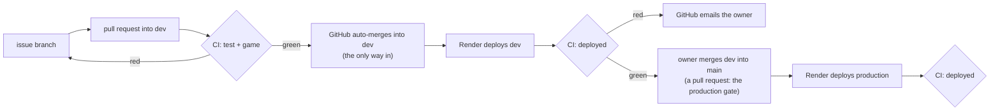

# Operations

## Environments

| | Game | Save API | Deploys |
|---|---|---|---|
| Production | https://immune-citadel-v4.onrender.com | https://immune-citadel-v4-api.onrender.com | every commit on `main` |
| Dev | https://immune-citadel-v4-dev.onrender.com | https://immune-citadel-v4-api-dev.onrender.com | every commit on `dev` |
| Local | http://localhost:8080 | http://localhost:8787 | `docker compose up` |

All on Render: two static sites, two Node web services, one Postgres with one schema per environment. `GET /health` on an API returns the commit it runs (production from its next release), e.g. `{"ok":true,"commit":"13c5715…"}`; Render uses it as the health check, so a broken API deploy never takes traffic.

Settings on a Render static site: build `mkdir -p public && cp index.html public/ && printf %s "$RENDER_GIT_COMMIT" > public/version.txt`, publish directory `public`, variable `SKIP_INSTALL_DEPS=true`. Only the game is public (the default would publish the whole checkout, server code and `node_modules` included), and `/version.txt` shows the commit the site runs.

## Releases

| Step | What | Proof |
|---|---|---|
| CI | [ci.yml](../.github/workflows/ci.yml): `test` (unit and integration) and `game` on every pull request and every push to `dev` and `main`; the rules below make both required | PR [#30](https://github.com/alexisdacquay/immune-citadel-v4/pull/30) and [#31](https://github.com/alexisdacquay/immune-citadel-v4/pull/31) checks |
| Auto-merge | `gh pr merge <n> --auto --merge` on the pull request: GitHub merges it once `test` and `game` pass on a branch up to date with `dev`; if `dev` moved meanwhile, it waits: `gh pr update-branch <n>`. Enabled with a person's token: a merge by `GITHUB_TOKEN` would start no workflows, so no deploy proof | PR [#45](https://github.com/alexisdacquay/immune-citadel-v4/pull/45) |
| CD | Render's auto-deploy trigger "on commit" on all four services: every commit on `dev` (or `main`) deploys, and only green pull requests can put one there | [PIPELINE-PLAN.md](PIPELINE-PLAN.md) step 3 |
| Deploy proof | CI job `deployed` on each push to `dev`/`main`: [tools/verify-deploy.js](../tools/verify-deploy.js) waits until the API `/health` and the site `/version.txt` serve the pushed commit, else the run goes red after 15 min (a newer push on the branch takes over the check) | [run 42221746028](https://github.com/alexisdacquay/immune-citadel-v4/actions/runs/42221746028): live 58 s after the merge |
| Production | the same on `main`; only the owner merges `dev` into `main` | the `deployed` job on `main` (from the next release: production's current build has no commit in `/health`) |

**Rules on `dev` and `main`** ([.github/rulesets/dev-main.json](../.github/rulesets/dev-main.json), GitHub ruleset 26693579, needs GitHub Pro on a private repo): changes only through a pull request; `test` and `game` (from GitHub Actions) must pass on a branch that is up to date; no force push, no deletion, nobody bypasses. Re-apply after an edit: `gh api -X PUT repos/alexisdacquay/immune-citadel-v4/rulesets/26693579 --input .github/rulesets/dev-main.json`.

**What goes wrong, and who notices:**

| Failure | Caught by | Signal |
|---|---|---|
| a test or game check fails | `test` / `game` on the pull request | red check, no merge |
| a commit bypasses CI | ruleset (pull request + checks required, no bypass) | push rejected (`GH013`) |
| a broken API build | Render health check on `/health` | the old deploy keeps traffic; `deployed` red after 15 min |
| Render never deploys, or deploys the wrong commit | `deployed` | red run; GitHub emails whoever triggered it (the person who enabled auto-merge, today the owner) if Actions email notifications are on |
| game site down | Better Stack: HEAD on both sites every 5 min ([observability/betterstack.js](../observability/betterstack.js)) | email |
| production API down | nothing yet | Better Stack once the API is on a paid instance, step 6; the dev API is not monitored (a check keeps a Free API awake, see the plan) |
| the game crashes on players' devices (dev and production sites) | Sentry, project `immune-citadel-game` | email when an issue is new or returns ([observability/sentry-game-alert.json](../observability/sentry-game-alert.json)) |
| CI never runs after a merge, or a dashboard rollback leaves an old commit live | not covered | accepted: see [OBSERVABILITY-PLAN.md](OBSERVABILITY-PLAN.md), Open |
| a save or load fails with a server error | Sentry alert (below); production from [OBSERVABILITY-PLAN.md](OBSERVABILITY-PLAN.md) step 6 | email |

**Rollback:** Render dashboard → the service → Events → Rollback on the last good deploy (reuses its build; a dashboard rollback turns auto-deploy off: turn it back on after), or merge a revert pull request (CI, then Render, redeploy).

## Telemetry

| What | Where | Detail |
|---|---|---|
| save API errors | Sentry, project `immune-citadel-api` | every request that fails with a server error, with its stack trace and route |
| save API traces | same | every request except `/health`, with its Postgres queries (query text with `$1`, no values) |
| logs | Render, the service's Logs tab | JSON lines with method, route, status, duration; never the save code |
| game errors and load speed | Sentry, project `immune-citadel-game` | dev and production sites only; release = the commit in `/version.txt`; save codes scrubbed |
| site up | Better Stack | HEAD on both game sites every 5 min; apply changes with `node observability/betterstack.js` (`BETTERSTACK_API_TOKEN`) |

Sentry organisation `myown-76`, EU region (de.sentry.io). Environments: `local`, `dev`, `production`.

**Children's data:** [server/sentry.js](../server/sentry.js) sends no IP, headers, cookies, bodies, query strings, database parameters or local variables, and replaces any save code (the player's only credential) with `:code` in errors and traces. Proof: [server/sentry.test.js](../server/sentry.test.js). Logs use the route `/api/save/:code` ([server/route.js](../server/route.js), [server/telemetry.test.js](../server/telemetry.test.js)).

Settings on a Render API service: build `cd server && npm ci --omit=dev`, start `cd server && npm start`, and the variables `SENTRY_DSN` (Sentry → project → Client Keys) and `SENTRY_ENVIRONMENT` (`dev` or `production`). Without `SENTRY_DSN`, Sentry is off. Locally: `SENTRY_DSN` in `.env` (see `.env.example`).

## Alert: save API error

"Save API error (a save or load failed): email owner": every error in `immune-citadel-api` emails the owner, at most once per 30 min per issue. Defined in [observability/sentry-alert.json](../observability/sentry-alert.json) (Sentry alert 1464000), applied through the Sentry MCP.

Try it locally (with `SENTRY_DSN` in `.env`): `docker compose up`, make a save, `docker compose stop db`, make another, then `docker compose start db`. Measured 2026-11-06: failed save 17:42:21 UTC, issue IMMUNE-CITADEL-API-1, alert fired 17:42:33, email received.
