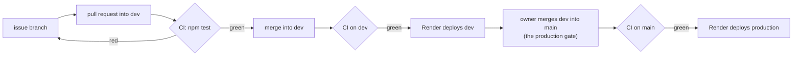

# Operations

## Environments

| | Game | Save API | Deploys |
|---|---|---|---|
| Production | https://immune-citadel-v4.onrender.com | https://immune-citadel-v4-api.onrender.com | branch `main`, after CI passes |
| Dev | https://immune-citadel-v4-dev.onrender.com | https://immune-citadel-v4-api-dev.onrender.com | branch `dev`, after CI passes |
| Local | http://localhost:8080 | http://localhost:8787 | `docker compose up` |

All on Render: two static sites, two Node web services, one Postgres with one schema per environment. `GET /health` on an API returns the commit it runs, e.g. `{"ok":true,"commit":"13c5715…"}`; Render uses it as the health check, so a broken API deploy never takes traffic.

## Releases

| Step | What | Proof |
|---|---|---|
| CI | [ci.yml](../.github/workflows/ci.yml): unit and integration tests on every pull request and every push to `dev` and `main` | PR [#30](https://github.com/alexisdacquay/immune-citadel-v4/pull/30) and [#31](https://github.com/alexisdacquay/immune-citadel-v4/pull/31) checks |
| CD to dev | Render's auto-deploy trigger "after CI checks pass" on the dev services | [#25](https://github.com/alexisdacquay/immune-citadel-v4/issues/25#issuecomment-6667755969): CI passed 19:51:17, Render started the deploy at 19:51:20, `/health` showed the commit 115 s after the merge |
| Production | the same trigger on `main`; only the owner merges `dev` into `main` | `/health` on the production API shows the commit |

**Rollback:** Render dashboard → the service → Events → Rollback on the last good deploy, or revert the change on `main` (CI, then Render, redeploy).

## Telemetry

The save API sends traces, metrics and logs to [Dash0](https://www.dash0.com) over OpenTelemetry (OTLP). Dev on Render sends them now; production will from its next release; locally only when `.env` holds the token (`.env.example`). The key journey is the cloud save (`PUT` then `GET /api/save/:code`).

- **Traces:** every API request, with its Postgres query. Spans carry the route `/api/save/:code`, never the code; client addresses are redacted; queries show `$1`, not values.
- **Metrics:** request duration by method and status; `saves_total{outcome="ok"|"failed"}`. Every signal carries `deployment.environment.name` (local, dev, production).
- **Logs:** JSON lines, each with the `trace_id` and `span_id` of its request, so a log line opens its trace.
- Code: [server/otel.js](../server/otel.js) (OpenTelemetry), [server/route.js](../server/route.js) (the redaction), [server/index.js](../server/index.js) (logs and the counter). Fast tests: [server/telemetry.test.js](../server/telemetry.test.js).

Settings on a Render API service: `OTEL_EXPORTER_OTLP_ENDPOINT=https://ingress.europe-west4.gcp.dash0.com`, `OTEL_EXPORTER_OTLP_HEADERS=Authorization=Bearer <token>`, `OTEL_SERVICE_NAME=immune-citadel-api`, `OTEL_RESOURCE_ATTRIBUTES=deployment.environment.name=<env>`.

## Alert: cloud saves failing

Defined as code in [observability/alert.js](../observability/alert.js) and created in Dash0 with `npm run alert`: fires when any save in the last 5 minutes failed with a server error, so a player's progress did not reach the cloud, and e-mails the owner. Checked every minute.

Try it locally (with `.env` set): `docker compose up`, make a save, then `docker compose stop db` and make another. Measured on 2026-11-05: three failed saves at 20:26:03 UTC, Dash0 marked the check critical at 20:27:04 (observed value 3). Then `docker compose start db`.
