# Proof, criterion by criterion

For course reviewers ([rubric](https://github.com/DataTalksClub/ai-dev-tools-zoomcamp/tree/main/project)). Each section: the rubric's words, what was built, then screenshots or raw output with links. Every link opens without a login, except GitHub Actions job logs (GitHub requires one); their key lines are quoted here.

**About this repository.** It was created on 2026-11-12 under the same name as the project's original repository, which was renamed and made private the same day, to publish the course submission without later product work. It keeps the full commit history; issues #1 to #58 were copied without their comments, each starting with a "_Copy of_" note. The original's pull requests, Actions runs and issue comments are not public, so the screenshots in [screenshots/proof/](screenshots/proof/) of issue #131, pull request #132 and run 42502143601 show the original repository under this same name; those numbers do not point to them here. Likewise, #numbers in commit messages before 2026-11-12 refer to the original repository, and GitHub links them to unrelated items here. The licence commit [`3d488f8`](https://github.com/alexisdacquay/immune-citadel-v4/commit/3d488f8) went to `main` directly during the re-creation, before the branch rules applied; every change since went through a pull request.

**Claimed: 24 of 24.** Evidence from before the re-creation was captured on 2026-11-08 in the original repository: the screenshots and the commits. Work since is live here: pull requests from [#59](https://github.com/alexisdacquay/immune-citadel-v4/pull/59) on, with their QA verdicts and CI runs, and the promotions [#69](https://github.com/alexisdacquay/immune-citadel-v4/pull/69) and [#127](https://github.com/alexisdacquay/immune-citadel-v4/pull/127).

| # | Criterion | Points | The proof in one line |
|---|---|---|---|
| [1](#1-problem-description) | Problem Description | 2 / 2 | README: the problem, what the game does, how it behaves |
| [2](#2-product-specification) | Product Specification | 2 / 2 | SPEC.md; issues with acceptance criteria; bot accounts post QA verdicts on every pull request into `dev` and, in the on-call drill, opened and worked an issue |
| [3](#3-agent-team-specification) | Agent Team Specification | 2 / 2 | 4 agents with roles and limits, one loop; their work is visible on every pull request |
| [4](#4-context-management) | Context Management | 2 / 2 | AGENTS.md points to STATUS, SPEC, TEAM, OPERATIONS |
| [5](#5-application) | Application | 2 / 2 | one command; a click in the browser lands as a row in Postgres |
| [6](#6-testing) | Testing | 2 / 2 | `npm test`: 61 unit and 5 integration tests pass, in CI on `a8e90f0` |
| [7](#7-containerization) | Containerization | 2 / 2 | `docker compose up --build`: game, API and Postgres, all healthy |
| [8](#8-deployment) | Deployment | 2 / 2 | public URL; `/health` and `/version.txt` name the live commit |
| [9](#9-cicd) | CI/CD | 3 / 3 | CI on every pull request; CD to dev on every merge; production is manual: a promotion is merged only on the owner's go for that release |
| [10](#10-observability) | Observability | 2 / 2 | one save: trace, log line and metric under one trace ID, in Sentry's UI |
| [11](#11-alerting-on-user-impact) | Alerting on User Impact | 1 / 1 | a failed save emails the owner and opens a GitHub issue |
| [12](#12-on-call-agent) | On-Call Agent | 2 / 2 | a real alert on a deliberately planted fault: the agent fixed it, live on dev 11 minutes later, no human |

## 1. Problem Description

> **2 points:** "The README clearly describes the problem, the system functionality, and expected behavior."

- **Problem:** immunology is taught as a list of names to memorise; teens learn the names without understanding what each cell does ([README, The problem](../README.md#the-problem)).
- **What it does:** a tower-defence game inside the body, 18 levels; each threat and cell is introduced when it first appears ([README, What it does](../README.md#what-it-does)).
- **Expected behaviour:** [README, Play in 30 seconds](../README.md#play-in-30-seconds) and the campaign table; full player journeys with acceptance criteria in [SPEC.md](SPEC.md).


## 2. Product Specification

> **2 points:** "A specification exists and there's a publicly accessible task tracker. The tasks define acceptance criteria and there's evidence that the agents used the tracker."

- **Specification:** [SPEC.md](SPEC.md), player journeys, each with acceptance criteria.
- **Public tracker:** [GitHub Issues](https://github.com/alexisdacquay/immune-citadel-v4/issues?q=is%3Aissue) and [merged pull requests](https://github.com/alexisdacquay/immune-citadel-v4/pulls?q=is%3Apr%20is%3Amerged). Many issues carry an "Acceptance criteria" section ([search](https://github.com/alexisdacquay/immune-citadel-v4/issues?q=is%3Aissue%20%22acceptance%20criteria%22)); most of the rest are bug reports, roadmap ideas, or early features from before that rule.
- **Agents used the tracker** (the QA and on-call agents post as bot accounts; the orchestrator posts through the owner's login, as the next bullet explains):
  - in this repository: issue [#93](https://github.com/alexisdacquay/immune-citadel-v4/issues/93), a bug with acceptance criteria → pull request [#94](https://github.com/alexisdacquay/immune-citadel-v4/pull/94), "Fixes #93", with the builder's `## QA checks` and the QA agent's verdicts as `github-actions` → "Fixed by #94" on #93 once it merged into `dev`. Every pull request into `dev` since [#59](https://github.com/alexisdacquay/immune-citadel-v4/pull/59) carries the builder's `## QA checks` and the bot's verdict;
  - in the original repository (screenshots): the on-call drill's issue, opened by `sentry[bot]` and worked by the on-call agent as `github-actions` ([screenshot](screenshots/proof/oncall-2-agent-comments.jpg), criterion 12), and the QA agent's verdict on the on-call agent's fix ([screenshot](screenshots/proof/team-qa-on-oncall-pr.jpg), criterion 3).
- **The orchestrator on issues:** it runs on the owner's machine, so GitHub shows the owner's login; the heading names the role ("Build notes", "QA verdict"), for example issue #24 in the original repository (its copy here, [#24](https://github.com/alexisdacquay/immune-citadel-v4/issues/24), has the ticked criteria but not the comments):

| Acceptance criteria, ticked when verified | The QA verdict on the same issue (posted through the owner's login) |
|---|---|
| 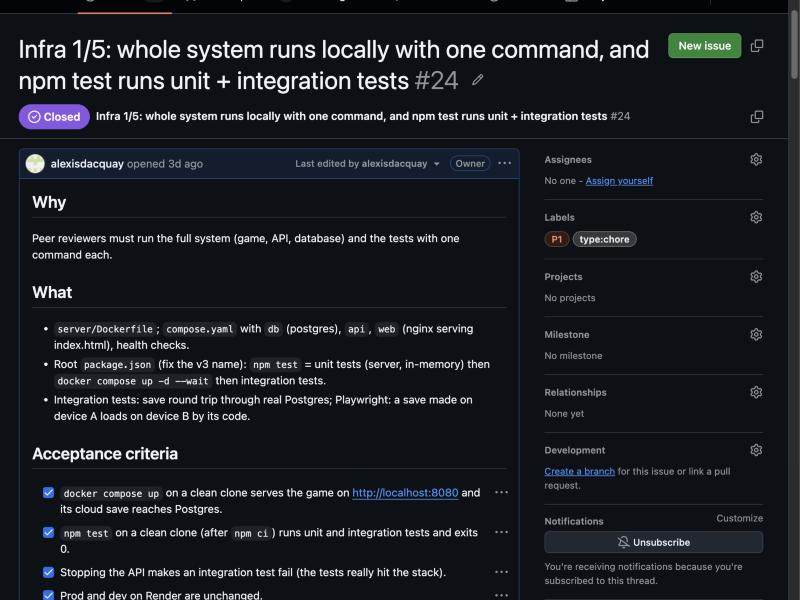 | 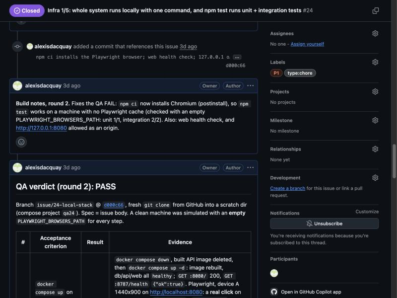 |

## 3. Agent Team Specification

> **2 points:** "The project defines the agent team and process of how they work together."

| Agent | Runs on | Does | Never does |
|---|---|---|---|
| Orchestrator | Claude Code (the main session) | specs each issue, builds it, writes its QA checks, opens the pull request | merges a promotion into `main` without the owner's go for that release |
| QA | DeepSeek, in CI on every pull request into `dev` ([tools/qa.js](../tools/qa.js)) | answers yes/no checks (required); writes an open review (advisory) | edit code |
| On-call | DeepSeek, woken by a Sentry alert ([tools/oncall.js](../tools/oncall.js)) | finds the cause, opens a fix pull request with a regression test | touch `main`, CI, dependencies, or files outside the game and the save API |
| Panels | short-lived Claude subagents, started by the orchestrator | audit a change or propose designs; a second subagent re-checks each finding | decide or merge |

**The loop** (diagram below): issue → branch → pull request → CI and the QA agent → `dev` → owner's go → `main`. An alert enters the same loop through the on-call agent. Full process: [TEAM.md](TEAM.md).


Two agents on one pull request, in this repository: on [PR #87](https://github.com/alexisdacquay/immune-citadel-v4/pull/87), the QA agent's stage 1 failed the change twice: first on past failure #73, whose question named the per-address budget the change replaces (the builder rewrote it in [#88](https://github.com/alexisdacquay/immune-citadel-v4/pull/88)), then on another pull request's QA checks, which had replaced its own in the description. With both fixed, stage 1 passed, and the builder answered the advisory review in a comment on the pull request.

In the original repository: the on-call agent's fix, judged by the QA agent, then merged automatically.

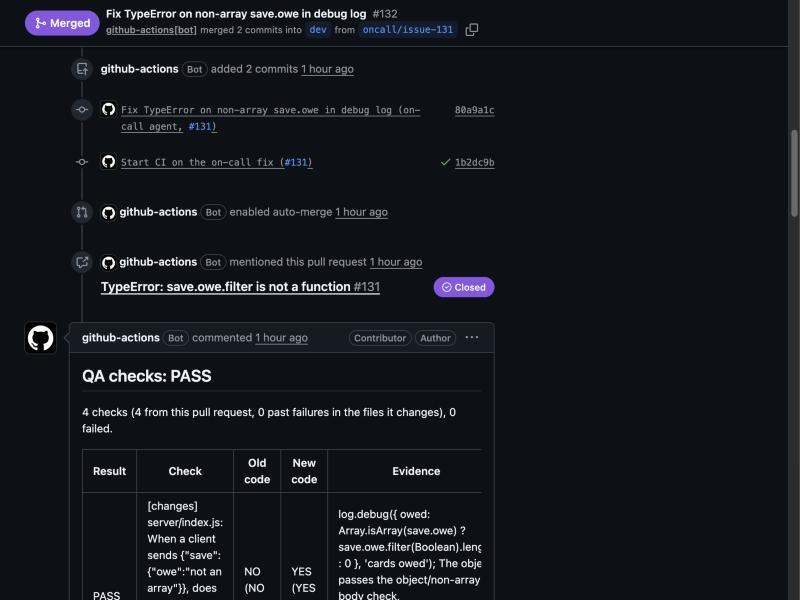

## 4. Context Management

> **2 points:** "AGENTS.md exists and it also points to modular docs (process, teams, etc.)."

[AGENTS.md](../AGENTS.md), loaded by [CLAUDE.md](../CLAUDE.md), points every agent to the modular docs:

```
$ cat CLAUDE.md
@AGENTS.md
$ grep -o 'docs/[A-Z-]*\.md' AGENTS.md | sort -u
docs/DPIA.md
docs/EVENTS.md
docs/OBSERVABILITY-PLAN.md
docs/OPERATIONS.md
docs/PIPELINE-PLAN.md
docs/SPEC.md
docs/STATUS.md
docs/TEAM.md
```

The main ones:

| Doc | What it holds |
|---|---|
| [STATUS.md](STATUS.md) | where things stand, what is next (read first) |
| [SPEC.md](SPEC.md) | player journeys and acceptance criteria |
| [TEAM.md](TEAM.md) | the agent team, the loop, QA in two stages, the test plan |
| [OPERATIONS.md](OPERATIONS.md) | environments, releases, rollback, telemetry, alerts, on-call |
| [.claude/skills/team-loop](../.claude/skills/team-loop/SKILL.md) | what "continue" means: one turn of the team loop |

## 5. Application

> **2 points:** "Full-stack application works end to end: frontend talks to backend, data persists in a database. Application runs locally with a single command."

**One command:** `docker compose up --build`, then open http://localhost:8080. Prerequisite: Docker.

Proof on a fresh clone, 2026-11-08. On the title screen, pick difficulty **HARD** (top right); the game saves to the local API by itself. (A throwaway save in the local database. The address bar is outside the screenshot; the Postgres row below shows it is the local stack.)

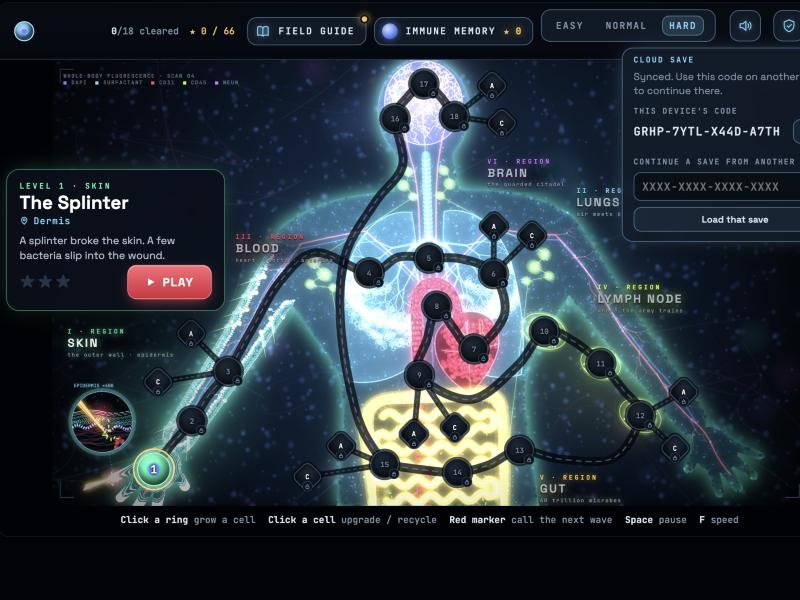

The same save, read from Postgres (codes are stored without dashes):

```
$ docker compose exec db psql -U postgres -c "SELECT code, data->>'diff' AS difficulty, updated_at FROM saves WHERE code = 'GRHP7YTLX44DA7TH';"
       code       | difficulty |          updated_at
------------------+------------+-------------------------------
 GRHP7YTLX44DA7TH | hard       | 2026-11-08 18:18:17.930521+00
(1 row)
```

Browser → save API → Postgres: the click on HARD is the `hard` in that row.

## 6. Testing

> **2 points:** "Both unit and integration tests exist, run with a single command, and pass."

**One command:** `npm test` (prerequisites: Node 22 and Docker; install once with `npm ci`). It runs the unit tests, then the integration tests on the Docker stack. Output of job `test` on `a8e90f0`, the push run on `main` after promotion #69 ([run 43270181878](https://github.com/alexisdacquay/immune-citadel-v4/actions/runs/43270181878)), trimmed:

```
> npm run test:unit && npm run test:integration
> test:unit
# tests 61
# pass 61
# fail 0
> test:integration
ok 1 - a save sent to the API is stored in Postgres and read back
ok 2 - the server prunes cloud saves untouched for 13 months, at start, and keeps newer ones
ok 3 - past the daily cap of new save codes, Postgres refuses a new code and still updates an existing save
ok 4 - gameplay events reach the events table and its views
ok 5 - progress saved on one device continues on another through its save code
# tests 5
# pass 5
# fail 0
```

- **Unit:** [server/test.js](../server/test.js), [server/observability.test.js](../server/observability.test.js) and the other files in `package.json` (`test:unit`).
- **Integration:** [test/integration.test.js](../test/integration.test.js), against the real Postgres.
- **In CI:** job `test` runs this suite on every pull request and every push to `dev` and `main`; the output above is from [run 43270181878](https://github.com/alexisdacquay/immune-citadel-v4/actions/runs/43270181878). CI also runs `npm run test:game`, a browser bot that plays all 18 levels.

## 7. Containerization

> **2 points:** "The full system, including the database, runs via Docker or Docker Compose and starts with a single command."

[compose.yaml](../compose.yaml) runs the game (nginx), the save API ([server/Dockerfile](../server/Dockerfile)) and Postgres, each with a health check. After `docker compose up --build` on a fresh clone (in a folder named `clean`, hence `clean-api`):

```
$ docker compose ps
SERVICE   IMAGE                STATUS                    PORTS
api       clean-api            Up 12 seconds (healthy)   0.0.0.0:8787->8787/tcp
db        postgres:16-alpine   Up 21 seconds (healthy)   5432/tcp
web       nginx:alpine         Up 16 seconds (healthy)   0.0.0.0:8080->80/tcp
```

## 8. Deployment

> **2 points:** "The application is deployed and reachable at a public URL, or there's a clear demo with the deployment."

- **Play it:** https://immune-citadel-v4.onrender.com
- **Live commit:** [/version.txt](https://immune-citadel-v4.onrender.com/version.txt) (the game) and [/health](https://immune-citadel-v4-api.onrender.com/health) (the save API). On 2026-11-08 both said `d3f7a43`; on 2026-11-12, after promotion [#69](https://github.com/alexisdacquay/immune-citadel-v4/pull/69), both name `a8e90f0`. Later, both name the head of [`main`](https://github.com/alexisdacquay/immune-citadel-v4/commits/main).
- **Dev:** https://immune-citadel-v4-dev.onrender.com ([/version.txt](https://immune-citadel-v4-dev.onrender.com/version.txt)) and the save API's [/health](https://immune-citadel-v4-api-dev.onrender.com/health): both name the head of [`dev`](https://github.com/alexisdacquay/immune-citadel-v4/commits/dev).
- **Infrastructure as code:** [render.yaml](../render.yaml): the game site, the save API and Postgres, for dev and for production.

Production, 2026-11-12, after promotion #69:

```
$ curl -s -o /dev/null -w '%{http_code}\n' https://immune-citadel-v4.onrender.com/
200
$ curl -s https://immune-citadel-v4.onrender.com/version.txt
a8e90f0c8d2fe992d225764820f46d0320f84b61
$ curl -s https://immune-citadel-v4-api.onrender.com/health
{"ok":true,"commit":"a8e90f0c8d2fe992d225764820f46d0320f84b61"}
```

## 9. CI/CD

> **3 points:** "CI runs tests, CD deploys to dev, and there's a manual deploy to production."

| Step | What happens | Proof |
|---|---|---|
| CI | every pull request runs `test` (unit and integration) and `game` (the bot plays every level; skipped when a pull request changes only `docs/` or `*.md` files); every pull request into `dev` also runs `qa` (the QA agent) | [ci.yml](../.github/workflows/ci.yml); the green checks on the on-call agent's fix ([screenshot](screenshots/proof/team-qa-on-oncall-pr.jpg)) |
| CD to dev | a green pull request merges into `dev`; Render deploys every commit on `dev`; CI's `deployed` job waits until the live site serves it, then tests it | [render.yaml](../render.yaml) (`branch: dev`, `autoDeployTrigger: commit`); [a dev run, `deployed` green](https://github.com/alexisdacquay/immune-citadel-v4/actions/runs/43239236141) |
| Manual deploy to production | production is manual: a promotion pull request (`dev` → `main`) is merged only on the owner's go for that release; nothing merges into `main` automatically | [promotion PR #69](https://github.com/alexisdacquay/immune-citadel-v4/pull/69) and [its run on `main`](https://github.com/alexisdacquay/immune-citadel-v4/actions/runs/43270181878); [rulesets](https://github.com/alexisdacquay/immune-citadel-v4/rules), [STATUS, Promotions](STATUS.md#promotions) |
| Rollback | redeploy the last good commit in Render, or revert the pull request | [OPERATIONS, Rollback](OPERATIONS.md#rollback) |

- **The merge is the manual step:** Render deploys `main` on merge, and nothing automatic targets `main`. [tools/automerge.sh](../tools/automerge.sh) refuses any base but `dev`. No workflow, schedule or auto-merge merges into `main`: [ci.yml](../.github/workflows/ci.yml) and [promotion.yml](../.github/workflows/promotion.yml) only run checks, and [oncall.yml](../.github/workflows/oncall.yml) opens pull requests into `dev`.
- **GitHub enforces** on `main` (ruleset 27124774, [main.json](../.github/rulesets/main.json)): a pull request only, up to date, with `test`, `game` and `dev-green` green. The owner's go is a team rule, which GitHub does not enforce.
- **A promotion made in this repository:** [PR #69](https://github.com/alexisdacquay/immune-citadel-v4/pull/69), `dev` → `main`, merged by hand on 2026-11-12 at 17:30 UTC as [`a8e90f0`](https://github.com/alexisdacquay/immune-citadel-v4/commit/a8e90f0), with no auto-merge armed on it. Before it, `dev`'s own run on the promoted commit `e322752` was green ([run 43268129015](https://github.com/alexisdacquay/immune-citadel-v4/actions/runs/43268129015)). After it, the push run on `main` ran `test`, `game` and `deployed` green ([run 43270181878](https://github.com/alexisdacquay/immune-citadel-v4/actions/runs/43270181878)); Render deployed `a8e90f0` by itself.
- **Earlier promotions** were merged in the original repository, whose pull requests are not public; [STATUS, Promotions](STATUS.md#promotions) lists each one by its merge commit on `main` here.

The rules on `dev` and `main`:

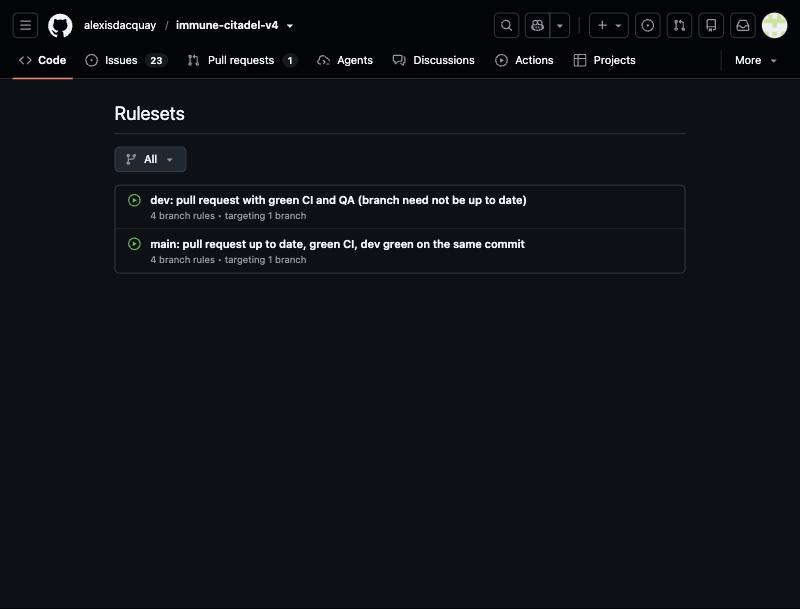

After promotion #69 (`a8e90f0`), the push run on `main` ([run 43270181878](https://github.com/alexisdacquay/immune-citadel-v4/actions/runs/43270181878)) ran the tests, then checked production itself. `qa` and `qa-review` run on pull requests into `dev` only, so they show as skipped on this push run. Its `deployed` job ([log](https://github.com/alexisdacquay/immune-citadel-v4/actions/runs/43270181878/job/131364323582)) printed:

```
SMOKE PASS https://immune-citadel-v4.onrender.com at a8e90f0c8d2fe992d225764820f46d0320f84b61: 4 Sentry requests held back, no player data in them; with play stats off or GPC, crash reports and no traces
```

It means: the smoke test catches the page's Sentry requests ("held back") and inspects them; with play stats off, or Global Privacy Control (a browser's opt-out signal) on, only crash reports are sent.

## 10. Observability

> **2 points:** "A key user journey is instrumented with metrics, traces, and structured logs that share a trace ID; no customer data or credentials are sent to telemetry; and the signals are collected, stored, and viewable in a UI."

**The journey:** a cloud save, as the save API handles it (the browser's request is not joined to the trace). One real save on dev, trace `e273c17a1ecc4b94b4627985857338e4`:

| Signal | Where | Proof |
|---|---|---|
| Trace | Sentry: the request and its Postgres spans | screenshot 1 |
| Structured log | Sentry Logs, found by the same trace ID; the same JSON line is in Render's logs (login needed): `{"trace_id":"e273c17a1ecc4b94b4627985857338e4","method":"PUT","route":"/api/save/:code","status":200,"ms":53,"msg":"request"}` | screenshot 2 |
| Metric | Sentry: `http.server.request.duration`, same trace ID | screenshot 3 |

**1. Trace:** the request and its Postgres spans (4 spans, 1 log, 1 metric).

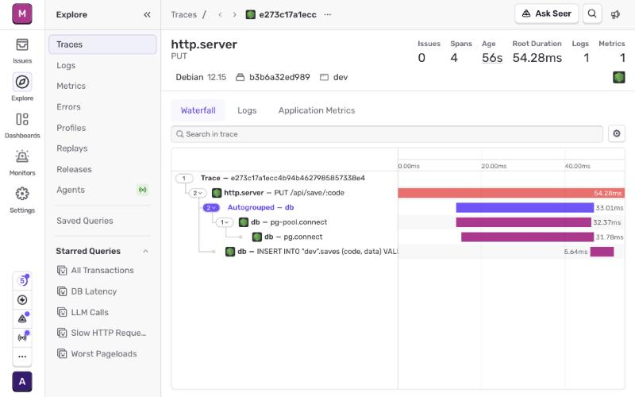

**2. Log:** Sentry Logs filtered on the same trace ID.

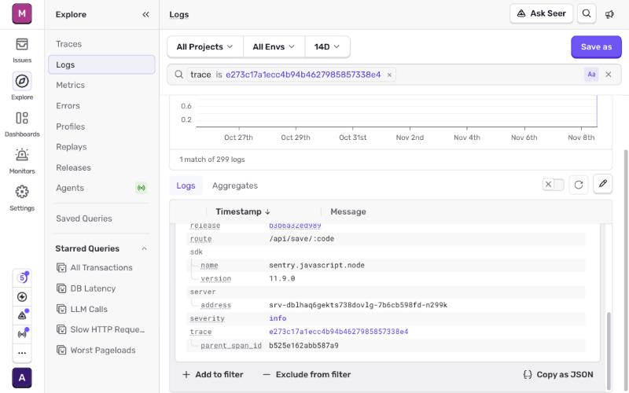

**3. Metric:** the duration sample of the same trace (53 ms, status 200).

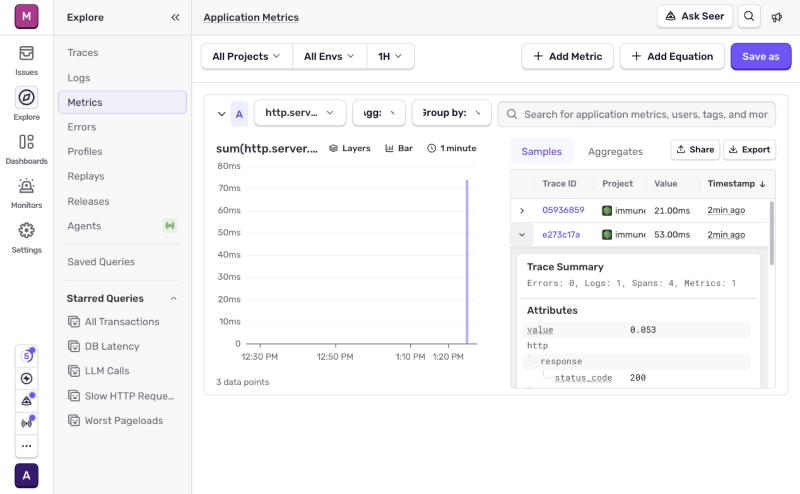

**No customer data or credentials:**
- the save code, the only key to a save, is replaced by `:code` everywhere;
- no IP, no user agent, no request headers (so no cookies), no save content;
- SQL in spans has placeholders only (`VALUES ($1, $2)`); values are never sent;
- the API has no passwords or tokens to send.

Checked by [server/observability.test.js](../server/observability.test.js) on every pull request and by CI's smoke test after every deploy (the `SMOKE PASS` line in [criterion 9](#9-cicd)).

## 11. Alerting on User Impact

> **1 point:** "At least one alert exists." The course asks to alert "on real user impact instead of CPU graphs".

- **The user impact:** a player's save or load fails.
- **The alert:** any save API error emails the owner and opens a GitHub issue, which wakes the on-call agent ([observability/sentry-alert.json](../observability/sentry-alert.json)).
- **Fired twice:** 2026-11-06 (database stopped on purpose, local stack) and 2026-11-08 (the drill, criterion 12).
- **Also:** a game crash emails the owner, in dev and production ([observability/sentry-game-alert.json](../observability/sentry-game-alert.json)), and Better Stack emails when a site or an API is down.

| Its two firings | Its two actions: email the owner ("Notify Al", the owner's Sentry name) and open a GitHub issue |
|---|---|
| 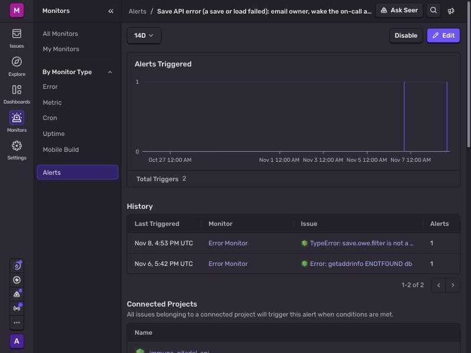 | 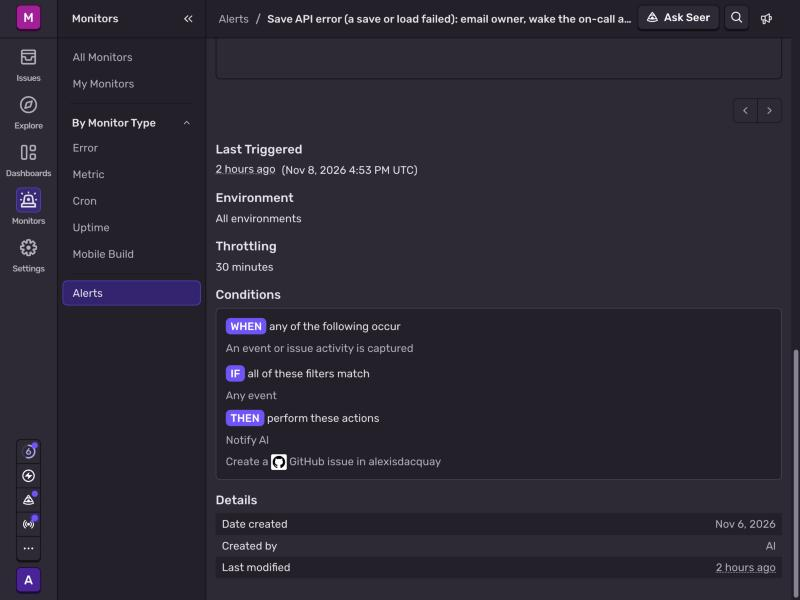 |

## 12. On-Call Agent

> **2 points:** "An agent wakes up on an alert and fixes the issue."

**First drill, 2026-11-08, on dev, in the project's original repository.** Its issue, pull requests and runs are not public here; the evidence is the screenshots in [screenshots/proof/](screenshots/proof/) ([1](screenshots/proof/oncall-1-issue-by-sentry.jpg), [2](screenshots/proof/oncall-2-agent-comments.jpg), [3](screenshots/proof/oncall-3-fix-pr-merged.jpg), below) and its public trace here: the fix's two commits, authored by `immune-citadel on-call agent` ([80a9a1c](https://github.com/alexisdacquay/immune-citadel-v4/commit/80a9a1c), [1b2dc9b](https://github.com/alexisdacquay/immune-citadel-v4/commit/1b2dc9b)), and their merge into `dev` by `github-actions[bot]` ([411f62b](https://github.com/alexisdacquay/immune-citadel-v4/commit/411f62b)). [#58](https://github.com/alexisdacquay/immune-citadel-v4/issues/58) is the drill's issue as copied here; its two comments are an on-call run on 2026-11-12, before Sentry access was connected to this repository, not part of the drill.

The only known 500, a deeply nested save ([#57](https://github.com/alexisdacquay/immune-citadel-v4/issues/57)), did not reproduce on Render, so a fault was planted on purpose ([d70e778](https://github.com/alexisdacquay/immune-citadel-v4/commit/d70e778)). The agent was never told about it: its prompt is built only from the Sentry event and the files its stack trace names ([tools/oncall.js](../tools/oncall.js), `incident()` and `sourceContext()`); its first comment on the issue lists them ([screenshot 2](screenshots/proof/oncall-2-agent-comments.jpg)): `server/index.js`, `server/test.js`. Before its fix, `PUT {"save":{"owe":"x"}}` answered 500 on dev; after it, 200.

| Time (UTC) | Step |
|---|---|
| 16:52:52 | a crafted save hits the fault: the API answers 500 |
| 16:53:05 | the alert fires |
| 16:53:06 | Sentry opens the issue ([screenshot 1](screenshots/proof/oncall-1-issue-by-sentry.jpg)) |
| 16:53:13 | GitHub starts [the On-call run](screenshots/proof/oncall-2-agent-comments.jpg) on that issue's `opened` event: no polling, no schedule ([oncall.yml](../.github/workflows/oncall.yml), `on: issues`) |
| 16:53:22 | the agent reports on the issue |
| 16:54:40 | it opens the fix ([screenshot 3](screenshots/proof/oncall-3-fix-pr-merged.jpg)), with a regression test |
| 17:02:00 | CI and the QA agent pass; the fix merges itself into `dev` |
| 17:04:06 | live: dev's `/health` names the fix's merge `411f62b`, and the crafted save answers 200 (checked afterwards with curl; nothing was done to the system). The next dev run's `deployed` job covers it. |
| 17:29:17 | promoted to production: merge [`d3f7a43`](https://github.com/alexisdacquay/immune-citadel-v4/commit/d3f7a43) |

**11 minutes from the error to the fix live, no human in the loop.** The agent's whole fix ([diff](https://github.com/alexisdacquay/immune-citadel-v4/commit/80a9a1c)):

```diff
# server/index.js (the fix)
-        log.debug({ owed: save.owe ? save.owe.filter(Boolean).length : 0 }, 'cards owed');
+        log.debug({ owed: Array.isArray(save.owe) ? save.owe.filter(Boolean).length : 0 }, 'cards owed');
# server/test.js (the regression test)
+  assert.equal((await put(code, { save: { owe: 'not an array' } })).status, 200, 'non-array owe is not a server error');
```

The fix removes the 500. Rejecting a non-list `owe` outright was a separate issue, [#51](https://github.com/alexisdacquay/immune-citadel-v4/issues/51), since fixed by [#61](https://github.com/alexisdacquay/immune-citadel-v4/pull/61).

| 1. The alert opens an issue | 2. The agent reports on it | 3. Its fix, merged by the bot |
|---|---|---|
| 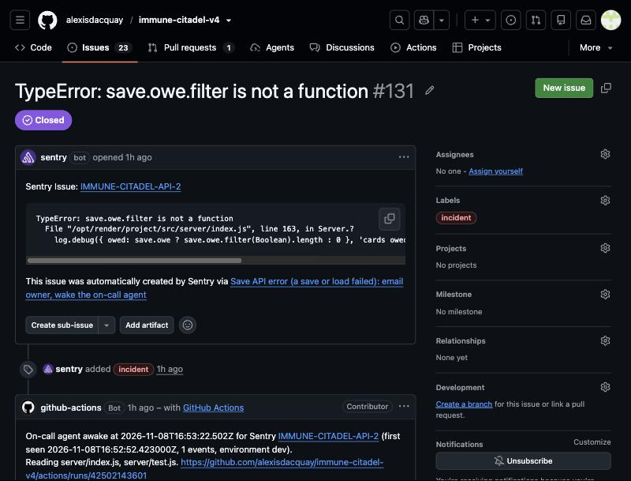 | 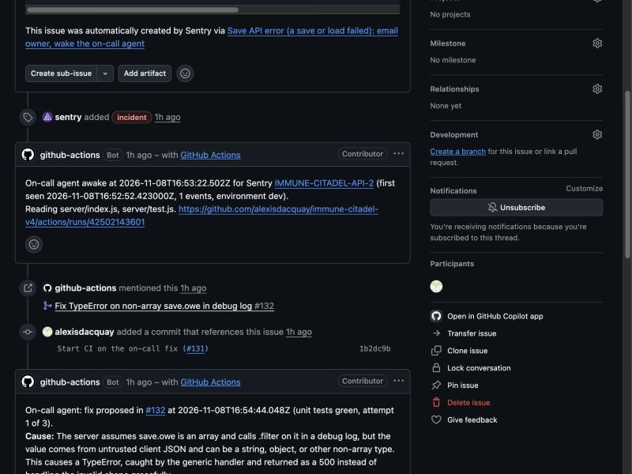 | ![PR #132, merged by github-actions[bot] into dev](screenshots/proof/oncall-3-fix-pr-merged.jpg) |

GitHub labels the push of the second commit, [1b2dc9b](https://github.com/alexisdacquay/immune-citadel-v4/commit/1b2dc9b), "alexisdacquay" (screenshot 2) because the agent pushes with the repository's deploy key: a push with GitHub's own token starts no CI.

How it works and its safeguards: [OPERATIONS, On-call agent](OPERATIONS.md#on-call-agent).
