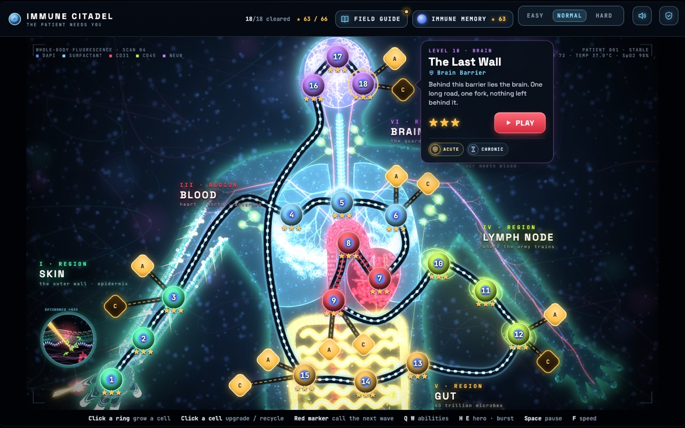
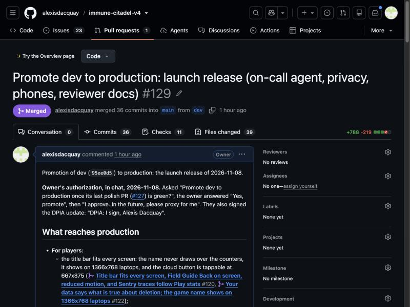
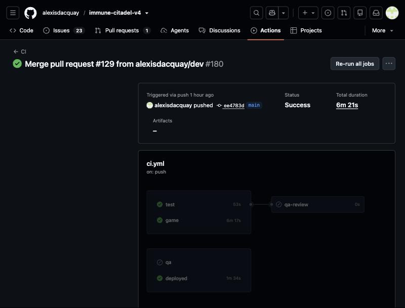
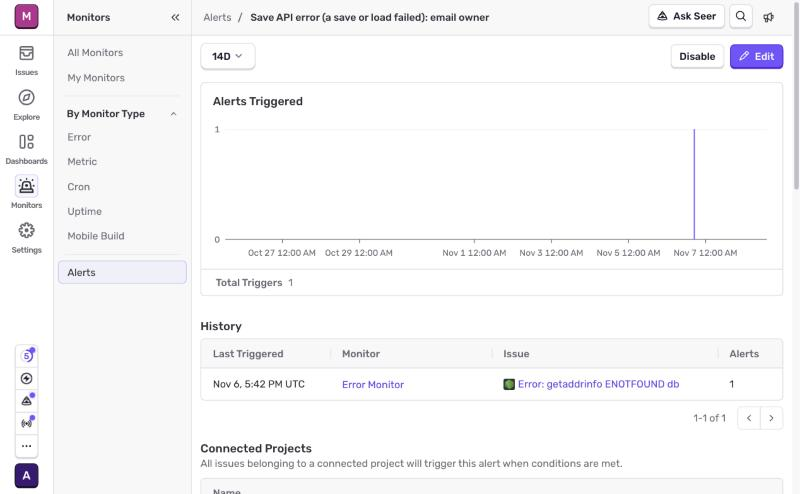

# Proof, criterion by criterion

For course reviewers ([rubric](https://github.com/DataTalksClub/ai-dev-tools-zoomcamp/tree/main/project)). Each section gives the rubric's words, what was built, a screenshot or raw output, and a check you can run in under a minute. Every link opens without a login.

**Claimed: 24 of 24.** Evidence captured on 2026-11-08.

| # | Criterion | Points | The proof in one line |
|---|---|---|---|
| [1](#1-problem-description) | Problem description | 2 / 2 | README opens with the problem, what the game does and how it behaves |
| [2](#2-product-specification) | Product specification | 2 / 2 | SPEC.md; 58 public issues with acceptance criteria; agents' specs and QA verdicts on them |
| [3](#3-agent-team) | Agent team | 2 / 2 | 4 agents with roles, rules and one loop; their work is visible on every pull request |
| [4](#4-context-management) | Context management | 2 / 2 | AGENTS.md points to STATUS, SPEC, TEAM, OPERATIONS and skills |
| [5](#5-application) | Application | 2 / 2 | one command; a click in the browser lands as a row in Postgres |
| [6](#6-testing) | Testing | 2 / 2 | `npm test`: 46 unit and 4 integration tests pass on a fresh clone |
| [7](#7-containerization) | Containerization | 2 / 2 | `docker compose up --build`: game, API and Postgres, all healthy |
| [8](#8-deployment) | Deployment | 2 / 2 | public URL; `/health` and `/version.txt` name the live commit |
| [9](#9-cicd) | CI/CD | 3 / 3 | CI on every pull request; CD to dev on every merge; production only by an approved pull request |
| [10](#10-observability) | Observability | 2 / 2 | one save: trace, log line and metric under one trace ID, in Sentry's UI |
| [11](#11-alerting-on-user-impact) | Alerting on user impact | 1 / 1 | a failed save emails the owner and opens a GitHub issue |
| [12](#12-on-call-agent) | On-call agent | 2 / 2 | a real alert was fixed by the agent and live on dev 11 minutes later, with no human |

## 1. Problem description

> **2 points:** "The README clearly describes the problem, the system functionality, and expected behavior."

- **Problem:** immunology is taught as a list of names to memorise; teens learn the names without understanding what each cell does ([README, The problem](../README.md#the-problem)).
- **What it does:** a tower-defence game inside the body; 18 levels; each threat and cell is introduced when it first appears ([README, What it does](../README.md#what-it-does)).
- **Expected behaviour:** written as player journeys with acceptance criteria in [SPEC.md](SPEC.md).



## 2. Product specification

> **2 points:** "A specification exists and there's a publicly accessible task tracker. The tasks define acceptance criteria and there's evidence that the agents used the tracker."

- **Specification:** [SPEC.md](SPEC.md), player journeys, each with acceptance criteria.
- **Public tracker:** [GitHub Issues](https://github.com/alexisdacquay/immune-citadel-v4/issues?q=is%3Aissue): 58 issues, 35 closed, and 73 merged pull requests.
- **Tasks with acceptance criteria:** for example [#24](https://github.com/alexisdacquay/immune-citadel-v4/issues/24) (below).
- **Agents used the tracker:** the agents post their spec, build notes and QA verdicts on the issues, for example [#24](https://github.com/alexisdacquay/immune-citadel-v4/issues/24) and [#21](https://github.com/alexisdacquay/immune-citadel-v4/issues/21). The CI agents post as `github-actions` on pull requests. The on-call agent worked [#131](https://github.com/alexisdacquay/immune-citadel-v4/issues/131) on its own (criterion 12). Agents running on the owner's machine post through the owner's login, with a heading that names the role ("Build notes", "QA verdict").

| Acceptance criteria, ticked when verified | The QA verdict on the same issue |
|---|---|
|  |  |

## 3. Agent team

> **2 points:** "The project defines the agent team and process of how they work together."

| Agent | Runs on | Does | Never does |
|---|---|---|---|
| Orchestrator | Claude Code (main session) | specs each issue, builds it, writes the test plan, opens the pull request | merges into production without the owner's written go |
| QA | DeepSeek, in CI on every pull request into `dev` ([tools/qa.js](../tools/qa.js)) | stage 1 (required): closed YES/NO checks; stage 2: an open review | edit code |
| On-call | DeepSeek, woken by a Sentry alert ([tools/oncall.js](../tools/oncall.js)) | finds the cause, opens a fix pull request with a regression test | touch `main`, CI, dependencies, or any file outside the game and the save API |
| Panels | short-lived Claude subagents | independent audits and design options, each finding checked by a skeptic | decide |

How they work together, in full: [TEAM.md](TEAM.md). Below, two agents on one pull request: the on-call agent's fix, judged by the QA agent, then merged automatically.


## 4. Context management

> **2 points:** "AGENTS.md exists and it also points to modular docs (process, teams, etc.)."

[AGENTS.md](../AGENTS.md), loaded by [CLAUDE.md](../CLAUDE.md), points every agent to:

| Doc | What it holds |
|---|---|
| [STATUS.md](STATUS.md) | where things stand, what is next (read first) |
| [SPEC.md](SPEC.md) | player journeys and acceptance criteria |
| [TEAM.md](TEAM.md) | the agent team, the loop, QA in two stages, the test plan |
| [OPERATIONS.md](OPERATIONS.md) | environments, releases, rollback, telemetry, alerts, on-call |
| [.claude/skills/team-loop](../.claude/skills/team-loop/SKILL.md) | what "continue" means: one turn of the team loop |

## 5. Application

> **2 points:** "Full-stack application works end to end: frontend talks to backend, data persists in a database. Application runs locally with a single command."

**One command:** `docker compose up --build`, then open http://localhost:8080.

Proof, on a fresh clone (2026-11-08). In the browser, pick **HARD**, and the game saves to the cloud by itself:


The same save, read from Postgres:

```
$ docker compose exec db psql -U postgres -c "SELECT code, data->>'diff' AS difficulty, updated_at FROM saves WHERE code = 'GRHP7YTLX44DA7TH';"
       code       | difficulty |          updated_at
------------------+------------+-------------------------------
 GRHP7YTLX44DA7TH | hard       | 2026-11-08 18:18:17.930521+00
(1 row)
```

Browser, then API, then database: the click on HARD is the `hard` in that row.

## 6. Testing

> **2 points:** "Both unit and integration tests exist, run with a single command, and pass."

**One command:** `npm test` (unit tests first, then integration tests on the Docker stack). Output on a fresh clone (2026-11-08, `d3f7a43`), trimmed:

```
$ npm test
ℹ tests 46
ℹ pass 46
ℹ fail 0
✔ a save sent to the API is stored in Postgres and read back
✔ the server prunes cloud saves untouched for 13 months, at start, and keeps newer ones
✔ gameplay events reach the events table and its views
✔ progress saved on one device continues on another through its save code
ℹ tests 4
ℹ pass 4
ℹ fail 0
```

- **Unit:** [server/test.js](../server/test.js), [server/observability.test.js](../server/observability.test.js) and the other files listed in `package.json` (`test:unit`).
- **Integration:** [test/integration.test.js](../test/integration.test.js), against the real Postgres.
- **Also:** `npm run test:game`, a browser bot that plays all 18 levels. CI runs all three on every pull request (criterion 9).

## 7. Containerization

> **2 points:** "The full system, including the database, runs via Docker or Docker Compose and starts with a single command."

[compose.yaml](../compose.yaml) runs the game (nginx), the save API ([server/Dockerfile](../server/Dockerfile)) and Postgres, each with a health check. After `docker compose up --build` on a fresh clone:

```
$ docker compose ps
SERVICE   IMAGE                STATUS                    PORTS
api       clean-api            Up 12 seconds (healthy)   0.0.0.0:8787->8787/tcp
db        postgres:16-alpine   Up 21 seconds (healthy)   5432/tcp
web       nginx:alpine         Up 16 seconds (healthy)   0.0.0.0:8080->80/tcp
```

## 8. Deployment

> **2 points:** "The application is deployed and reachable at a public URL."

- **Play it:** https://immune-citadel-v4.onrender.com
- **Live commit:** [/version.txt](https://immune-citadel-v4.onrender.com/version.txt) (the game) and [/health](https://immune-citadel-v4-api.onrender.com/health) (the save API). On 2026-11-08 both said `d3f7a43`, the head of `main`.
- **Dev:** https://immune-citadel-v4-dev.onrender.com, same checks.
- **Infrastructure as code:** [render.yaml](../render.yaml) declares all six Render resources.

## 9. CI/CD

> **3 points:** "CI runs tests, CD deploys to dev, and there's a manual deploy to production."

| Step | What happens | Proof |
|---|---|---|
| CI | every pull request runs `test` (unit and integration), `game` (the bot plays every level) and `qa` (the QA agent) | [.github/workflows/ci.yml](../.github/workflows/ci.yml) |
| CD to dev | a pull request merges into `dev` when green, and Render deploys `dev` automatically; CI's `deployed` job then checks the live site | [OPERATIONS, Releases](OPERATIONS.md#releases) |
| Manual deploy to production | only a promotion pull request into `main`, which needs green CI, `dev` green on the same commit, and the owner's written approval | [rulesets](https://github.com/alexisdacquay/immune-citadel-v4/rules), [promotion #129](https://github.com/alexisdacquay/immune-citadel-v4/pull/129) |
| Rollback | redeploy the last good commit in Render, or revert the pull request | [OPERATIONS, Rollback](OPERATIONS.md#rollback) |

| The rules on `dev` and `main` | A promotion, approved in writing by the owner |
|---|---|
|  |  |

After the merge, CI on `main` ran the tests, then checked production itself:



```
SMOKE PASS https://immune-citadel-v4.onrender.com at d3f7a43d47fbddd870a453b291ac7a7a6aae11b1: 4 Sentry requests held back, no player data in them; with play stats off or GPC, crash reports and no traces
```

## 10. Observability

> **2 points:** "A key user journey is instrumented with metrics, traces, and structured logs that share a trace ID; no customer data or credentials are sent to telemetry; and the signals are collected, stored, and viewable in a UI."

**The journey:** a cloud save. One real save on dev, trace `e273c17a1ecc4b94b4627985857338e4`:

| Signal | Where | Proof |
|---|---|---|
| Structured log | Render's log line (JSON) | `{"trace_id":"e273c17a1ecc4b94b4627985857338e4","method":"PUT","route":"/api/save/:code","status":200,"ms":53,"msg":"request"}` |
| Trace | Sentry: the request and its Postgres spans | screenshot 1 |
| Log | Sentry Logs, found by the same trace ID | screenshot 2 |
| Metric | Sentry: `http.server.request.duration`, same trace ID | screenshot 3 |


**No customer data:** the save code is replaced by `:code` everywhere, and there is no IP, user agent or save content. This is checked three ways: [server/observability.test.js](../server/observability.test.js) on every pull request, CI's smoke test after every deploy (the `SMOKE PASS` line in [criterion 9](#9-cicd)), and the screenshots above.

## 11. Alerting on user impact

> **1 point:** "At least one alert exists." The course asks to alert "on real user impact instead of CPU graphs".

- **The user impact:** a player's save or load fails.
- **The alert:** any save API error emails the owner and opens a GitHub issue, which wakes the on-call agent ([observability/sentry-alert.json](../observability/sentry-alert.json)).
- **Also:** a game crash emails the owner, in dev and production ([observability/sentry-game-alert.json](../observability/sentry-game-alert.json)), and Better Stack emails when a site or an API is down.



## 12. On-call agent

> **2 points:** "An agent wakes up on an alert and fixes the issue."

First drill, 2026-11-08, on dev. A fault was planted on purpose ([#130](https://github.com/alexisdacquay/immune-citadel-v4/pull/130)), and then:

| Time (UTC) | Step |
|---|---|
| 16:52:52 | a crafted save hits the fault: the API answers 500 |
| 16:53:05 | the alert fires |
| 16:53:06 | Sentry opens issue [#131](https://github.com/alexisdacquay/immune-citadel-v4/issues/131) |
| 16:53:22 | the on-call agent wakes and reports on the issue |
| 16:54:40 | it opens fix [#132](https://github.com/alexisdacquay/immune-citadel-v4/pull/132), with a regression test |
| 17:02:00 | CI and the QA agent pass, and the fix merges itself into `dev` |
| 17:04:06 | the fix is live: the same request answers 200 |

**11 minutes from the error to the fix live, with no human in the loop.**

| 1. The alert opens an issue | 2. The agent reports on it | 3. Its fix, merged by the bot |
|---|---|---|
|  |  | ![PR #132, merged by github-actions[bot] into dev](screenshots/proof/oncall-3-fix-pr-merged.jpg) |

How it works and its safeguards: [OPERATIONS, On-call agent](OPERATIONS.md#on-call-agent). The workflow: [.github/workflows/oncall.yml](../.github/workflows/oncall.yml).
