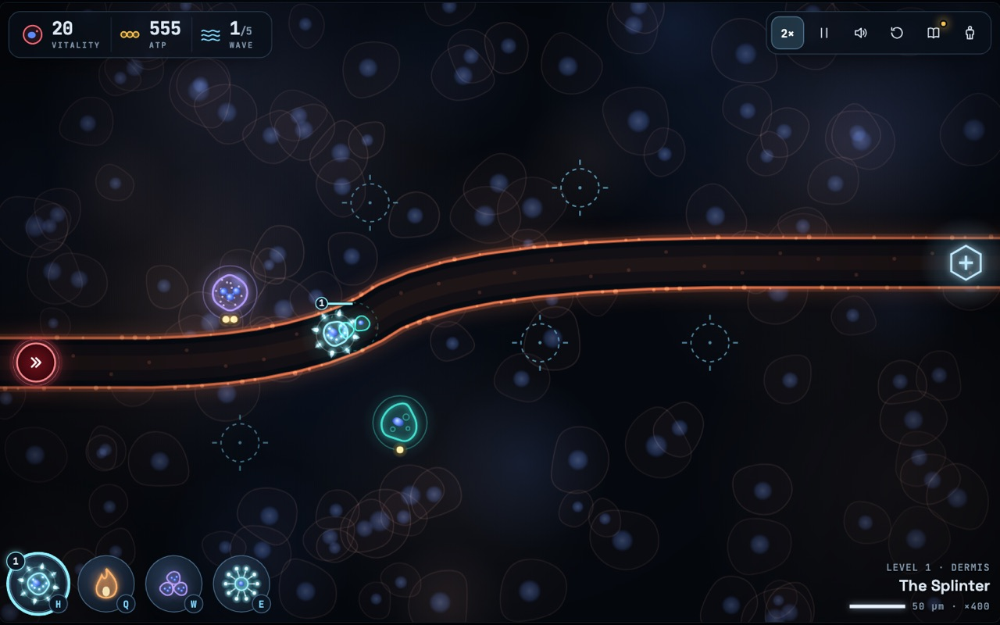
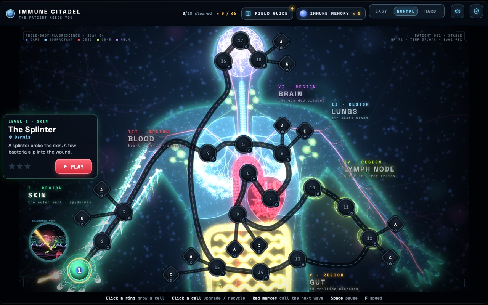
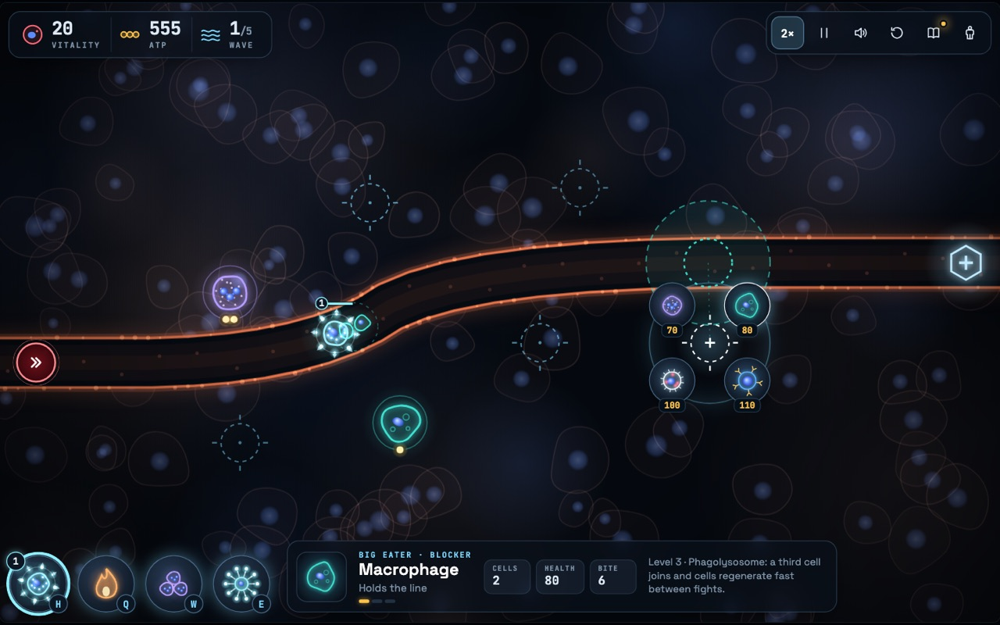
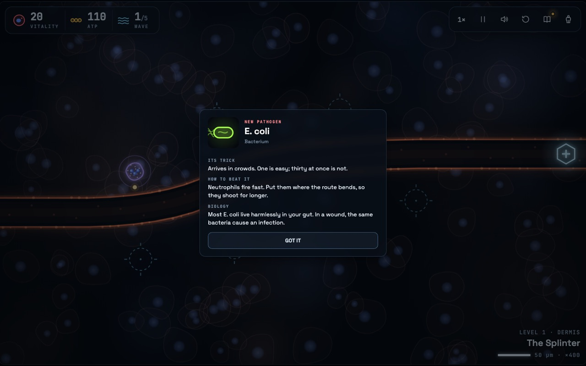
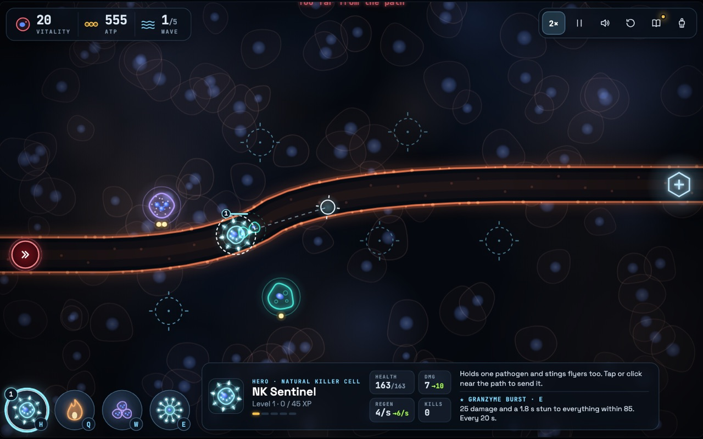
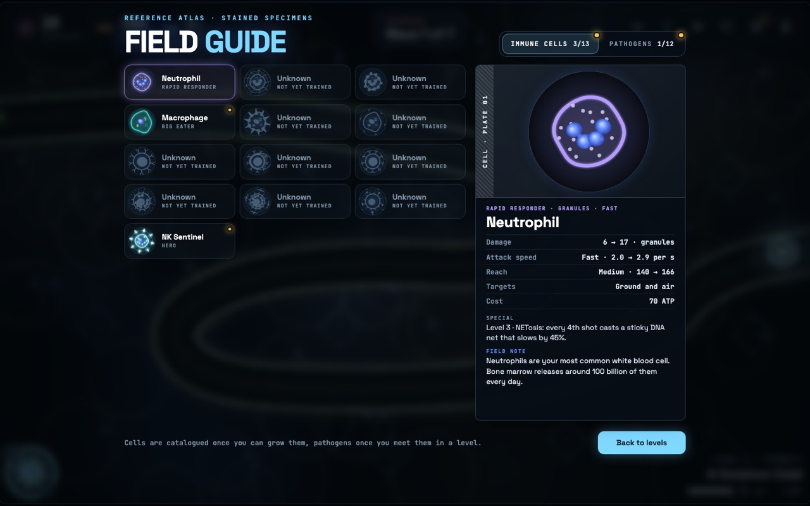
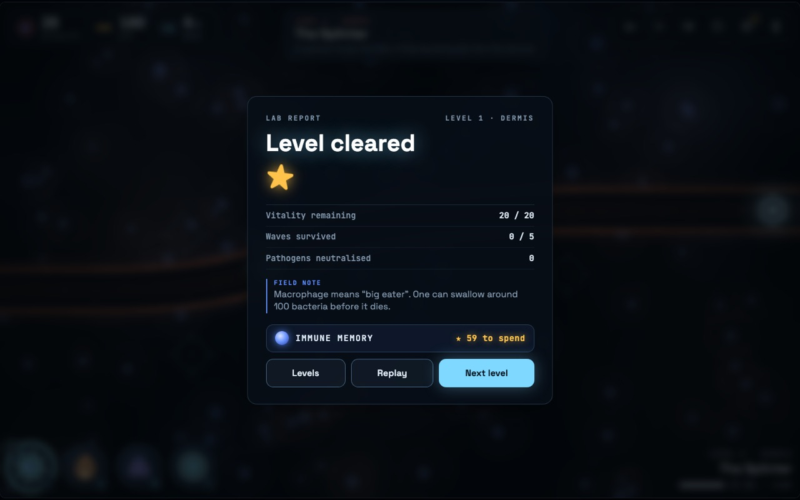
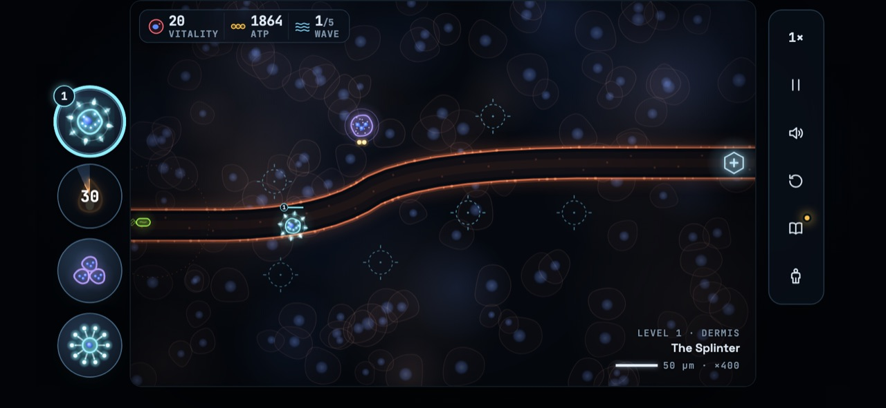

# Product specification

What the game must do for its players, written as player journeys with acceptance criteria. Each criterion below describes the game as it is: checked against `index.html` on 2026-11-08, the same game file on `dev` and in production since the promotion of 2026-11-08 (fonts #108, smoke #107). What is known and not built yet is listed at the end, under [Not built yet](#not-built-yet).

| | |
|---|---|
| **Who** | teens aged 12-15, playing in a browser on a laptop, tablet or phone, at home or in class |
| **Goal** | they come out able to say what each main immune cell does and why the body needs several kinds, because the game only rewards using each cell for what it is really good at |
| **Content rules** | fun first, honest always. On-screen words are immune-system words (no "tower", "magic", "armour"). Where the game bends real biology for play, an "In reality" note says how |
| **Backlog** | [GitHub issues](https://github.com/alexisdacquay/immune-citadel-v4/issues); each issue carries its own acceptance criteria |

## Words on screen and in the code

The player sees immune-system words; the code keeps some older names. Issues, saves and gameplay events use the code names, so a new contributor needs both.

| On screen | In the code and data |
|---|---|
| Level 1 to 18 | specimen (`SPECIMENS`, `LEVELS`, index 0 to 17) |
| Acute challenge | `heroic` |
| Chronic challenge | `iron` |
| cell (Neutrophil, Macrophage, B Cell, Killer T Cell) | tower (`TOWERS`); "tower" is never shown |
| ATP | `gold` |
| vitality | `lives` |
| body map | `renderMap`, `renderTray` |
| field note: a first-play tip, the fact on a lab report, the fact on a Field Guide plate | `HINTS`, `NOTES`, `FACTS` |
| intro card | `INTRO` |
| Immune Memory | `MEMORY`, `save.mem` |

## 1. First play

A new player can start and understand the first level without reading instructions.

*The title screen is the body map. A new player's first level is already selected.*

- The title screen opens on Level 1, The Splinter, ready to play: no account and no save needed.
- A first-time player has only the Neutrophil: no hero and no abilities until they join (table in [The campaign](#2-the-campaign)).
- On Levels 1 and 2 every wave waits for the player's call, so a new player can plan. From Level 3 the first wave still waits; after it, each wave starts on its own when the wave marker's ring runs out, and calling early earns bonus ATP.
- Field notes (first-play tips) appear one at a time on Levels 1 to 4, beside what they point at and never over it: where to grow a cell and how to call a wave (Level 1), how to upgrade (Level 2), timed waves (Level 3), the hero (Level 4). Each shows once, play goes on underneath, and a returning player never sees them.
- The first time a pathogen arrives, or a later level adds something new (a cell, an ability, the hero, its skill or a pair of specialists), the game pauses on an intro card: its trick (or what it does), how to beat it (or how to use it), the biology and, where the game bends biology, an "In reality" note. There are 21 intro cards: 10 pathogens and 11 additions.
- A lost level ("Host overrun") offers Try again at once.

| Grow a cell | Meet a pathogen |
|---|---|
|  |  |

*The screenshots of Level 1 come from a player who has unlocked every cell. On a first play the build menu offers the Neutrophil alone, and there are no hero or ability buttons.*

## 2. The campaign

The player crosses the body in 18 levels: six regions, three levels each, along the infection's path on the body map.

- Winning a level unlocks the next. A lost level can be retried, and a cleared one replayed.
- A campaign level starts with 20 vitality; each pathogen that breaks through costs some. A win earns 1 to 3 stars: 3 with 18 or more vitality left, 2 with 10 or more, else 1. The lab report says what the next star needs.
- Each level has its own route layout. The third level of each region is that region's full map and hosts its challenges.
- Each level adds at most one new cell, ability, hero skill or pair of specialists (table below). From Level 3 a new pathogen first arrives alone, in wave 3; the two bosses come in the last wave.
- Cells upgrade to level 3. A level-3 cell can then specialize into one of two forms, once its line's specialists have joined (Levels 10, 11, 15 and 17).
- The hero, the NK Sentinel, joins at Level 4: the player sends it anywhere near the route, and it levels up (to 5) as it fights. Its Granzyme Burst joins at Level 5.
- Every level can be won with only the cells unlocked by then and no Memory upgrades: on every test run a bot plays every level that way, then again with every upgrade.
- Difficulty (Easy, Normal, Hard, on the title bar) changes pathogen health, the spacing inside a wave and the time between waves. It is kept in the save.

| Level | Region · place | Name | New on this level |
|---|---|---|---|
| 1 | Skin · Dermis | The Splinter | Neutrophil · E. coli |
| 2 | Skin · Dermis | Day Two | Macrophage |
| **3** | Skin · Dermis | Breach at the Barrier | Staph aureus · waves start on their own |
| 4 | Lungs · Airways | A Common Cold | NK Sentinel (hero) · Rhinovirus |
| 5 | Lungs · Alveoli | Two Breaths | Granzyme Burst (hero skill) |
| **6** | Lungs · Alveoli | Storm in the Alveoli | Fever (ability) · Influenza |
| 7 | Blood · Aorta | Into the Current | Killer T Cell |
| 8 | Blood · Aorta | Blood Fluke | Helminth |
| **9** | Blood · Aorta | The Current | B Cell |
| 10 | Lymph Node | The Training Ground | Killer T specialists: Effector CTL, Th1 Helper |
| 11 | Lymph Node | Antibody Forge | B Cell specialists: Plasma Cell, Memory B Cell |
| **12** | Lymph Node | The Superbug | MRSA Superbug (boss) |
| 13 | Gut · Gut Lining | Yeast Bloom | Candida and its spores |
| 14 | Gut · Gut Lining | Tainted Meal | Swarm (ability) · Salmonella |
| **15** | Gut · Gut Lining | The Villi Maze | Neutrophil specialists: NET Trapper, Degranulator |
| 16 | Brain · Brain Barrier | Trojan Horse | Toxoplasma |
| 17 | Brain · Brain Barrier | Microglia | Macrophage specialists: M1 Inflammatory, M2 Resolver · challenges open |
| **18** | Brain · Brain Barrier | The Last Wall | Rabies Lyssavirus (boss) |

Levels in bold are the six full maps, where the challenges live.

## 3. Field Guide and Immune Memory

The Field Guide turns what the player has met into a reference; Immune Memory turns stars into lasting upgrades.

| Field Guide | Lab report |
|---|---|
|  |  |

**Field Guide**

- It opens from the title bar and during a level (the book button, or G). The level waits, paused, and Back returns to it.
- Two tabs: Immune cells (13 plates: four cells, eight specialists and the hero) and Pathogens (12 plates). A plate fills in once the player can grow that cell (a specialist once its line reaches level 3 in play) or has met that pathogen in a level; until then it shows a silhouette and says when it unlocks.
- Each plate has a live drawing, stats in plain words, its special ability and a field note: one true fact. A NEW dot marks plates not opened yet.

**Immune Memory**

- Every star trains a cell lineage for good. Six lineages (Neutrophil, Macrophage, B Cell, Killer T, Abilities, NK Sentinel) have three tiers each, bought in order for 2, 4 and 5 stars: 66 stars train everything, exactly the stars the game gives (54 from the campaign, 12 from challenges).
- A tier whose cell or ability has not joined yet stays locked and says from which level.
- Reset refunds every star, after a confirmation on the same screen.
- Training applies when a level starts. Memory opens from the title bar and from the lab report.

## 4. Challenges: Acute and Chronic

Harder versions of the six full maps, for players who have the whole set of cells.

- Levels 3, 6, 9, 12, 15 and 18 each offer an Acute and a Chronic challenge once that level has a star and the player has reached Level 17, where the last addition joins: the challenges are tuned for the full set. Before that, the level's card says "Challenges open at Level 17".
- **Acute:** 6 fierce waves, 3 vitality, the full set of cells.
- **Chronic:** one long wave that hardens as it goes, 1 vitality (any leak loses), two cell lines only (named in its rule), no Fever or Swarm.
- The first win of each challenge gives 1 star for Immune Memory; a replay gives none. Challenge wins are kept apart from campaign stars and never change them.
- On the body map each full map forks into an A and a C node. A challenge button shows its rule on hover or focus; on touch, the first tap shows the rule and the second starts.

## 5. Saves on several devices

Progress follows the player from one device to another without an account.

- Progress (stars, challenges won, the furthest level, cards and plates seen, Memory, settings) is saved in the browser after every change and survives a reload.
- On the dev and production sites, and on the local Docker stack, the first save also creates a save code and stores a copy on the save API. The code is 16 letters and digits, without I, O, 0 or 1 because codes get read aloud and retyped. The cloud panel (cloud button on the title bar) shows it in groups of four, with a Copy button.
- Typing that code on another device loads the save there and merges the two: progress only grows (best stars, every challenge won, the furthest level, everything seen), never overwritten (except when two devices sync in the same second: the cloud keeps the last write until the other device syncs again, [#104](https://github.com/alexisdacquay/immune-citadel-v4/issues/104)). Memory and settings follow the save being continued, then the most recent change.
- Without the cloud (offline, or the API down) the game plays and saves locally, and the cloud panel says that progress is safe on this device and will sync later. The next save or visit retries.
- The save code is the only key to a save: it never appears in logs (except a hand-crafted non-canonical path, [#102](https://github.com/alexisdacquay/immune-citadel-v4/issues/102)), in Sentry or in gameplay events.
- A cloud save not updated for 13 months is deleted automatically, at server start and daily, at the same moment as old gameplay events. A browser that still has the game uploads its progress again at the next visit.
- Questions, or a request to delete a cloud save, go to a [GitHub issue](https://github.com/alexisdacquay/immune-citadel-v4/issues), with no promised response time. The save code is never posted there: issues are public.
- A save from the earlier six-level version keeps its progress: its stars and challenge wins move onto the six full maps.

## 6. Your data

A player, a parent or a teacher can see what leaves the browser and turn the play stats off.

- The shield button on the title bar opens "Your data": what is sent, why and where, and how long play stats and internet addresses are kept, in words a 12-year-old can read.
- A Play stats switch, on by default, turns the anonymous gameplay events off. The choice is kept on this device only, never in the cloud save; turning it off also drops events not sent yet. A browser's Global Privacy Control signal counts as off, and the switch says why.
- What is collected and never collected: [EVENTS.md](EVENTS.md). The data protection impact assessment, signed by the owner: [DPIA.md](DPIA.md).

## 7. Any screen

- Playable by mouse or touch on a laptop (1440x900, and a small 800x540 window), a touch tablet (1024x768) and phones held sideways (844x390 with a notch, 932x430): no page scroll or zoom, touch targets at least 40 px, phone notches respected, and the controls covering no more of the map than in the small window.
- On touch, a first tap previews (a cell's stats and reach, what the next wave brings, a challenge's rule) and a second tap acts; with a mouse, hovering previews and one click acts.
- A phone held upright shows "Turn your device", and the level waits, paused.
- Keyboard shortcuts in a level: Space pause, F speed, N next wave, Q Fever, W Swarm, H hero, E Granzyme Burst, G Field Guide, Esc cancel.

## Checked by

Continuous integration runs `test` and `game` on every pull request and every push to `dev` or `main`; a pull request into `dev` merges automatically once `test`, `game` and `qa` are green, the three checks GitHub's rule on `dev` requires (jobs in [ci.yml](../.github/workflows/ci.yml)).

| Journey | Checked by | What it proves |
|---|---|---|
| 1, 2, 3, 4, 7 | `npm run test:game`: [tools/test.js](../tools/test.js), [tools/touch.js](../tools/touch.js) | onboarding with real clicks, a bot winning every level, Memory, challenges and the star economy, the Field Guide, phone, tablet and laptop layouts |
| 5 | `npm test`: [server/test.js](../server/test.js), [test/integration.test.js](../test/integration.test.js); the merge rules in [tools/test.js](../tools/test.js) | the save API, and a save continued on a second browser through its code |
| 5 (the code never leaks) | [server/telemetry.test.js](../server/telemetry.test.js), [server/sentry.test.js](../server/sentry.test.js), [server/observability.test.js](../server/observability.test.js) | no save code in logs, routes or anything sent to Sentry |
| 6 | [tools/test.js](../tools/test.js) (gameplay events), [server/test.js](../server/test.js), [test/integration.test.js](../test/integration.test.js) | the right events at the right moments, none with the switch off; the API stores only known shapes |
| every pull request into `dev` | QA stage 1 (`qa`, required): [tools/qa.js](../tools/qa.js), in use since [PR #92](https://github.com/alexisdacquay/immune-citadel-v4/pull/92) merged into `dev` (2026-11-08) | an independent DeepSeek agent answers closed YES or NO questions, each 3 times, and the majority answer counts: the pull request's own `## QA checks`, and the past failures in [test/past-failures.md](../test/past-failures.md) whose files the change touches (for example challenge vitality #2, field-note numbers #7, tablet build sites #22, an owed card after a merge #37, save codes in Sentry PR #82). Stage 2, `qa-review`, is an open review and advisory |

## Not built yet

| Gap | Where it is tracked |
|---|---|
| Saves never expire: no retention period has been decided | [DPIA.md](DPIA.md), risk "saves never expire" |
| The Chronic challenge is very hard: the bot wins 2 of 6 (target about 5 of 6); parked by the owner | [#20](https://github.com/alexisdacquay/immune-citadel-v4/issues/20) |
| On the body map an unlocked level looks cleared; regions II and III read out of order | [#84](https://github.com/alexisdacquay/immune-citadel-v4/issues/84), [#78](https://github.com/alexisdacquay/immune-citadel-v4/issues/78) |
| No tips after a leak or a loss, no situation cards for first-time players | [#12](https://github.com/alexisdacquay/immune-citadel-v4/issues/12), [#81](https://github.com/alexisdacquay/immune-citadel-v4/issues/81) |
| The owner's playtest of the 18-level campaign | [#18](https://github.com/alexisdacquay/immune-citadel-v4/issues/18) |
| More chapters, enemies and modes | [roadmap issues](https://github.com/alexisdacquay/immune-citadel-v4/issues?q=is%3Aissue+is%3Aopen+label%3Aroadmap) |
