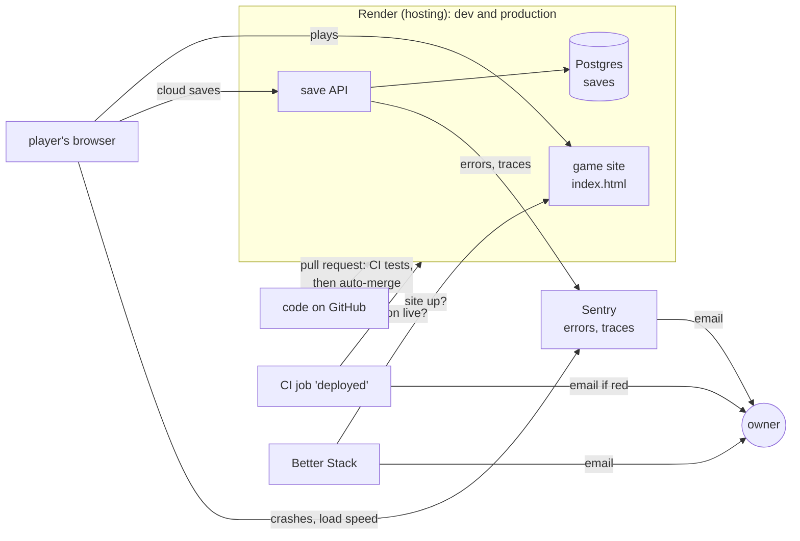

# Status

One page: where the project stands and what comes next. Updated at the end of every step. Details live in the linked plans; the backlog is [GitHub Issues](https://github.com/alexisdacquay/immune-citadel-v4/issues).

Last update: 2026-11-06 18:00 UTC.

## How it fits together

All of it runs on dev today; production gets it at the next promotion ([OBSERVABILITY-PLAN.md](OBSERVABILITY-PLAN.md) step 6). Gameplay events (step 5) will go player → save API → Postgres. Dash0 is no longer used by this project.

## Where things run

| | Commit | What it has |
|---|---|---|
| production (`main`) | 8792a17, 2026-11-04 | the game before the body map; cloud saves; no telemetry |
| dev (`dev`) | ahead of `main` | body map (#39, #40), P0 bug fixes (#3-#9), intro cards (#10), the pipeline below, Sentry on the save API |

## Plans

| Plan | Done | Now | Next |
|---|---|---|---|
| [PIPELINE-PLAN.md](PIPELINE-PLAN.md): trustworthy deploys | 1-4: site publishes only the game; rules on `dev`/`main`; deploy on commit + `deployed` proof; auto-merge | — | closed (step 5 moved to the observability plan) |
| [OBSERVABILITY-PLAN.md](OBSERVABILITY-PLAN.md): Sentry, own gameplay events, Better Stack | 1-4: Sentry on the save API and in the game, Dash0 removed, Better Stack on both sites, all proven on dev | — | 5: gameplay events (event list to approve) · 6: production at promotion |

## Order of work

| # | Work | Why this order |
|---|---|---|
| 1 | bug #37 (fever spike card shows as new at several levels) | the only open P1 bug |
| 2 | observability step 5 (gameplay events) | needs the event list approved |
| 3 | owner playtest (#18), then promotion to production (#19) with observability step 6 | production is two days behind dev |

## Waiting on the owner

| Item | When |
|---|---|
| approve the gameplay event list | step 5 |
| playtest (#18), approve the promotion (#19) and a paid production API instance | before step 6 |
| `immune-citadel-dev-db` and `immune-citadel-prod-db` (v3 leftovers, paid): keep or delete | any time |

## Parked by the owner

| Item | Note |
|---|---|
| public repo (#28) | "not yet" |
| on-call agent (#27) | stopped |
| independent QA agent | later; CI tests are the QA today |

## Decisions (2026-11-06)

| Decision | Instead of |
|---|---|
| Sentry for errors in the game and the save API; Dash0 removed from this project (account kept for another) | Dash0, Grafana, PostHog |
| own gameplay events in our Postgres (children's data stays first-party) | a third-party analytics tool |
| Better Stack for uptime; the `deployed` CI job for "right commit live" | Checkly as an outside observer |
| alerts by email only | a phone pager |
| not covered, accepted: CI never running after a merge; a dashboard rollback leaving an old commit live | a continuous outside check |
