# Status

One page: where the project stands and what comes next. Updated at the end of every step. Details live in the linked plans; the backlog is [GitHub Issues](https://github.com/alexisdacquay/immune-citadel-v4/issues).

Last update: 2026-11-07 10:45 UTC.

## How it fits together

All of it runs on dev today; production gets it at the next promotion ([OBSERVABILITY-PLAN.md](OBSERVABILITY-PLAN.md) step 6). Gameplay events (step 5, [EVENTS.md](EVENTS.md)) go player → save API → Postgres, dev first. Dash0 is no longer used by this project.

## Where things run

| | Commit | What it has |
|---|---|---|
| production (`main`) | 8792a17, 2026-11-04 | the game before the body map; cloud saves; no telemetry |
| dev (`dev`) | ahead of `main` | body map (#39, #40), P0 bug fixes (#1-#9), the owed-card fix (#37), intro cards (#10), HUD fixes on small screens (#22, #23), the pipeline below, Sentry on the save API and in the game, gameplay events, QA agent in CI (#61) |

## Plans

| Plan | Done | Now | Next |
|---|---|---|---|
| [PIPELINE-PLAN.md](PIPELINE-PLAN.md): trustworthy deploys | 1-4: site publishes only the game; rules on `dev`/`main`; deploy on commit + `deployed` proof; auto-merge | — | closed (step 5 moved to the observability plan) |
| [OBSERVABILITY-PLAN.md](OBSERVABILITY-PLAN.md): Sentry, own gameplay events, Better Stack | 1-5: Sentry on the save API and in the game, Dash0 removed, Better Stack on both sites, gameplay events, all proven on dev | — | 6: production at promotion |

## Order of work

| # | Work | Why this order |
|---|---|---|
| 1 | owner playtest (#18), then promotion to production (#19) with observability step 6 | production is three days behind dev; no open bug left |
| 2 | Chronic challenge balance (#20): settle a target win rate, then tune | the bot wins it 2 times in 6 |
| 3 | QA agent: count real catches and false alarms on each pull request until 2026-11-21, then decide the next QA check | add QA checks only where they earn their cost |

## Waiting on the owner

| Item | When |
|---|---|
| sign [DPIA.md](DPIA.md) | before step 6 (production) |
| playtest (#18), approve the promotion (#19) | before step 6 |

## Parked by the owner

| Item | Note |
|---|---|
| public repo (#28) | "not yet" |
| on-call agent (#27) | stopped |

## Decisions (2026-11-07)

| Decision | Instead of |
|---|---|
| every environment production grade, dev mirrors production; `render.yaml` the only place infrastructure changes (#57) | Free instances, one shared database |
| QA agent as a required CI check; merges into `dev` automatic on green, production by the owner only (#61) | a human or an agent arming each merge |
| `dev` merges without the up-to-date rule; `main` keeps it and needs `dev` green (#63) | GitHub's merge queue (needs Enterprise Cloud on a private repo) |
| diagrams with `diagram-design`, light, never Mermaid | Mermaid |

## Decisions (2026-11-06)

| Decision | Instead of |
|---|---|
| Sentry for errors in the game and the save API; Dash0 removed from this project (account kept for another) | Dash0, Grafana, PostHog |
| own gameplay events in our Postgres (children's data stays first-party) | a third-party analytics tool |
| Better Stack for uptime; the `deployed` CI job for "right commit live" | Checkly as an outside observer |
| alerts by email only | a phone pager |
| not covered, accepted: CI never running after a merge; a dashboard rollback leaving an old commit live | a continuous outside check |
